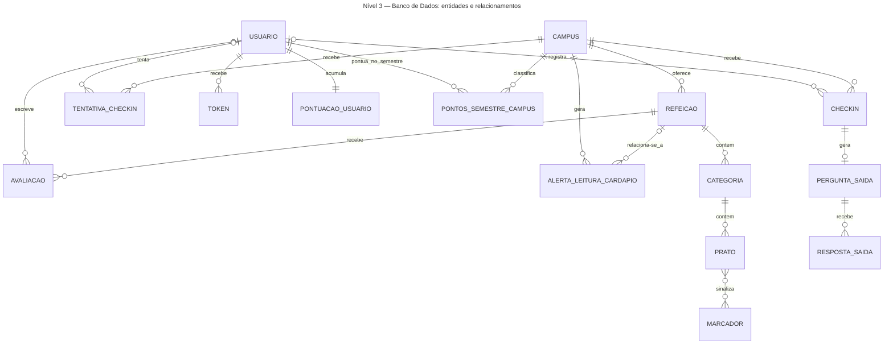

# Arquitetura C4 — Nível 3 — Banco de Dados — Bandejão

> Fontes: `docs/requisitos/CONTEXT-DOMINIO.md` (glossário do domínio),
> Documento de Requisitos de Software (RF01–RF33, RN01–RN13, RNF01–RNF09,
> RI01–RI12, Anexo A) e ADRs 0001 a 0011 (`docs/arquitetura/adr/`). Nomes de
> entidades seguem o vocabulário canônico do glossário — não os nomes usados
> no rascunho da issue (#32): "Cardápio" não existe como entidade única, pois
> o glossário já decompõe esse conceito em Refeição → Categoria → Prato;
> "Relato" foi mapeado para `AlertaLeituraCardapio`, a estrutura que registra
> os alertas de leitura de PDF previstos em RF06.
>
> Este documento segue a skill c4-architecture (título em cada diagrama, até
> 20 entidades por diagrama), e os nomes de tabelas e colunas correspondem aos
> models dos Níveis 4 do backend (`docs/arquitetura/backend/`).
>
> O Nível 4 (diagrama entidade-relacionamento completo e dicionário de dados)
> está em [`C4-nivel-4-banco-de-dados-bandejao.md`](C4-nivel-4-banco-de-dados-bandejao.md).

---

## Nível 3 — Diagrama de Componentes (entidades e relacionamentos)

### Notas do diagrama (Nível 3)

- **`USUARIO` é a conta**, não a pessoa (glossário: "Usuário"). Uma pessoa com
  matrícula e SIAPE pode gerar duas linhas de `USUARIO`.
- **Não existe uma entidade `Cardapio`.** O cardápio de uma refeição é a
  composição `REFEICAO → CATEGORIA → PRATO (→ MARCADOR)`; isso é decisão de
  modelagem, não uma omissão — reflete a própria estrutura hierárquica exigida
  por RF07 ("categorias em lista hierarquizada").
- **`AVALIACAO.usuario_id` e `ALERTA_LEITURA_CARDAPIO.refeicao_id` são opcionais** (nullable no Nível 4), por isso o lado "pai" desses dois relacionamentos é `|o`, não `||`.
- **`PRATO` não é avaliado individualmente.** A avaliação (RF15) é sempre por
  `REFEICAO` inteira; por isso `AVALIACAO` se relaciona a `REFEICAO`, não a
  `PRATO`. `PRATO` só existe para exibição e para os filtros (RF08, RF09).
- **`CHECKIN`, `TENTATIVA_CHECKIN`, `PERGUNTA_SAIDA`, `RESPOSTA_SAIDA`,
  `PONTUACAO_USUARIO` e `PONTOS_SEMESTRE_CAMPUS` são Release 2, e
  `ALERTA_LEITURA_CARDAPIO` é do módulo Leitor de Cardápio (ADR 0003)** —
  incluídos aqui porque já fazem parte do modelo de dados em construção; a
  Release 2 é a entrega final.
- **`CHECKIN` e `TENTATIVA_CHECKIN` são tabelas separadas** (decisão 2): a
  primeira guarda só os check-ins confirmados e tem UNIQUE; a segunda guarda
  todas as tentativas, inclusive as rejeitadas, com o motivo.
- **O check-in aponta para o campus, não para a refeição**: guarda campus, tipo
  de refeição e data, para a fila e a previsão funcionarem mesmo se o PDF do
  cardápio falhar. "Mesma refeição" é sempre campus + tipo + data.
- **Fila da Release 2:** cada check-in confirmado gera uma `PERGUNTA_SAIDA`
  (RF21), que recebe até duas `RESPOSTA_SAIDA` (a segunda só depois de "Ainda
  estou na fila").
- **Gamificação (ADR 0011):** só contadores agregados ficam ligados à conta:
  `PONTUACAO_USUARIO` (um por conta) e `PONTOS_SEMESTRE_CAMPUS` (um por conta,
  campus e semestre). Não há histórico de pontos.
- **`TOKEN` generaliza os links de uso único** de confirmação de e-mail (RF02)
  e de redefinição de senha (RF04): mesma estrutura, campo `tipo` diferencia o
  uso. Ver o [Nível 4](C4-nivel-4-banco-de-dados-bandejao.md) para os campos.
- **`MARCADOR` é tabela de apoio (lookup) com exatamente 10 linhas fixas**
  (RF06: "a legenda do arquivo contém exatamente os 10 marcadores
  conhecidos"), povoada por uma migration de dados (fixture), não pelo
  usuário final nem pela leitura do PDF.

---

## Referências

- `docs/requisitos/CONTEXT-DOMINIO.md` — glossário do domínio (fonte dos
  nomes de entidade).
- `docs/requisitos/documento-de-requisitos-bandejao.md` — Documento de
  Requisitos de Software — Bandejão (RF01–RF33, RN01–RN13, RNF01–RNF09,
  RI01–RI12, Anexo A).
- ADRs 0001 a 0011, em `docs/arquitetura/adr/` (em especial 0003, 0009, 0010
  e 0011, que originam entidades e campos deste nível).
- `docs/arquitetura/c4-niveis-1-2.md` — Níveis 1 e 2, onde o Banco de Dados
  aparece como um único container.
- `docs/arquitetura/backend/` — Níveis 4 do backend, cujos models
  correspondem às tabelas deste nível.
- [`C4-nivel-4-banco-de-dados-bandejao.md`](C4-nivel-4-banco-de-dados-bandejao.md) — Nível 4 (diagrama entidade-relacionamento completo, dicionário
  de dados, constraints e estratégia de migração), que detalha este arquivo.
