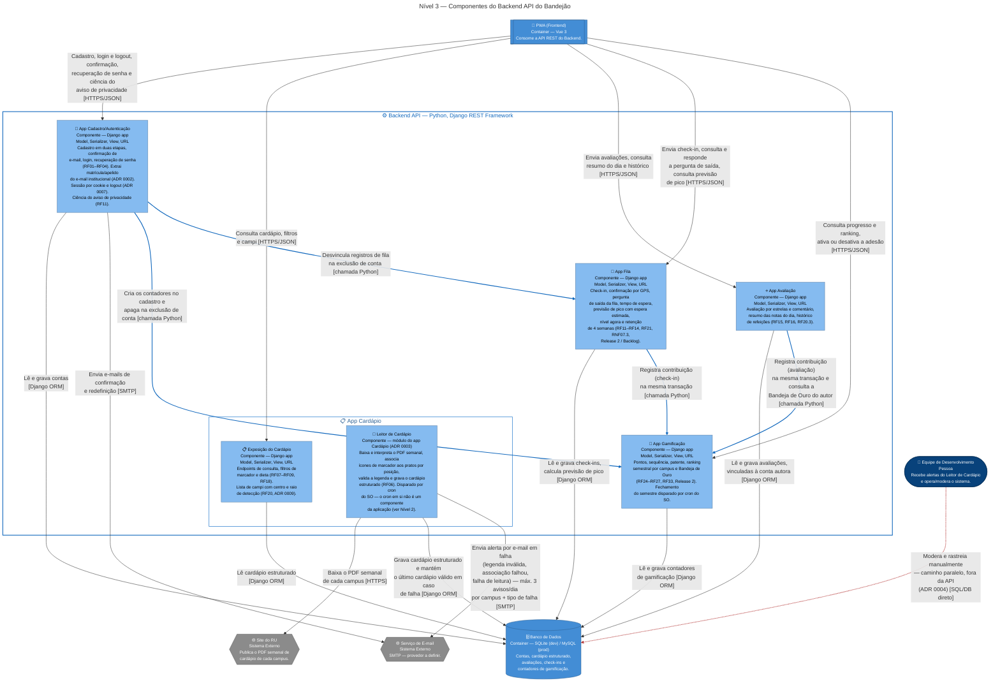

# Arquitetura C4 — Nível 3 (Backend) — Bandejão

> Continuação de `c4-niveis-1-2.md`. Este documento decompõe o container
> "Backend API" do Nível 2 em seus componentes internos (apps Django) e é
> **único para o backend inteiro** — não se repete por Épico.
>
> Os diagramas de **Nível 4** (classes), um por Épico/componente, ficam em
> arquivos separados, cada um referenciando o componente correspondente
> deste Nível 3:
>
> - ✅ `c4-nivel-4-leitor-cardapio.md` — Épico Cardápio (parte de leitura) →
>   componente Leitor de Cardápio
> - ✅ `c4-nivel-4-cadastro-autenticacao.md` — Épico Login → componente
>   Cadastro/Autenticação
> - ✅ `c4-nivel-4-exposicao-cardapio.md` — Épico Cardápio (parte de
>   exibição) → componente Exposição do Cardápio
> - ✅ `c4-nivel-4-avaliacao.md` — Épico Avaliação → componente Avaliação
> - ✅ `c4-nivel-4-fila.md` — Épico Fila e Previsão de Pico → componente
>   Fila
> - ✅ `c4-nivel-4-gamificacao.md` — Épico Gamificação → componente
>   Gamificação
>
> Referências: ADRs 0001 a 0011, em `docs/arquitetura/adr/`. As que mais
> pesam neste nível são a 0003 (Leitor de PDF como módulo do backend), a
> 0004 (acesso direto da equipe ao banco), a 0007 (sessão por cookie
> `HttpOnly`), a 0009 (detecção de campus no aparelho), a 0010 (nível por
> chegadas com espera estimada) e a 0011 (contadores de gamificação).

### Legenda de formas (Nível 3)

Mesma legenda do Nível 1/2, com um acréscimo:

| Forma | Tipo de elemento | Exemplo |
|---|---|---|
| ⬭ Oval (estádio) | Pessoa | Equipe de Desenvolvimento |
| ▤ Retângulo de barras duplas | Container (fora do escopo deste diagrama, mostrado como vizinho) | PWA, Banco de Dados |
| ⬡ Hexágono | Sistema externo | Site do RU, Serviço de E-mail |
| ⛁ Cilindro | Banco de dados | Banco de Dados |
| ▭ Retângulo simples | **Componente** (app Django ou módulo dentro de um app) | App Cardápio, Leitor de Cardápio |

---

## Nível 3 — Diagrama de Componentes do Backend API

### Notas do diagrama

- **Padrão de desenho (skill c4-architecture).** Este diagrama e os Níveis 4
  seguem as boas práticas da skill c4-architecture usada pelo grupo: título
  em cada diagrama, no máximo 20 elementos por diagrama, setas num só
  sentido com verbo de ação e tecnologia nos rótulos, e cada elemento com
  nome, tipo e descrição. A sintaxe continua `flowchart` (Nível 3) e
  `classDiagram` (Nível 4), e não os tipos `C4Component` da skill, para
  manter a mesma forma dos Níveis 1 e 2 e do frontend.
- **Um componente por app Django, seguindo a RNF06.** A separação
  Cadastro/Autenticação, Cardápio, Avaliação, Fila e Gamificação não é só uma
  conveniência de desenho: é a própria exigência de manutenibilidade do
  Documento de Requisitos ("a arquitetura deve separar claramente esses
  módulos, de modo que uma mudança no formato do PDF do cardápio exija
  alteração apenas no módulo de leitura de cardápio").
- **Só quatro setas entre componentes, todas azuis.** Os apps Django deste
  backend não se chamam via HTTP interno: é um monólito que compartilha um
  único banco, e a relação entre, por exemplo, uma Avaliação e a Conta que a
  escreveu é uma *foreign key* no banco. Ler um model de outro app
  (Avaliação lê `Conta` e `Refeicao`) também não vira seta. As exceções são
  chamadas diretas a funções públicas de outro app (`[chamada Python]`):
  **Fila → Gamificação**, **Avaliação → Gamificação**, **Cadastro →
  Gamificação** e **Cadastro → Fila**. As duas primeiras levam dois tipos de
  chamada:
  - **pontuação:** ao gravar um check-in confirmado, uma resposta à pergunta
    de saída ou uma avaliação, Fila e Avaliação chamam
    `PontuacaoService.registrarContribuicao`, **dentro da
    mesma transação** (`transaction.atomic()`). Ou tudo é gravado, ou nada
    é;
  - **consulta da Bandeja de Ouro:** para exibir o distintivo ao lado do
    apelido nos comentários (RF15.2, RF33.2), o `AvaliacaoPublicaMapper`
    pergunta ao `BandejaOuroResolver` quais autores têm a Bandeja exibível.
    É só leitura: não grava nada e não participa de transação. Fica na
    Gamificação porque a regra de exibição (válida, adesão ativa e conta
    ativa) é dela.

  A chamada direta para pontuar foi escolhida porque:
  - os pontos precisam voltar na própria resposta, para o aviso "+10
    pontos" (RF24.2);
  - cada contribuição pontua uma vez só, sem histórico de pontos (ADR
    0011), o que pede a mesma transação e o marcador de "pontos já
    concedidos" no registro de origem;
  - os pontos não podem ser recalculados depois, porque os registros de
    fila perdem o vínculo com a conta em 4 semanas (RNF07.3).

  As duas setas que saem do Cadastro/Autenticação vêm das decisões tomadas
  com o time de banco de dados:
  - **Cadastro → Gamificação:** no cadastro, o `CadastroService` cria a
    pontuação da conta com zero ponto (`inicializarConta`), na mesma
    transação, para a trava da pontuação sempre encontrar a linha; na
    exclusão de conta, o `RemoverContaCommand` apaga os contadores
    (`apagarContadores`, RNF07.4);
  - **Cadastro → Fila:** na exclusão de conta, o mesmo comando pede à Fila
    que retire o vínculo dos registros de fila da conta
    (`RetencaoFilaService.desvincularConta`).

  O comando chama os outros apps, em vez de apagar as tabelas deles direto,
  para que cada app continue sendo o único dono dos próprios dados. Detalhes
  em `c4-nivel-4-cadastro-autenticacao.md`.
- **A dependência tem um sentido só.** A Gamificação nunca chama a Fila nem
  a Avaliação: ela só lê os models delas (`Checkin`, `PerguntaSaida`,
  `Avaliacao`) e o `Refeicao` do Cardápio, e grava neles apenas o marcador
  de "pontos já concedidos". Do mesmo jeito, a Fila lê
  `Conta.avisoPrivacidadePendente()`, do Cadastro/Autenticação, antes do
  check-in (RF11), sem seta: é leitura de model, não chamada. A regra da
  avaliação (pontua quando a refeição tem avaliação
  e check-in confirmado, o que vier por último, RN09) fica só dentro do
  `PontuacaoService`, chamado pelos dois lados. O campus enviado é sempre o
  **da refeição**, tirado do registro já gravado no servidor, nunca um campo
  vindo do PWA nem o campus detectado no aparelho (RN09, ADR 0009, L13).
  Detalhes em `c4-nivel-4-gamificacao.md`.
- **Contratos com o PWA (decisões 6, 7 e 12 da lista de ajustes).** Cada
  componente lista seus endpoints no próprio Nível 4. Em resumo:
  - Exposição do Cardápio: `GET /api/campi/` (centro e raio de detecção de
    cada campus, público, com cache);
  - Avaliação: `GET /api/avaliacoes/resumo/` (notas de todas as refeições
    do dia numa chamada) e o campo `distintivo` nos comentários;
  - Fila: `GET /api/fila/pergunta-pendente/` (204 sem pergunta vencida),
    `POST /api/fila/respostas-saida/`,
    `POST /api/fila/perguntas-saida/{id}/dispensa/` e `perguntaDevidaEm`
    na resposta do check-in;
  - Gamificação: progresso, adesão e ranking, mais o bloco `pontos` igual
    nas respostas de check-in, resposta de saída e avaliação;
  - Cadastro/Autenticação: `POST /api/privacidade/aceite/` e
    `avisoPrivacidadePendente` na sessão.

  A tela do campus não tem um endpoint que junte tudo: o PWA chama em
  paralelo os endpoints de cada componente, e uma parte que falhe (por
  exemplo, a previsão sem dados) não derruba as outras.
- **Alternativas descartadas para acionar a pontuação:** signals do Django
  (escondem o fluxo e disparam de novo a cada `save`), `transaction.on_commit`
  (o check-in ficaria gravado sem pontos se a pontuação falhasse),
  processamento assíncrono por cron ou Celery (atrasa o "+10 pontos" e, com
  Celery, cria um container novo) e pontos calculados na consulta
  (impossível depois que os registros perdem o vínculo com a conta, ADR
  0011).
- **As quatro setas entre componentes são azuis e foram desenhadas depois da
  seta tracejada** (`linkStyle 15,16,17,18`), para destacar as exceções acima
  e para que o `linkStyle 12` continue marcando a relação Equipe → Banco de
  Dados. Ao acrescentar setas, desenhe-as no fim da lista ou recalcule os
  índices.
- **Decisões tomadas com o time de banco de dados que valem para todo o
  backend:**
  - IDs inteiros autoincrementais, o padrão do Django (`BigAutoField`), nos
    Níveis 4 e no banco; nenhum endpoint autoriza o acesso só porque recebeu
    um id;
  - check-ins confirmados e tentativas em tabelas separadas, e o check-in
    ligado à refeição por campus + tipo + data, sem FK para `Refeicao`;
  - o MySQL fica no nível de isolamento READ COMMITTED (padrão do Django),
    do qual depende a trava da pontuação;
  - `USE_TZ = True` e `TIME_ZONE = "America/Sao_Paulo"`: semana, semestre,
    faixa de 15 minutos e fechamento do semestre são calculados no horário
    de Brasília, nos dois bancos;
  - o cron do SO roda também a retenção de 4 semanas da Fila
    (`DesvincularRegistrosFilaJob`), o fechamento do semestre da Gamificação
    e o `clearsessions` do Django (ADR 0007).
- **Leitor de Cardápio aparece dentro da fronteira do App Cardápio**, e não
  como um componente irmão solto, porque a ADR 0003 o define como módulo
  desse app, não como app à parte. Ainda assim ele está desenhado como caixa
  separada de "Exposição do Cardápio": as duas partes do app têm perfis bem
  diferentes — uma expõe endpoints de leitura para o PWA; a outra é
  disparada por cron, escreve no banco e depende de um sistema externo (Site
  do RU). Essa fronteira interna é exatamente o que o Nível 4 detalha (ver
  `c4-nivel-4-leitor-cardapio.md`).
- **Leitor de Cardápio → Serviço de E-mail é o canal de alerta à Equipe.**
  Reaproveita a mesma integração já usada por Cadastro/Autenticação para
  confirmação de cadastro e redefinição de senha (RF02, RF04), em vez de
  introduzir um canal novo. Para não virar ruído em caso de falha
  persistente, o envio é limitado a **no máximo 3 avisos por dia, por
  campus + tipo de falha** (detalhado no `AlertaEquipeService` em
  `c4-nivel-4-leitor-cardapio.md`) — decisão registrada na ADR 0006
  (`docs/arquitetura/adr/0006-alerta-de-falha-do-leitor-por-email.md`).
- **A relação Equipe → Banco de Dados continua tracejada e vermelha**
  (herdada do Nível 2, ADR 0004): é acesso administrativo direto e
  deliberado, de natureza diferente do alerta automático acima — por isso
  as duas exceções ao fluxo normal permanecem visualmente distintas.
- **App Fila e App Gamificação são da Release 2**, que é a entrega final do
  projeto (o MVP já foi entregue). Dentro da Fila, só o nível de fila
  "agora" (RF14) continua no Backlog.
