# Arquitetura C4 — Nível 4 (Avaliação) — Bandejão

> Detalha, em diagrama de classes, o componente **Avaliação**, desenhado no
> Nível 3 do backend (ver `c4-nivel-3-backend.md`). Cobre o Épico Avaliação
> por inteiro: avaliação por estrelas e comentário (RF15) e histórico de
> refeições anteriores (RF16).
>
> Este componente **lê, mas não escreve**, em dois models de outros
> componentes: `Conta` (Cadastro/Autenticação, para obter o apelido do
> autor) e `Refeicao`/`Categoria`/`Prato` (Cardápio, para montar o
> histórico do RF16) — a mesma relação de leitura entre apps que já aparece
> entre Leitor de Cardápio e Exposição do Cardápio. Essas leituras não viram
> chamada entre componentes (ver nota do Nível 3): é sempre leitura via
> *foreign key* no mesmo banco. Este componente chama a Gamificação em dois
> pontos (ver nota do Nível 3 e `c4-nivel-4-gamificacao.md`):
>
> - **pontuação:** depois de salvar a avaliação, o `AvaliacaoService` chama
>   o `PontuacaoService` na mesma transação (desenhado abaixo);
> - **Bandeja de Ouro nos comentários:** o `AvaliacaoPublicaMapper` consulta
>   o `BandejaOuroResolver` para exibir o distintivo ao lado do apelido
>   (RF15.2, RF33.2). É só leitura (desenhado abaixo).
>
> **Endpoints deste componente:**
>
> | Endpoint | Acesso | View |
> |---|---|---|
> | `POST /api/avaliacoes/` | Logado | `AvaliacaoView` |
> | `GET /api/avaliacoes/resumo/?campus=&data=` | Público | `ResumoDoDiaView` |
> | `GET /api/refeicoes/{refeicaoId}/avaliacoes/` | Público | `RefeicaoAvaliacoesView` |
> | `GET /api/historico/?campus=&data=&refeicao=` | Público | `HistoricoRefeicoesView` |

## Nível 4 — Diagrama de Classes da Avaliação

```mermaid
classDiagram
  class AvaliacaoView {
    +post(request) Response
  }
  class RefeicaoAvaliacoesView {
    +get(refeicaoId: UUID) Response
  }
  class ResumoDoDiaView {
    +get(campus: Campus, data: date) Response
  }
  class HistoricoRefeicoesView {
    +get(campus: Campus, data: date, refeicao: str) Response
  }

  class AvaliacaoService {
    +avaliar(conta: Conta, refeicao: Refeicao, nota: int, comentario: str) AvaliacaoRegistrada
  }
  class AvaliacaoRegistrada {
    +avaliacao: Avaliacao
    +pontos: ResultadoPontuacao
  }

  class JanelaAvaliacaoValidator {
    +podeAvaliar(refeicao: Refeicao, agora: datetime) bool
  }
  class AvaliacaoIndisponivelError

  class NotaValidator {
    +validar(nota: int) bool
  }
  class NotaInvalidaError

  class ComentarioValidator {
    +validar(comentario: str) bool
    -MAX_CARACTERES: int = 500
  }
  class ComentarioMuitoLongoError

  class AvaliacaoRepository {
    +buscarPorContaERefeicao(conta: Conta, refeicao: Refeicao) Avaliacao
    +salvar(avaliacao: Avaliacao) Avaliacao
    +listarPorRefeicao(refeicao: Refeicao) list~Avaliacao~
    +mediaEQuantidade(refeicao: Refeicao) ResumoAvaliacoes
    +resumosDoDia(campus: Campus, data: date) list~ResumoRefeicao~
  }

  class Avaliacao {
    +id: UUID
    +contaId: UUID
    +refeicaoId: UUID
    +nota: int
    +comentario: str
    +criadaEm: datetime
    +editadaEm: datetime
    +pontosConcedidosEm: datetime
  }
  class ResumoAvaliacoes {
    +media: float
    +quantidade: int
  }
  class ResumoRefeicao {
    +refeicaoId: UUID
    +tipo: str
    +media: float
    +quantidade: int
  }

  class AvaliacaoPublicaMapper {
    +paraPublico(avaliacoes: list~Avaliacao~) list~AvaliacaoPublica~
  }
  class AvaliacaoPublica {
    +apelido: str
    +distintivo: DistintivoPublico
    +nota: int
    +comentario: str
    +criadaEm: datetime
  }

  class HistoricoService {
    +refeicoesDisponiveis(campus: Campus, dataInicio: date, dataFim: date) list~Refeicao~
    +detalhar(refeicao: Refeicao) HistoricoRefeicao
  }
  class HistoricoRefeicao {
    +campus: Campus
    +data: date
    +tipo: str
    +categorias: list~Categoria~
    +resumoAvaliacoes: ResumoAvaliacoes
    +comentarios: list~AvaliacaoPublica~
  }

  class Conta {
    +id: UUID
    +apelido: str
    +removida: bool
  }
  class Refeicao {
    +campus: Campus
    +tipo: str
    +data: date
  }
  class Categoria {
    +nome: str
  }

  class PontuacaoService {
    <<App Gamificação>>
    +registrarContribuicao(conta: Conta, tipo: TipoContribuicao, origemId: UUID, refeicao: RefeicaoRef) ResultadoPontuacao
  }
  class ResultadoPontuacao {
    <<App Gamificação>>
    +total: int
  }
  class BandejaOuroResolver {
    <<App Gamificação>>
    +distintivosExibiveis(contas: list~Conta~, hoje: date) dict
  }
  class DistintivoPublico {
    <<App Gamificação>>
    +tipo: str
    +campi: list~CampusRef~
    +semestre: str
  }

  AvaliacaoView --> AvaliacaoService : avaliar()
  RefeicaoAvaliacoesView --> AvaliacaoRepository : mediaEQuantidade() / listarPorRefeicao()
  RefeicaoAvaliacoesView --> AvaliacaoPublicaMapper : converte comentários
  ResumoDoDiaView --> AvaliacaoRepository : resumosDoDia()
  AvaliacaoRepository --> ResumoRefeicao : calcula em lote
  HistoricoRefeicoesView --> HistoricoService : refeicoesDisponiveis() / detalhar()

  AvaliacaoService --> JanelaAvaliacaoValidator : valida se refeição pode ser avaliada
  JanelaAvaliacaoValidator ..> AvaliacaoIndisponivelError : lança se fora da janela
  AvaliacaoService --> NotaValidator : valida nota
  NotaValidator ..> NotaInvalidaError : lança se ausente/fora de 1–5
  AvaliacaoService --> ComentarioValidator : valida comentário
  ComentarioValidator ..> ComentarioMuitoLongoError : lança se > 500 caracteres
  AvaliacaoService --> AvaliacaoRepository : busca existente (upsert) / salva
  AvaliacaoService --> Avaliacao : cria ou edita
  AvaliacaoService --> PontuacaoService : registra contribuição (mesma transação)
  AvaliacaoService --> AvaliacaoRegistrada : devolve
  AvaliacaoRegistrada --> ResultadoPontuacao : tem

  AvaliacaoRepository ..> Avaliacao : grava/lê
  AvaliacaoRepository --> ResumoAvaliacoes : calcula

  AvaliacaoPublicaMapper --> AvaliacaoPublica : produz
  AvaliacaoPublicaMapper ..> Conta : lê apelido (ou "usuário removido")
  AvaliacaoPublicaMapper ..> BandejaOuroResolver : distintivos dos autores, em lote
  AvaliacaoPublica --> DistintivoPublico : tem (opcional)

  HistoricoService --> AvaliacaoRepository : lê avaliações da refeição
  HistoricoService --> AvaliacaoPublicaMapper : converte comentários
  HistoricoService --> HistoricoRefeicao : monta
  HistoricoService ..> Refeicao : lê (Épico Cardápio)
  HistoricoService ..> Categoria : lê (Épico Cardápio)

  Avaliacao --> Conta : pertence a (FK)
  Avaliacao --> Refeicao : refere-se a (FK)
  HistoricoRefeicao *-- AvaliacaoPublica
```

### Notas do diagrama

- **`AvaliacaoService.avaliar` é sempre um upsert**, nunca um "criar" e um
  "editar" separados: o RF15 define que a segunda tentativa de avaliar a
  mesma refeição edita a anterior, e a janela de edição ("até 23h59 do
  mesmo dia") coincide, na prática, com a própria janela de avaliação
  ("refeições do dia corrente, já iniciadas") — depois desse horário, a
  refeição deixa de ser "do dia corrente" e `JanelaAvaliacaoValidator`
  já rejeitaria uma nova tentativa de avaliar por outro motivo. Por isso
  não existe uma regra de edição separada da regra de criação neste
  desenho: as duas dependem da mesma validação de janela.
- **Depois do upsert, o `AvaliacaoService` chama a pontuação**
  (`PontuacaoService.registrarContribuicao(conta, AVALIACAO, avaliacao.id,
  refeicao)`, da Gamificação), na **mesma `transaction.atomic()`** que grava
  a avaliação. Se a pontuação falhar, a avaliação não é gravada, e o usuário
  pode tentar de novo.
- **Quem decide se a avaliação pontua é o `PontuacaoService`, não este
  componente.** A RN09 só dá pontos à avaliação quando a refeição passa a
  ter, para o usuário, uma avaliação **e** um check-in confirmado, o que vier
  por último. Por isso o `AvaliacaoService` chama sempre, e a Gamificação
  confere o check-in:
  - com check-in confirmado na mesma refeição: a avaliação recebe os pontos
    na hora;
  - sem check-in ainda: `ResultadoPontuacao.total` volta 0, e os pontos
    chegam depois, quando a Fila confirmar o check-in e fizer a sua chamada;
  - sem check-in nunca: a avaliação continua válida, só não pontua (RF24.1).
  A regra fica num lugar só, sem cópia aqui e na Fila.
- **Editar a avaliação não pontua de novo.** Como `avaliar` é sempre um
  upsert, a segunda chamada chega à Gamificação com a mesma avaliação; o
  marcador `Avaliacao.pontosConcedidosEm`, preenchido pelo `PontuacaoService`
  na primeira vez, impede pontos em dobro (ADR 0011). É o único campo da
  Avaliação que a Gamificação escreve. Segue a recomendação da decisão 4 da
  lista de ajustes (marcador nos registros de origem), ainda a confirmar
  pelas duplas.
- **A `refeicao` enviada é a refeição avaliada** (campus, tipo e data da
  `Refeicao` já gravada no servidor), nunca um campo vindo do PWA nem o
  campus detectado no aparelho (RN09, L13). Se a pessoa avaliar por engano a
  refeição de outro campus, essa avaliação não encontra check-in na mesma
  refeição e não pontua. Os pontos também não dependem da nota nem do
  comentário (RI11).
- **`AvaliacaoRegistrada` leva os pontos de volta à `AvaliacaoView`**, que
  os devolve na resposta para o aviso imediato (RF24.2), no mesmo formato
  das outras contribuições:
  `"pontos": {"total": 5, "contribuicao": 5, "avaliacaoLiberada": 0, "bonusSemana": 0}`.
  Sem check-in na refeição, `total` vem 0 e o PWA não mostra aviso.
- **`GET /api/avaliacoes/resumo/?campus=&data=` devolve, numa chamada só, a
  nota média e a quantidade de avaliações de cada refeição do dia** (RF20.3),
  para o seletor de refeições da tela do campus:
  `[{"refeicaoId": "…", "tipo": "almoco", "media": 4.2, "quantidade": 37}]`.
  `resumosDoDia` faz uma única consulta agrupada por refeição. Os comentários
  continuam vindo só da refeição selecionada, por
  `GET /api/refeicoes/{refeicaoId}/avaliacoes/`. Assim, abrir a tela do
  campus custa uma chamada de resumo em vez de uma por refeição.
- **Bandeja de Ouro nos comentários (RF15.2, RF33.2, decisão 12).** Cada
  `AvaliacaoPublica` traz o campo `distintivo`, que é `null` ou
  `{"tipo": "BANDEJA_DE_OURO", "campi": [{"id": 1, "nome": "Gama"}], "semestre": "2026.2"}`.
  O `AvaliacaoPublicaMapper` converte a lista de avaliações de uma vez e pede
  ao `BandejaOuroResolver` os distintivos de todos os autores numa única
  chamada (`distintivosExibiveis`), em vez de uma consulta por comentário.
  Quem decide se o distintivo pode ser exibido (Bandeja válida, adesão ao
  ranking ativa e conta ativa) é a Gamificação; o PWA só mostra o que vier.
  A resposta nunca traz a posição no ranking nem os pontos (RI12). Como o
  mapper também é usado pelo `HistoricoService`, os comentários do
  histórico (RF16) mostram a Bandeja que o autor tem **hoje**, não a que
  tinha na data da refeição.
- **`JanelaAvaliacaoValidator` reaproveita o mesmo tipo de parâmetro do
  Anexo A** (horários de café/almoço/jantar) já usado por
  `HorarioRefeicaoResolver` no componente Exposição do Cardápio — é a
  mesma fonte de configuração, lida por dois componentes diferentes, não
  uma cópia dela.
- **Nota e comentário têm validadores próprios**, separados do
  `AvaliacaoService`, pelo mesmo motivo dos validadores dos outros
  componentes (Matrícula, no Cadastro/Autenticação): são regras
  isoladas — nota obrigatória de 1 a 5, comentário opcional até 500
  caracteres — testáveis sem precisar simular uma refeição completa.
- **`AvaliacaoPublicaMapper` é o único lugar por onde uma `Conta` vira
  visível para terceiros**, e ele deliberadamente só extrai o apelido e o
  distintivo — nunca a matrícula/SIAPE ou o e-mail (RI10, RNF04). Também é aqui que a
  exclusão de conta (RNF07) se reflete: se `Conta.removida` for
  verdadeiro, o mapper devolve "usuário removido" no lugar do apelido, em
  vez de a avaliação sumir — a RNF07 exige que a avaliação em si
  permaneça, só o autor fica anônimo.
- **`Avaliacao.contaId` nunca é apagado, mesmo com a conta removida** —
  é o vínculo permanente exigido pela RNF08 (rastreabilidade e moderação:
  a equipe precisa conseguir identificar o autor de uma avaliação
  problemática por consulta administrativa manual, o mesmo acesso direto
  ao banco já desenhado no Nível 3, ADR 0004). O `AvaliacaoPublicaMapper`
  só controla o que é exibido publicamente; o dado de rastreabilidade
  continua inteiro no banco.
- **`HistoricoService` não tem nenhuma lógica de escrita nem de filtro**
  (RF08/RF09 não se aplicam ao histórico) — é deliberadamente mais simples
  que `CardapioQueryService` (Exposição do Cardápio): RF16 pede consulta
  somente leitura por campus, data e refeição, cardápio completo, sem
  marcador nem dieta selecionáveis.
- **Nenhuma nova classe para "refeições de semanas anteriores somem da
  interface mas continuam armazenadas" (RF15/L09)** — isso já é uma
  consequência de `RefeicaoAvaliacoesView` (usada junto ao cardápio da
  semana vigente) e `HistoricoRefeicoesView` (RF16) serem endpoints
  diferentes: o dado nunca é apagado, só para de aparecer pela primeira
  via depois que a semana passa.
- Este diagrama é uma **proposta de decomposição inicial**, não uma
  decisão de arquitetura registrada — ajuste-o se a dupla responsável por
  esta frente encontrar um desenho de classes diferente ao implementar.
