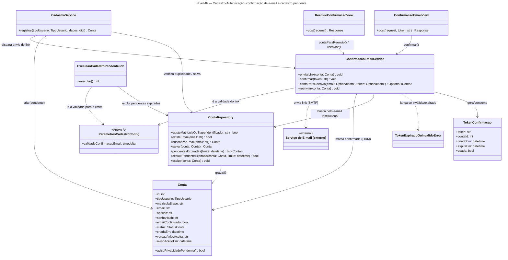
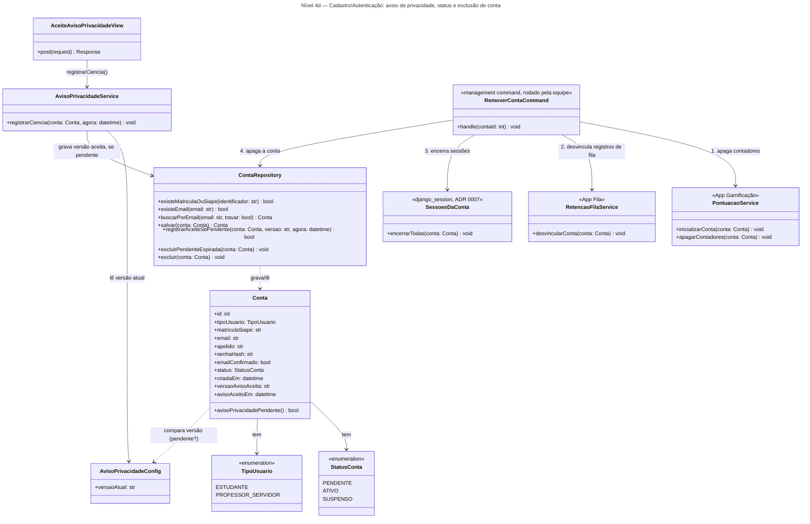

# Arquitetura C4 — Nível 4 (Cadastro/Autenticação) — Bandejão

> Detalha, em diagrama de classes, o componente **Cadastro/Autenticação**,
> desenhado no Nível 3 do backend (ver `c4-nivel-3-backend.md`). Cobre o
> Épico Login por inteiro: cadastro em duas etapas (RF01), confirmação de
> e-mail (RF02), login (RF03) e recuperação de senha (RF04). Na Release 2,
> também registra a ciência do aviso de privacidade atualizado, exigida
> antes do primeiro check-in de quem já tinha conta (RF11, RNF07.1).
>
> Também cria os contadores de gamificação de cada conta nova e concentra a
> exclusão de conta (`RemoverContaCommand`, RNF07.4), que chama a
> Gamificação e a Fila. Essas são as únicas chamadas deste componente a
> outros (ver nota do Nível 3).
>
> A sessão é a do próprio Django, em cookie `HttpOnly` (ADR 0007), com
> login, logout (RF03.3) e "quem sou eu" na mesma rota, e a matrícula/SIAPE
> fica em texto claro, em `matriculaSiape` (ADR 0008). O login é com o
> e-mail institucional e a senha (ADR 0016).
>
> A classe `Conta` destes diagramas é o model `Usuario` do app `cadastro`
> (tabela `USUARIO` no Nível 4 do banco de dados; glossário: "Usuário").
>
> **Endpoints de sessão e privacidade:**
>
> | Endpoint | Acesso | View |
> |---|---|---|
> | `POST /api/sessao/` | Público | `SessaoView` (login) |
> | `GET /api/sessao/` | Logado | `SessaoView` ("quem sou eu") |
> | `DELETE /api/sessao/` | Logado | `SessaoView` (logout) |
> | `POST /api/privacidade/aceite/` | Logado | `AceiteAvisoPrivacidadeView` |
>
> Referências: ADR 0002 — *Matrícula e apelido extraídos do e-mail
> institucional* (`docs/arquitetura/adr/0002-matricula-apelido-extraidos-do-email.md`),
> ADR 0007 — *Sessão autenticada por cookie HttpOnly*
> (`docs/arquitetura/adr/0007-sessao-autenticada-por-cookie-httponly.md`),
> ADR 0008 — *Matrícula/SIAPE em texto claro*
> (`docs/arquitetura/adr/0008-matricula-siape-em-texto-claro.md`) e
> ADR 0016 — *Login com e-mail institucional e senha*
> (`docs/arquitetura/adr/0016-login-com-email-institucional.md`).

Há quatro diagramas: **4a** cadastro, **4b** confirmação de e-mail, **4c** login e recuperação de senha e **4d** aviso de privacidade, status e exclusão de conta. Cada diagrama tem no máximo 20 elementos e um título próprio, seguindo a skill c4-architecture usada pelo grupo; classes compartilhadas (como `Conta` ou as configurações) aparecem em mais de um diagrama.

## Nível 4a — Cadastro

```mermaid
---
title: "Nível 4a — Cadastro/Autenticação: cadastro em duas etapas"
---
classDiagram
  class CadastroView {
    +post(request) Response
  }
  class CadastroService {
    +registrar(tipoUsuario: TipoUsuario, dados: dict) Conta
  }
  class TipoUsuario {
    <<enumeration>>
    ESTUDANTE
    PROFESSOR_SERVIDOR
  }
  class IdentificadorExtractor {
    <<interface>>
    +extrair(dados: dict) IdentificadorExtraido
  }
  class EstudanteIdentificadorExtractor {
    +extrair(dados: dict) IdentificadorExtraido
  }
  class ProfessorServidorIdentificadorExtractor {
    +extrair(dados: dict) IdentificadorExtraido
  }
  class IdentificadorExtraido {
    +identificador: str
    +apelidoSugerido: str
  }
  class MatriculaValidator {
    +validarFormato(matricula: str) bool
    +validarPrefixoAnoSemestre(matricula: str) bool
    +validarSequenciaDigitos(matricula: str) bool
  }
  class SiapeValidator {
    +validarFormato(siape: str) bool
  }
  class EmailInstitucionalValidator {
    +validarFormatoEstudante(email: str) bool
    +validarFormatoProfessorServidor(email: str) bool
  }
  class ApelidoResolver {
    +resolverManual(apelidoDigitado: str) str
    +resolverExtraido(textoAntesDoArroba: str) str
    -limparCaracteresNaoAlfanumericos(texto: str) str
    +validarDisponibilidade(apelido: str) bool
  }
  class ApelidoIndisponivelError
  class SenhaValidator {
    +validar(senha: str) bool
  }
  class PasswordHasher {
    +hash(senha: str) str
    +verificar(senha: str, hash: str) bool
  }
  class ContaRepository {
    +existeMatriculaOuSiape(identificador: str) bool
    +existeEmail(email: str) bool
    +buscarPorEmail(email: str) Conta
    +salvar(conta: Conta) Conta
    +excluirPendenteExpirada(conta: Conta) void
    +excluir(conta: Conta) void
  }
  class IdentificadorJaCadastradoError
  class EmailJaCadastradoError
  class Conta {
    +id: int
    +tipoUsuario: TipoUsuario
    +matriculaSiape: str
    +email: str
    +apelido: str
    +senhaHash: str
    +emailConfirmado: bool
    +status: StatusConta
    +criadaEm: datetime
    +versaoAvisoAceita: str
    +avisoAceitoEm: datetime
    +avisoPrivacidadePendente() bool
  }
  class PontuacaoService {
    <<App Gamificação>>
    +inicializarConta(conta: Conta) void
    +apagarContadores(conta: Conta) void
  }
  class AvisoPrivacidadeConfig {
    +versaoAtual: str
  }

  CadastroView --> CadastroService : registrar()
  IdentificadorExtractor <|.. EstudanteIdentificadorExtractor
  IdentificadorExtractor <|.. ProfessorServidorIdentificadorExtractor
  IdentificadorExtractor --> IdentificadorExtraido : produz
  CadastroService --> IdentificadorExtractor : escolhe estratégia por TipoUsuario
  CadastroService --> MatriculaValidator : valida (Estudante)
  CadastroService --> SiapeValidator : valida (Professor/Servidor)
  CadastroService --> EmailInstitucionalValidator : valida formato
  CadastroService --> ApelidoResolver : resolve/valida apelido
  ApelidoResolver ..> ApelidoIndisponivelError : lança se indisponível
  CadastroService --> SenhaValidator : valida senha
  SenhaValidator --> PasswordHasher : gera hash
  CadastroService --> ContaRepository : verifica duplicidade / salva
  ContaRepository ..> IdentificadorJaCadastradoError : lança se já em uso
  ContaRepository ..> EmailJaCadastradoError : lança se já em uso
  CadastroService --> Conta : cria (pendente)
  CadastroService --> PontuacaoService : cria os contadores da conta (mesma transação)
  ContaRepository ..> Conta : grava/lê
  Conta --> TipoUsuario : tem
  CadastroService --> AvisoPrivacidadeConfig : grava versão aceita no cadastro
  Conta ..> AvisoPrivacidadeConfig : compara versão (pendente?)
```

### Notas do diagrama (4a)

- **`IdentificadorExtractor` é uma estratégia por `TipoUsuario`** — a
  distinção entre Estudante e Professor/Servidor do RF01/ADR 0002 (quem
  digita o quê, e o que é extraído do e-mail) fica isolada nas duas
  implementações, em vez de virar um emaranhado de `if tipo == ...` dentro
  do `CadastroService`. Isso deixa mais fácil testar as duas regras da ADR
  0002 separadamente: para Estudante, a matrícula vem do e-mail e o apelido
  é digitado; para Professor/Servidor, é o inverso.
- **`ApelidoResolver` concentra as três variações da regra de apelido**:
  aceitar o valor digitado (Estudante), extrair e limpar caracteres não
  alfanuméricos do texto antes do "@" (Professor/Servidor), e validar
  disponibilidade/tamanho nos dois casos. A colisão ou o tamanho inválido
  do apelido extraído automaticamente não é tratada como erro fatal do
  cadastro: o RF01 pede que, nesse caso específico, o sistema **peça um
  apelido alternativo digitado manualmente**, em vez de simplesmente
  rejeitar o cadastro — vale essa distinção na hora de implementar
  `ApelidoIndisponivelError` (é recuperável, não é o mesmo tipo de falha que
  matrícula/e-mail duplicados).
- **`MatriculaValidator` tem três métodos separados**, não um só
  `validar()`, porque o RF01 define três checagens compostas e
  independentes: formato (9 dígitos), prefixo de ano (de 2010 ao ano
  corrente, recalculado a cada ano conforme o Anexo A) e sequência dos
  6 dígitos restantes (rejeita crescente, decrescente ou todos iguais).
  O método do prefixo mantém o nome `validarPrefixoAnoSemestre`, mas só
  confere o ano: o 3º dígito (semestre) não é conferido, porque o formato
  dos outros níveis de ensino não foi confirmado (L16, ADR 0002).
  O ano mínimo vem de `ParametrosCadastroConfig.primeiroAnoMatricula`
  (BD-04); o ano corrente, de `timezone.localdate()`, no fuso do projeto.
  A `ParametrosCadastroConfig` fica fora deste diagrama para manter o limite
  de 20 elementos; o consumo aparece na tabela de parâmetros do fim do
  documento.
  Métodos separados tornam cada regra testável isoladamente com casos de
  borda próprios, sem depender de montar uma matrícula "válida no resto"
  só para testar uma das três checagens.
- **`Conta.matriculaSiape` fica em texto claro (ADR 0008)**, na coluna
  `USUARIO.matricula_siape` (UNIQUE, indexada), diferente de `senhaHash`,
  que é hash irreversível. A equipe precisa ler a matrícula/SIAPE a partir do
  apelido para tratar matrícula contestada (L01) e para moderação (RNF08,
  ADR 0004), e o UNIQUE e a busca no login funcionam direto pelo ORM. A
  proteção vem do controle de acesso, não de criptografia na coluna: acesso
  direto ao banco só para membros nomeados da equipe, nenhum serializer
  público expõe matrícula/SIAPE ou e-mail (RI10, com teste automatizado), e
  as rotas de cadastro, login, recuperação e reenvio não registram o corpo
  da requisição em log.
- **Contadores de gamificação nascem com a conta.** Na mesma transação do
  cadastro, o `CadastroService` chama `PontuacaoService.inicializarConta`, da
  Gamificação, que cria a `PontuacaoUsuario` com zero ponto. As contas que
  já existiam ganham a linha por uma *data migration*. Assim, a trava da
  pontuação (`select_for_update`) sempre encontra a linha (ver
  `c4-nivel-4-gamificacao.md`).
- **IDs inteiros (decidido com o time de banco de dados).** `id` e `contaId` são inteiros
  autoincrementais, como no banco.

## Nível 4b — Confirmação de e-mail

### Notas do diagrama (4b)

- **`ExclusaoCadastroPendenteJob` é um job separado do `CadastroService`**,
  análogo ao `LerCardapioCommand` do Leitor de Cardápio: o RF02 exige que um
  cadastro pendente não confirmado em 24h seja excluído automaticamente,
  o que é responsabilidade de um processo periódico (cron ou scheduler),
  não de uma ação disparada por requisição HTTP. Roda pelo mesmo cron do SO
  do Leitor de Cardápio, junto com o `clearsessions` do Django (ADR 0007), a
  retenção da Fila e o fechamento do semestre da Gamificação.
- **Implementação (BE-06, #96).** O job é o comando
  `python manage.py excluir_cadastros_pendentes`, e `executar()` devolve
  quantas contas apagou. O prazo de 24 h conta do último link **entregue** (o
  reenvio renova, RF02.2; um envio que falhou não deixa token), e não da
  criação da conta. Cada exclusão trava a conta (`select_for_update`) e confere
  o prazo de novo, e um erro de banco numa conta não para as outras. A exclusão
  é pelo ORM, para os tokens e a `PontuacaoUsuario` irem junto (`CASCADE`).
- **Sem teto absoluto (pendente).** Como cada reenvio renova o prazo, uma conta
  pendente pode ficar viva para sempre se alguém pedir reenvio a cada menos de
  24 h. O limite de pedidos da #123 (3 links por hora por conta) não resolve
  isso, porque um reenvio por dia já basta; um teto (por exemplo, `criado_em` +
  N dias) ainda precisa ser decidido pelo grupo e registrado no Anexo A.
- **Limite de taxa (#123).** `POST /api/cadastro/` e
  `POST /api/reenviar-confirmacao/` têm limite por IP (`LimiteCadastroPorIP` e
  `LimiteReenvioPorIP`, subclasses de `LimitePorIP` em
  `apps/cadastro/limite_de_taxa.py`): acima dele, 429 `limite_excedido` com
  `Retry-After`. O reenvio tem também um limite por conta
  (`LimiteReenvioPorConta`, chamado no `reenviar()`), que é silencioso: a conta
  que passou dele não recebe outro e-mail, mas a resposta continua 200
  (RF02.2). Só conta o envio que saiu: o `enviar_link` diz se o e-mail foi, e
  só então a vaga é registrada, para uma queda do SMTP não deixar a pessoa uma
  hora sem link. O link do cadastro não passa por esse limite. Os números
  ficam no `LimiteDeTaxaConfig` (Anexo A), e os contadores, no cache em banco
  (tabela `cache_bandejao`, criada pela migration 0003 do cadastro), que vale
  para todos os workers do Gunicorn. Atrás do Caddy, o IP é o último endereço
  do `X-Forwarded-For` (`NUM_PROXIES`, que segue o `ATRAS_DE_PROXY_HTTPS` e
  supõe o Caddy como único proxy), e o IPv6 conta pela faixa /64. Uma falha ao
  gravar um contador não derruba o pedido, mas vai para o log.
- **Token.** O `TokenConfirmacao` é o model `Token` com
  `tipo = confirmacao_email`: o campo `usado` é a coluna `usado_em`, e o
  `token` em claro só existe no e-mail (o banco guarda o SHA-256).
- **Primeiro envio que falha.** O token não entregue é apagado, então a conta
  fica sem link, e o prazo do job passa a contar do `criado_em` da conta. Sem
  um reenvio, ela é apagada em 24 h, e a falha fica no log.
- **Link do e-mail.** Aponta para a página `/confirmar-email` do PWA
  (`URL_DO_PWA` no `.env`), que chama `POST /api/confirmar-email/{token}/`.
- **Reenvio.** `contaParaReenvio` acha a conta pelo e-mail institucional (o
  mesmo dado do login, pedido pela tela de login, ADR 0016; no corpo HTTP, o
  campo `emailInstitucional`) ou por um token antigo (mesmo vencido ou usado).
  O e-mail passa pelo `normalizar_email` antes da busca. Se vierem os dois,
  vale o e-mail; se ele não achar conta, o token é tentado. Ao contrário do
  login, o reenvio não confere o domínio: um e-mail fora do padrão só não acha
  conta. A resposta HTTP é sempre a mesma, exista ou não a conta (RF02.2).
- **Erro inesperado no reenvio (#205).** Só a conta pendente passa pelo
  limite por conta (cache em banco) e pelo `enviarLink`, então um erro ali
  (banco fora, lock no cache) dava 500 só para ela. Como o e-mail
  institucional é fácil de adivinhar, isso responderia "este e-mail tem conta
  pendente?". O `reenviar()` captura qualquer exceção desse trecho, registra
  no log só o id da conta, o nome da exceção e o arquivo e a linha do último
  ponto do código do projeto (sem mensagem nem traceback, que podem trazer o
  e-mail ou o token; ADR 0008) e a rota devolve o mesmo 200. Captura
  `Exception`, e não só `DatabaseError`, porque um bug que só aparece em
  produção vazaria do mesmo jeito. A regra BLE001 do ruff (ativa no padrão do
  ruff 0.17) só aceita `except Exception` que registre o traceback, como os
  `logger.exception` do Leitor de Cardápio; como aqui ele não pode ir ao log,
  a linha leva `# noqa: BLE001`. Se o erro vier depois de o e-mail sair, o
  link chega, mas a vaga do limite por conta não é contada: enquanto o cache
  estiver com problema, só o limite por IP segura os reenvios.

## Nível 4c — Login e recuperação de senha

```mermaid
---
title: "Nível 4c — Cadastro/Autenticação: login e recuperação de senha"
---
classDiagram
  class SessaoView {
    +post(request) Response
    +get(request) Response
    +delete(request) Response
  }
  class SolicitarRecuperacaoSenhaView {
    +post(request) Response
  }
  class RedefinirSenhaView {
    +post(token: str, request) Response
  }
  class LoginService {
    +autenticar(email: str, senha: str) Conta
  }
  class EmailInstitucionalValidator {
    +validarFormatoEstudante(email: str) bool
    +validarFormatoProfessorServidor(email: str) bool
  }
  class TentativaLoginTracker {
    +registrarTentativa(conta: Conta, sucesso: bool) void
    +estaBloqueado(conta: Conta) bool
    +segundosRestantes(conta: Conta) int
  }
  class IdentificadorInvalidoError
  class ContaNaoConfirmadaError
  class CredenciaisInvalidasError
  class LoginBloqueadoError {
    +segundosRestantes: int
  }
  class SessoesDaConta {
    <<django_session, ADR 0007>>
    +abrir(request, conta: Conta) void
    +encerrarAtual(request) void
    +encerrarTodas(conta: Conta) void
  }
  class ParametrosSessaoConfig {
    <<Anexo A>>
    +duracaoSegundos: int
  }
  class ParametrosCadastroConfig {
    <<Anexo A>>
    +primeiroAnoMatricula: int
    +validadeConfirmacaoEmail: timedelta
    +loginMaxTentativas: int
    +loginJanela: timedelta
    +loginBloqueio: timedelta
    +validadeRedefinicaoSenha: timedelta
    +redefinicaoMaxSolicitacoes: int
    +redefinicaoJanela: timedelta
  }
  class RecuperacaoSenhaService {
    +solicitar(email: str) void
    +redefinir(token: str, novaSenha: str) void
  }
  class TokenRedefinicaoSenha {
    +token: str
    +contaId: int
    +criadoEm: datetime
    +expiraEm: datetime
    +usado: bool
  }
  class SolicitacaoRedefinicaoTracker {
    +podeSolicitar(email: str) bool
  }
  class PasswordHasher {
    +hash(senha: str) str
    +verificar(senha: str, hash: str) bool
  }
  class ContaRepository {
    +existeMatriculaOuSiape(identificador: str) bool
    +existeEmail(email: str) bool
    +buscarPorEmail(email: str, travar: bool) Conta
    +salvar(conta: Conta) Conta
    +excluirPendenteExpirada(conta: Conta) void
    +excluir(conta: Conta) void
  }
  class EmailSvc["Serviço de E-mail (externo)"] {
    <<external>>
  }
  class Conta {
    +id: int
    +tipoUsuario: TipoUsuario
    +matriculaSiape: str
    +email: str
    +apelido: str
    +senhaHash: str
    +emailConfirmado: bool
    +status: StatusConta
    +criadaEm: datetime
    +versaoAvisoAceita: str
    +avisoAceitoEm: datetime
    +avisoPrivacidadePendente() bool
  }

  SessaoView --> LoginService : autenticar(), no POST
  SessaoView --> SessoesDaConta : abrir(), no POST, e encerrarAtual(), no DELETE
  SessaoView ..> Conta : lê apelido, tipo e aviso pendente, no GET
  SolicitarRecuperacaoSenhaView --> RecuperacaoSenhaService : solicitar()
  RedefinirSenhaView --> RecuperacaoSenhaService : redefinir()
  LoginService --> EmailInstitucionalValidator : confere o formato (ADR 0002)
  LoginService --> TentativaLoginTracker : verifica bloqueio / registra tentativa
  LoginService --> ContaRepository : busca pelo e-mail e trava a conta
  LoginService --> PasswordHasher : verifica senha
  LoginService ..> IdentificadorInvalidoError : lança se o e-mail não é institucional
  LoginService ..> ContaNaoConfirmadaError : lança se conta pendente
  LoginService ..> CredenciaisInvalidasError : lança em erro (mensagem genérica)
  LoginService ..> LoginBloqueadoError : lança se bloqueado
  SessoesDaConta ..> ParametrosSessaoConfig : duração aplicada pelo Django (SESSION_COOKIE_AGE)
  RecuperacaoSenhaService --> SolicitacaoRedefinicaoTracker : limita solicitações por janela
  RecuperacaoSenhaService --> TokenRedefinicaoSenha : gera/consome
  RecuperacaoSenhaService --> ContaRepository : busca conta / atualiza senha
  RecuperacaoSenhaService --> PasswordHasher : gera hash da nova senha
  RecuperacaoSenhaService ..> EmailSvc : envia link [SMTP]
  RecuperacaoSenhaService --> SessoesDaConta : encerra todas, ao redefinir
  ContaRepository ..> Conta : grava/lê
  TentativaLoginTracker --> ParametrosCadastroConfig : lê limites e duração
  RecuperacaoSenhaService ..> ParametrosCadastroConfig : lerá a validade do token
  SolicitacaoRedefinicaoTracker ..> ParametrosCadastroConfig : lerá máximo e janela
```

### Notas do diagrama (4c)

- **Setas para `ParametrosCadastroConfig`: cheia já existe, tracejada é
  consumo previsto (BD-04).** O `TentativaLoginTracker` já lê o máximo de
  tentativas, a janela e o bloqueio. A recuperação de senha ainda não foi
  implementada: quando for, o `RecuperacaoSenhaService` lerá
  `validadeRedefinicaoSenha` e o `SolicitacaoRedefinicaoTracker` lerá
  `redefinicaoMaxSolicitacoes` e `redefinicaoJanela`, em vez de números
  fixos no código. Os três valores já estão na configuração.
- **Dois limites no login, dois códigos (#123).** O `TentativaLoginTracker`
  bloqueia a **conta** que errou a senha 5 vezes (429 `login_bloqueado`). O
  `LimiteLoginPorIP` limita o **IP** que mandou pedidos demais, certos ou
  errados (429 `limite_excedido`), e segura quem testa uma senha em muitas
  contas. Os dois mandam `Retry-After`, e o front decide pelo `codigo`. Só o
  `POST` tem limite por IP: o `GET` e o `DELETE` da sessão ficam livres.

- **Sessão do Django em cookie, não token (ADR 0007).** O login
  (`POST /api/sessao/`) abre uma sessão guardada em `django_session`, com
  cookie `HttpOnly`, `Secure` e `SameSite=Lax`, de 14 dias e renovada a cada
  uso (`ParametrosSessaoConfig`, Anexo A). A seta para a
  `ParametrosSessaoConfig` é tracejada porque quem aplica a duração é o
  próprio Django, lendo `SESSION_COOKIE_AGE` do settings: a
  `ParametrosSessaoConfig` só expõe o valor para quem precisar mostrá-lo, e
  a `SessoesDaConta` só chama `login()`/`logout()`. `SessoesDaConta` representa o
  mecanismo do Django (`django.contrib.sessions`); não é uma tabela própria
  do projeto. As requisições que alteram estado mandam o token CSRF do
  Django num cabeçalho.
- **Uma rota, três verbos.** `SessaoView` atende `POST` (login),
  `DELETE` (logout, RF03.3, encerra só a sessão atual) e `GET` ("quem sou
  eu"). O `GET` devolve só `{apelido, tipo, avisoPrivacidadePendente}`, nunca
  matrícula/SIAPE ou e-mail (RI10); é por ele que o PWA sabe se há sessão e
  se precisa mostrar o aviso de privacidade antes do primeiro check-in.
- **Redefinir a senha encerra todas as sessões** da conta (RF04): o Django
  já invalida as sessões quando a senha muda, e o diagrama deixa isso
  explícito na seta `RecuperacaoSenhaService → SessoesDaConta`.
- **Conta suspensa vira `is_active = False`** (ADR 0004 e
  0007): o login é recusado com a mesma mensagem genérica de
  `CredenciaisInvalidasError`, e as sessões já abertas deixam de autenticar
  na requisição seguinte. A exclusão de conta também encerra todas as
  sessões (diagrama 4d).
- **`clearsessions`** roda pelo cron do SO para apagar sessões expiradas de
  `django_session`.
- **Implementação do login (BE-07, #97; e-mail na BE-20, #201).** O
  `LoginService` normaliza o e-mail (`normalizar_email`: sem espaços nas
  pontas e em minúsculas) e confere, nesta ordem: domínio (`@aluno.unb.br` ou
  `@unb.br`, pelo `EmailInstitucionalValidator`, ADR 0002, sem consultar o
  banco: 422 `dados_invalidos`, não conta como tentativa; o formato da
  matrícula não é conferido no login, só no cadastro), conta inexistente, bloqueio,
  senha e conta suspensa ou removida, e por fim conta pendente. Conta
  inexistente, senha errada e conta suspensa ou removida dão o mesmo 401
  `credenciais_invalidas`; para a conta inexistente, o service calcula um hash
  à toa, para o tempo de resposta não revelar que ela não existe. A conta
  pendente só recebe o 403 `conta_nao_confirmada` com a senha certa. O
  corpo do `POST /api/sessao/` é `{emailInstitucional, senha}` (contrato
  `LoginEntradaRequest`); um corpo com `matriculaSiape` dá 422. No MVP, o
  login usava a matrícula/SIAPE, separada pelo tamanho (9 ou 7 dígitos), e
  `buscarPorIdentificador` (ADR 0016). O `IdentificadorInvalidoError` manteve
  o nome da BE-07, quando o identificador era a matrícula/SIAPE: hoje ele é
  lançado para e-mail fora dos domínios institucionais.
- **Quem abre a sessão é a `SessaoView`**, com `SessoesDaConta.abrir()`
  depois do `autenticar()`, e não o `LoginService`: assim o service não
  depende da requisição HTTP e é testado sem ela. O `login` do Django troca o
  id da sessão (evita fixação de sessão) e o `csrftoken`, que o PWA relê.
  `encerrarTodas` entra com a redefinição de senha (RF04) e a exclusão de
  conta (BD-12).
- **Onde o `TentativaLoginTracker` guarda a contagem.** Nas colunas da
  própria conta: `tentativas_login_falhas`, `primeira_falha_login_em` (o
  começo da janela de 10 minutos, coluna nova da BE-07) e `bloqueado_ate`. Por
  isso os métodos recebem a `Conta`, e não o identificador. O `LoginService`
  trava a linha (`select_for_update`) antes de contar, para duas tentativas
  simultâneas não virarem uma. A janela começa na primeira falha (não
  desliza), a 5ª falha da janela já responde 429 `login_bloqueado` (como o
  simulado do front, #119), com `Retry-After` em segundos, e tentativas
  durante o bloqueio não o estendem.
  - **Rajada na virada da janela (comportamento esperado, não é bug).**
    Como a janela é fixa, 4 falhas no fim de uma janela e mais 4 no começo da
    seguinte somam 8 falhas em poucos segundos sem 429. A média de longo
    prazo não muda (cerca de 4 tentativas a cada 10 minutos), e é o que o
    dicionário do banco descreve ("zerado a cada nova janela de 10 min"). Uma
    janela deslizante exigiria guardar o horário de cada falha (ou ir para o
    cache da #123), o que não compensa agora (revisão do #127). Um acerto zera tudo, inclusive o de uma
  conta pendente (senha certa não é tentativa malsucedida).
- **Limitação aceita: o 429 só existe para conta que existe.** Um e-mail
  sem conta não tem onde guardar a contagem e nunca bloqueia, então quem
  errar a senha 5 vezes descobre, pelo 429, que a conta existe. Não é um
  vazamento novo: o cadastro já diz, de propósito, se o e-mail tem conta
  (RF01.5). O que torna cara a descoberta de contas em massa (e o teste de
  uma senha em muitos e-mails) é o limite de pedidos por IP no login, no
  cadastro e no reenvio, que fica na #123. Se o grupo quiser fechar também
  este caso, as tentativas passam a ficar no cache compartilhado da #123, por
  e-mail, e não só na `USUARIO`.

- **`TentativaLoginTracker` e `SolicitacaoRedefinicaoTracker` são duas
  classes, não uma genérica de "rate limiting"**, porque os parâmetros e a
  granularidade são diferentes: bloqueio de login é por conta, 5
  tentativas em 10 minutos, bloqueio de 10 minutos (RF03); recuperação de
  senha é por e-mail institucional, 3 solicitações por hora (RF04). Também evita
  que uma implementação genérica demais esconda esses números do Anexo A
  atrás de uma configuração difícil de rastrear até o requisito.
- **`LoginService` nunca deixa a `SessaoView` saber se existe conta com o
  e-mail** — tanto `ContaNaoConfirmadaError` quanto `CredenciaisInvalidasError`
  viram mensagens específicas de propósito diferente (uma convida a
  confirmar o e-mail; a outra é genérica de propósito, para não permitir
  enumeração de contas, RF03) — mas nenhuma das duas revela existência da
  conta a quem não sabe a senha correta.

## Nível 4d — Aviso de privacidade, status e exclusão de conta

### Notas do diagrama (4d)

- **Ciência do aviso de privacidade (RF11, RNF07.1; contrato combinado com o frontend).** A conta
  guarda qual versão do aviso foi aceita (`versaoAvisoAceita`) e quando
  (`avisoAceitoEm`). `AvisoPrivacidadeConfig.versaoAtual` é a versão em
  vigor (a da Release 2, que cita fila, localização, gamificação e
  ranking). Fluxo:
  - no cadastro, o aceite já é obrigatório (RF01), então o `CadastroService`
    grava a versão atual e a conta nasce sem pendência;
  - quem tinha conta antes da Release 2 fica com a versão antiga, e
    `Conta.avisoPrivacidadePendente()` passa a ser verdadeiro;
  - o endpoint "quem sou eu" da sessão (`GET /api/sessao/`, ADR 0007,
    diagrama 4c) devolve `avisoPrivacidadePendente` ao lado de
    apelido e tipo, para o PWA mostrar o aviso **antes** de pedir a
    localização no primeiro check-in;
  - `POST /api/privacidade/aceite/` (`AceiteAvisoPrivacidadeView`, só
    logado, sem corpo) registra a ciência com a hora do servidor e devolve
    `204`;
  - se mesmo assim chegar um check-in sem a ciência, a Fila recusa com `403`
    e `"codigo": "aviso_privacidade_pendente"` (passo 0 do `CheckinService`,
    `c4-nivel-4-fila.md`).

  **Implementação (BE-07, #97).** `avisoPrivacidadePendente()` compara
  `versao_aviso_aceita` com `AvisoPrivacidadeConfig.versaoAtual`. O
  `registrarCiencia` ignora o corpo da requisição (versão e hora são as do
  servidor) e não faz nada se a conta já aceitou a versão atual: a hora do
  primeiro aceite é a prova do consentimento. A conferência e a escrita são um
  `UPDATE` condicional só (`ContaRepository.registrarAceiteSePendente`): num
  duplo clique, as duas requisições leem a conta pendente, mas só a primeira
  grava a hora (revisão do #127).

  `avisoPrivacidadePendente()` é um método do model, para que a Fila o leia
  como lê os outros dados da `Conta`, sem chamar este componente. Uma versão
  nova do aviso, no futuro, volta a gerar pendência para todos, sem mudança
  de código. No banco, `versaoAvisoAceita` é a coluna nova
  `versao_aviso_aceita`, e `avisoAceitoEm` é a coluna `aceite_privacidade_em`
  que já existe, atualizada também quando a pessoa aceita o aviso da
  Release 2.
- **`status` da conta (decisão tomada com o time de banco de dados).** A
  `Conta` passa a ter o mesmo `status` do banco: `PENDENTE` (cadastro sem
  e-mail confirmado), `ATIVO` e `SUSPENSO`. Não há estado de conta
  removida: a exclusão apaga a conta (ver abaixo). `confirmada` virou
  `emailConfirmado`, como a coluna `email_confirmado`. Conta suspensa não
  autentica e fica fora do ranking; os outros componentes leem
  `Conta.status`.
- **Exclusão de conta (RNF07.4): `RemoverContaCommand`.** A equipe roda o
  comando com o id da conta, e ele faz tudo numa transação:
  1. pede à Gamificação que apague os contadores
     (`PontuacaoService.apagarContadores`): pontos totais, pontos do
     semestre e sequência;
  2. pede à Fila que retire o vínculo dos registros de fila da conta
     (`RetencaoFilaService.desvincularConta`);
  3. encerra as sessões da conta (`django_session`, ADR 0007);
  4. apaga a conta: matrícula/SIAPE, e-mail, apelido, hash da senha e
     tokens deixam de existir (LGPD, art. 18, VI; revisão da ADR 0004).

  As avaliações ficam publicadas, exibidas como "usuário removido"
  (RNF07.4), sem vínculo com a pessoa: `AVALIACAO.usuario_id` vira nulo
  (`ON DELETE SET NULL`). A equipe ainda pode ocultá-las (RNF08), mas não
  identifica mais o autor. Se a pessoa pedir, a equipe também apaga as
  avaliações dela antes de apagar a conta. O comando chama os outros
  componentes, em vez de apagar as tabelas deles direto, para que cada um
  continue sendo o único dono dos próprios dados.

## Configuração compartilhada dos parâmetros — BD-04

As classes de configuração ficam em `backend/config/parametros.py`.
Os nomes das classes seguem os diagramas; no Python, os atributos usam
`snake_case`.

`ParametrosCadastroConfig` centraliza os seguintes valores do Anexo A:

| Atributo Python | Valor inicial | Consumidor |
|---|---|---|
| `primeiro_ano_matricula` | `10` (2010) | `MatriculaValidator` |
| `validade_confirmacao_email` | 24 horas | `ConfirmacaoEmailService` e `ExclusaoCadastroPendenteJob` |
| `login_max_tentativas` | 5 | `TentativaLoginTracker` |
| `login_janela` | 10 minutos | `TentativaLoginTracker` |
| `login_bloqueio` | 10 minutos | `TentativaLoginTracker` |
| `validade_redefinicao_senha` | 1 hora | `RecuperacaoSenhaService` — consumo previsto |
| `redefinicao_max_solicitacoes` | 3 | `SolicitacaoRedefinicaoTracker` — consumo previsto |
| `redefinicao_janela` | 1 hora | `SolicitacaoRedefinicaoTracker` — consumo previsto |

Os diagramas 4a, 4b e 4c mostram, cada um, só os atributos de
`ParametrosCadastroConfig` lidos pelas classes daquele diagrama. A tabela
acima é a lista completa.

O limite superior do ano da matrícula continua sendo calculado a partir
da data atual no fuso do projeto; o terceiro dígito não é validado.
A validade configurada determina a expiração dos novos tokens, o prazo
informado no e-mail e o limite consultado pelo job de exclusão de pendentes.

Os atributos de `ParametrosCadastroConfig` são lidos na classe, no momento
da chamada (`ParametrosCadastroConfig.validade_confirmacao_email`). Nenhum
consumidor guarda o valor numa constante do próprio módulo.

`ParametrosSessaoConfig().duracao_segundos` é uma propriedade de instância
que lê `settings.SESSION_COOKIE_AGE` a cada acesso, sem duplicar o valor.
Por isso acompanha `override_settings` nos testes, sem recarregar o módulo
com `reload`. Os parênteses são obrigatórios: pela classe, sem instância, o
acesso devolve o objeto `property`, e não o número. O Django continua
responsável pela sessão, com duração padrão de 14 dias e renovação a
cada uso, conforme a ADR 0007.

O projeto usa `USE_TZ = True` e `TIME_ZONE = "America/Sao_Paulo"`.
