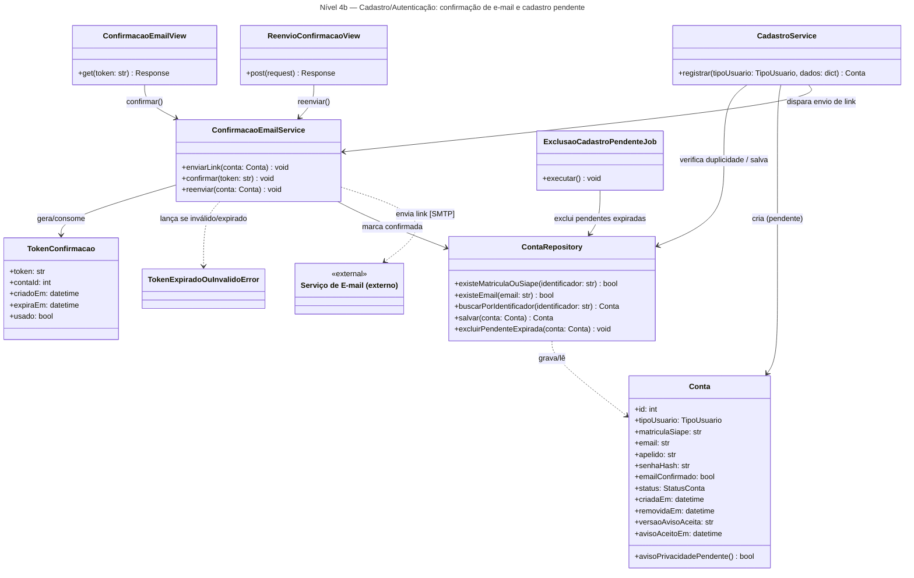
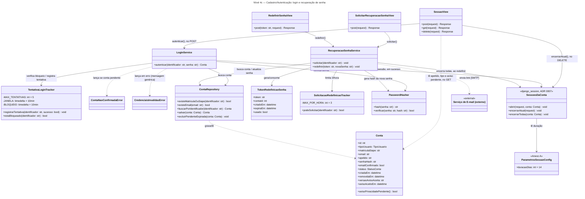
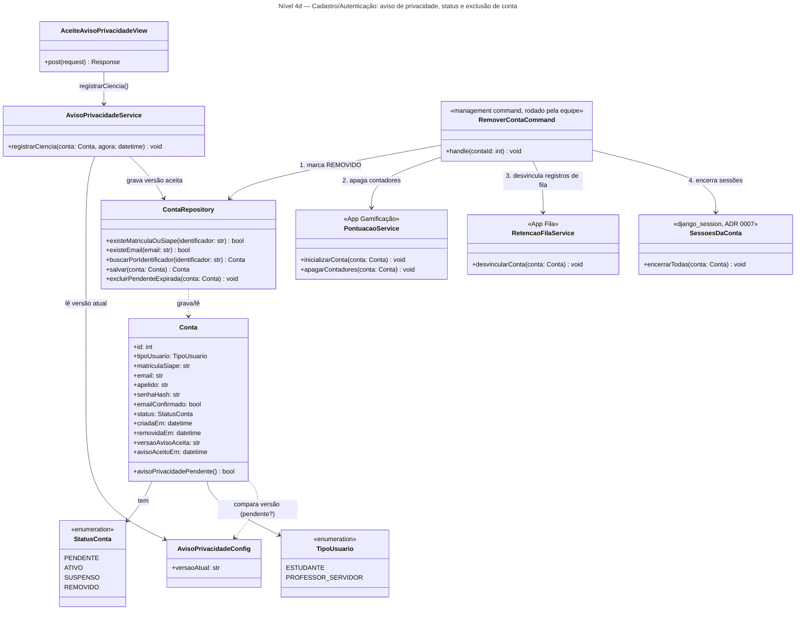

# Arquitetura C4 — Nível 4 (Cadastro/Autenticação) — Bandejão

> Detalha, em diagrama de classes, o componente **Cadastro/Autenticação**,
> desenhado no Nível 3 do backend (ver `c4-nivel-3-backend.md`). Cobre o
> Épico Login por inteiro: cadastro em duas etapas (RF01), confirmação de
> e-mail (RF02), login (RF03) e recuperação de senha (RF04). Na Release 2,
> também registra a ciência do aviso de privacidade atualizado, exigida
> antes do primeiro check-in de quem já tinha conta (RF11, RNF07.1).
>
> Também cria os contadores de gamificação de cada conta nova e concentra a
> exclusão de conta (`RemoverContaCommand`, RNF07.4), que chama a
> Gamificação e a Fila. Essas são as únicas chamadas deste componente a
> outros (ver nota do Nível 3).
>
> A sessão é a do próprio Django, em cookie `HttpOnly` (ADR 0007), com
> login, logout (RF03.3) e "quem sou eu" na mesma rota, e a matrícula/SIAPE
> fica em texto claro, em `matriculaSiape` (ADR 0008).
>
> **Endpoints de sessão e privacidade:**
>
> | Endpoint | Acesso | View |
> |---|---|---|
> | `POST /api/sessao/` | Público | `SessaoView` (login) |
> | `GET /api/sessao/` | Logado | `SessaoView` ("quem sou eu") |
> | `DELETE /api/sessao/` | Logado | `SessaoView` (logout) |
> | `POST /api/privacidade/aceite/` | Logado | `AceiteAvisoPrivacidadeView` |
>
> Referências: ADR 0002 — *Matrícula e apelido extraídos do e-mail
> institucional* (`docs/arquitetura/adr/0002-matricula-apelido-extraidos-do-email.md`),
> ADR 0007 — *Sessão autenticada por cookie HttpOnly*
> (`docs/arquitetura/adr/0007-sessao-autenticada-por-cookie-httponly.md`) e
> ADR 0008 — *Matrícula/SIAPE em texto claro*
> (`docs/arquitetura/adr/0008-matricula-siape-em-texto-claro.md`).

Há quatro diagramas: **4a** cadastro, **4b** confirmação de e-mail, **4c** login e recuperação de senha e **4d** aviso de privacidade, status e exclusão de conta. Cada diagrama tem no máximo 20 elementos e um título próprio, seguindo a skill c4-architecture usada pelo grupo; classes compartilhadas (como `Conta` ou as configurações) aparecem em mais de um diagrama.

## Nível 4a — Cadastro

```mermaid
---
title: "Nível 4a — Cadastro/Autenticação: cadastro em duas etapas"
---
classDiagram
  class CadastroView {
    +post(request) Response
  }
  class CadastroService {
    +registrar(tipoUsuario: TipoUsuario, dados: dict) Conta
  }
  class TipoUsuario {
    <<enumeration>>
    ESTUDANTE
    PROFESSOR_SERVIDOR
  }
  class IdentificadorExtractor {
    <<interface>>
    +extrair(dados: dict) IdentificadorExtraido
  }
  class EstudanteIdentificadorExtractor {
    +extrair(dados: dict) IdentificadorExtraido
  }
  class ProfessorServidorIdentificadorExtractor {
    +extrair(dados: dict) IdentificadorExtraido
  }
  class IdentificadorExtraido {
    +identificador: str
    +apelidoSugerido: str
  }
  class MatriculaValidator {
    +validarFormato(matricula: str) bool
    +validarPrefixoAnoSemestre(matricula: str) bool
    +validarSequenciaDigitos(matricula: str) bool
  }
  class SiapeValidator {
    +validarFormato(siape: str) bool
  }
  class EmailInstitucionalValidator {
    +validarFormatoEstudante(email: str) bool
    +validarFormatoProfessorServidor(email: str) bool
  }
  class ApelidoResolver {
    +resolverManual(apelidoDigitado: str) str
    +resolverExtraido(textoAntesDoArroba: str) str
    -limparCaracteresNaoAlfanumericos(texto: str) str
    +validarDisponibilidade(apelido: str) bool
  }
  class ApelidoIndisponivelError
  class SenhaValidator {
    +validar(senha: str) bool
  }
  class PasswordHasher {
    +hash(senha: str) str
    +verificar(senha: str, hash: str) bool
  }
  class ContaRepository {
    +existeMatriculaOuSiape(identificador: str) bool
    +existeEmail(email: str) bool
    +buscarPorIdentificador(identificador: str) Conta
    +salvar(conta: Conta) Conta
    +excluirPendenteExpirada(conta: Conta) void
  }
  class IdentificadorJaCadastradoError
  class EmailJaCadastradoError
  class Conta {
    +id: int
    +tipoUsuario: TipoUsuario
    +matriculaSiape: str
    +email: str
    +apelido: str
    +senhaHash: str
    +emailConfirmado: bool
    +status: StatusConta
    +criadaEm: datetime
    +removidaEm: datetime
    +versaoAvisoAceita: str
    +avisoAceitoEm: datetime
    +avisoPrivacidadePendente() bool
  }
  class PontuacaoService {
    <<App Gamificação>>
    +inicializarConta(conta: Conta) void
    +apagarContadores(conta: Conta) void
  }
  class AvisoPrivacidadeConfig {
    +versaoAtual: str
  }

  CadastroView --> CadastroService : registrar()
  IdentificadorExtractor <|.. EstudanteIdentificadorExtractor
  IdentificadorExtractor <|.. ProfessorServidorIdentificadorExtractor
  IdentificadorExtractor --> IdentificadorExtraido : produz
  CadastroService --> IdentificadorExtractor : escolhe estratégia por TipoUsuario
  CadastroService --> MatriculaValidator : valida (Estudante)
  CadastroService --> SiapeValidator : valida (Professor/Servidor)
  CadastroService --> EmailInstitucionalValidator : valida formato
  CadastroService --> ApelidoResolver : resolve/valida apelido
  ApelidoResolver ..> ApelidoIndisponivelError : lança se indisponível
  CadastroService --> SenhaValidator : valida senha
  SenhaValidator --> PasswordHasher : gera hash
  CadastroService --> ContaRepository : verifica duplicidade / salva
  ContaRepository ..> IdentificadorJaCadastradoError : lança se já em uso
  ContaRepository ..> EmailJaCadastradoError : lança se já em uso
  CadastroService --> Conta : cria (pendente)
  CadastroService --> PontuacaoService : cria os contadores da conta (mesma transação)
  ContaRepository ..> Conta : grava/lê
  Conta --> TipoUsuario : tem
  CadastroService --> AvisoPrivacidadeConfig : grava versão aceita no cadastro
  Conta ..> AvisoPrivacidadeConfig : compara versão (pendente?)
```

### Notas do diagrama (4a)

- **`IdentificadorExtractor` é uma estratégia por `TipoUsuario`** — a
  distinção entre Estudante e Professor/Servidor do RF01/ADR 0002 (quem
  digita o quê, e o que é extraído do e-mail) fica isolada nas duas
  implementações, em vez de virar um emaranhado de `if tipo == ...` dentro
  do `CadastroService`. Isso deixa mais fácil testar as duas regras da ADR
  0002 separadamente: para Estudante, a matrícula vem do e-mail e o apelido
  é digitado; para Professor/Servidor, é o inverso.
- **`ApelidoResolver` concentra as três variações da regra de apelido**:
  aceitar o valor digitado (Estudante), extrair e limpar caracteres não
  alfanuméricos do texto antes do "@" (Professor/Servidor), e validar
  disponibilidade/tamanho nos dois casos. A colisão ou o tamanho inválido
  do apelido extraído automaticamente não é tratada como erro fatal do
  cadastro: o RF01 pede que, nesse caso específico, o sistema **peça um
  apelido alternativo digitado manualmente**, em vez de simplesmente
  rejeitar o cadastro — vale essa distinção na hora de implementar
  `ApelidoIndisponivelError` (é recuperável, não é o mesmo tipo de falha que
  matrícula/e-mail duplicados).
- **`MatriculaValidator` tem três métodos separados**, não um só
  `validar()`, porque o RF01 define três checagens compostas e
  independentes: formato (9 dígitos), prefixo de ano/semestre (janela
  dinâmica, recalculada a cada semestre conforme o Anexo A) e sequência dos
  6 dígitos restantes (rejeita crescente, decrescente ou todos iguais).
  Métodos separados tornam cada regra testável isoladamente com casos de
  borda próprios, sem depender de montar uma matrícula "válida no resto"
  só para testar uma das três checagens.
- **`Conta.matriculaSiape` fica em texto claro (ADR 0008)**, na coluna
  `USUARIO.matricula_siape` (UNIQUE, indexada), diferente de `senhaHash`,
  que é hash irreversível. A equipe precisa ler a matrícula/SIAPE a partir do
  apelido para tratar matrícula contestada (L01) e para moderação (RNF08,
  ADR 0004), e o UNIQUE e a busca no login funcionam direto pelo ORM. A
  proteção vem do controle de acesso, não de criptografia na coluna: acesso
  direto ao banco só para membros nomeados da equipe, nenhum serializer
  público expõe matrícula/SIAPE ou e-mail (RI10, com teste automatizado), e
  as rotas de cadastro, login, recuperação e reenvio não registram o corpo
  da requisição em log.
- **Contadores de gamificação nascem com a conta.** Na mesma transação do
  cadastro, o `CadastroService` chama `PontuacaoService.inicializarConta`, da
  Gamificação, que cria a `PontuacaoUsuario` com zero ponto. As contas que
  já existiam ganham a linha por uma *data migration*. Assim, a trava da
  pontuação (`select_for_update`) sempre encontra a linha (ver
  `c4-nivel-4-gamificacao.md`).
- **IDs inteiros (decidido com o time de banco de dados).** `id` e `contaId` são inteiros
  autoincrementais, como no banco.

## Nível 4b — Confirmação de e-mail

### Notas do diagrama (4b)

- **`ExclusaoCadastroPendenteJob` é um job separado do `CadastroService`**,
  análogo ao `LerCardapioCommand` do Leitor de Cardápio: o RF02 exige que um
  cadastro pendente não confirmado em 24h seja excluído automaticamente,
  o que é responsabilidade de um processo periódico (cron ou scheduler),
  não de uma ação disparada por requisição HTTP. Roda pelo mesmo cron do SO
  do Leitor de Cardápio, junto com o `clearsessions` do Django (ADR 0007), a
  retenção da Fila e o fechamento do semestre da Gamificação.

## Nível 4c — Login e recuperação de senha

### Notas do diagrama (4c)

- **Sessão do Django em cookie, não token (ADR 0007).** O login
  (`POST /api/sessao/`) abre uma sessão guardada em `django_session`, com
  cookie `HttpOnly`, `Secure` e `SameSite=Lax`, de 14 dias e renovada a cada
  uso (`ParametrosSessaoConfig`, Anexo A). `SessoesDaConta` representa o
  mecanismo do Django (`django.contrib.sessions`); não é uma tabela própria
  do projeto. As requisições que alteram estado mandam o token CSRF do
  Django num cabeçalho.
- **Uma rota, três verbos.** `SessaoView` atende `POST` (login),
  `DELETE` (logout, RF03.3, encerra só a sessão atual) e `GET` ("quem sou
  eu"). O `GET` devolve só `{apelido, tipo, avisoPrivacidadePendente}`, nunca
  matrícula/SIAPE ou e-mail (RI10); é por ele que o PWA sabe se há sessão e
  se precisa mostrar o aviso de privacidade antes do primeiro check-in.
- **Redefinir a senha encerra todas as sessões** da conta (RF04): o Django
  já invalida as sessões quando a senha muda, e o diagrama deixa isso
  explícito na seta `RecuperacaoSenhaService → SessoesDaConta`.
- **Conta suspensa ou removida vira `is_active = False`** (ADR 0004 e
  0007): o login é recusado com a mesma mensagem genérica de
  `CredenciaisInvalidasError`, e as sessões já abertas deixam de autenticar
  na requisição seguinte. A exclusão de conta também encerra todas as
  sessões (diagrama 4d).
- **`clearsessions`** roda pelo cron do SO para apagar sessões expiradas de
  `django_session`.

- **`TentativaLoginTracker` e `SolicitacaoRedefinicaoTracker` são duas
  classes, não uma genérica de "rate limiting"**, porque os parâmetros e a
  granularidade são diferentes: bloqueio de login é por identificador, 5
  tentativas em 10 minutos, bloqueio de 10 minutos (RF03); recuperação de
  senha é por identificador, 3 solicitações por hora (RF04). Também evita
  que uma implementação genérica demais esconda esses números do Anexo A
  atrás de uma configuração difícil de rastrear até o requisito.
- **`LoginService` nunca deixa a `SessaoView` saber se a matrícula/SIAPE
  existe** — tanto `ContaNaoConfirmadaError` quanto `CredenciaisInvalidasError`
  viram mensagens específicas de propósito diferente (uma convida a
  confirmar o e-mail; a outra é genérica de propósito, para não permitir
  enumeração de contas, RF03) — mas nenhuma das duas revela existência da
  conta a quem não sabe a senha correta.

## Nível 4d — Aviso de privacidade, status e exclusão de conta

### Notas do diagrama (4d)

- **Ciência do aviso de privacidade (RF11, RNF07.1; contrato combinado com o frontend).** A conta
  guarda qual versão do aviso foi aceita (`versaoAvisoAceita`) e quando
  (`avisoAceitoEm`). `AvisoPrivacidadeConfig.versaoAtual` é a versão em
  vigor (a da Release 2, que cita fila, localização, gamificação e
  ranking). Fluxo:
  - no cadastro, o aceite já é obrigatório (RF01), então o `CadastroService`
    grava a versão atual e a conta nasce sem pendência;
  - quem tinha conta antes da Release 2 fica com a versão antiga, e
    `Conta.avisoPrivacidadePendente()` passa a ser verdadeiro;
  - o endpoint "quem sou eu" da sessão (`GET /api/sessao/`, ADR 0007,
    diagrama 4c) devolve `avisoPrivacidadePendente` ao lado de
    apelido e tipo, para o PWA mostrar o aviso **antes** de pedir a
    localização no primeiro check-in;
  - `POST /api/privacidade/aceite/` (`AceiteAvisoPrivacidadeView`, só
    logado, sem corpo) registra a ciência com a hora do servidor e devolve
    `204`;
  - se mesmo assim chegar um check-in sem a ciência, a Fila recusa com `403`
    e `"codigo": "aviso_privacidade_pendente"` (passo 0 do `CheckinService`,
    `c4-nivel-4-fila.md`).

  `avisoPrivacidadePendente()` é um método do model, para que a Fila o leia
  como lê os outros dados da `Conta`, sem chamar este componente. Uma versão
  nova do aviso, no futuro, volta a gerar pendência para todos, sem mudança
  de código. No banco, `versaoAvisoAceita` é a coluna nova
  `versao_aviso_aceita`, e `avisoAceitoEm` é a coluna `aceite_privacidade_em`
  que já existe, atualizada também quando a pessoa aceita o aviso da
  Release 2.
- **`status` da conta (decisão tomada com o time de banco de dados).** A
  `Conta` passa a ter o mesmo `status` do banco: `PENDENTE` (cadastro sem
  e-mail confirmado), `ATIVO`, `SUSPENSO` e `REMOVIDO`, com `removidaEm`.
  `confirmada` virou `emailConfirmado`, como a coluna `email_confirmado`.
  Conta suspensa ou removida não autentica e fica fora do ranking; os
  outros componentes leem `Conta.status` (o `Conta.removida` dos rascunhos
  antigos deixa de existir).
- **Exclusão de conta (RNF07.4): `RemoverContaCommand`.** A equipe roda o
  comando com o id da conta, e ele faz tudo numa transação:
  1. marca `status = REMOVIDO` e preenche `removidaEm`, sem apagar a conta;
  2. pede à Gamificação que apague os contadores
     (`PontuacaoService.apagarContadores`): pontos totais, pontos do
     semestre, posição final e, com ela, a Bandeja de Ouro;
  3. pede à Fila que retire o vínculo dos registros de fila da conta
     (`RetencaoFilaService.desvincularConta`);
  4. encerra as sessões da conta (`django_session`, ADR 0007).

  As avaliações ficam, exibidas como "usuário removido" (RNF07.4), e
  mantêm o vínculo para moderação (RNF08). A conta nunca é apagada
  fisicamente, porque isso quebraria essa rastreabilidade. O comando chama
  os outros componentes, em vez de apagar as tabelas deles direto, para que
  cada um continue sendo o único dono dos próprios dados.
