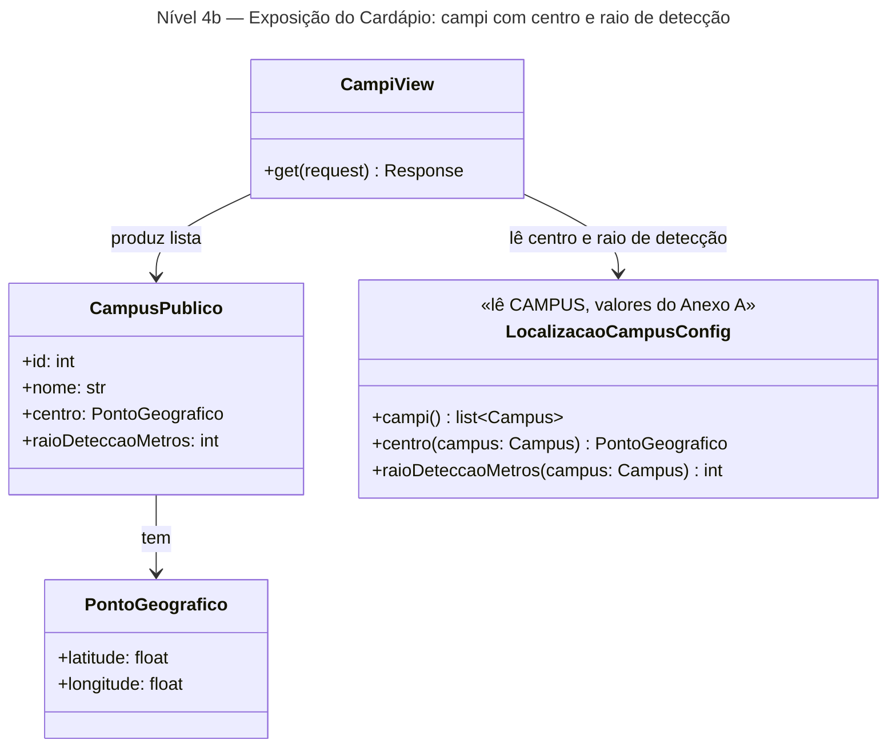

# Arquitetura C4 — Nível 4 (Exposição do Cardápio) — Bandejão

> Detalha, em diagrama de classes, o componente **Exposição do Cardápio**,
> desenhado no Nível 3 do backend dentro da fronteira do App Cardápio (ver
> `c4-nivel-3-backend.md`), ao lado do Leitor de Cardápio
> (`c4-nivel-4-leitor-cardapio.md`) — os dois compartilham os mesmos models
> Django (`Refeicao`, `Categoria`, `Prato`, `Marcador`), mas um escreve e o
> outro só lê. Cobre a parte de exibição do Épico Cardápio: exibição por
> campus/refeição/dia (RF07), filtro de marcadores (RF08), filtro de dieta
> (RF09) e exibição da semana seguinte (RF18). Na Release 2, também publica
> a lista de campi com o centro e o raio de detecção de cada um, usada pelo
> PWA para detectar o campus no aparelho (RF20.1, ADR 0009).
>
> **Decisão tomada neste refinamento:** os filtros de marcador (RF08) e de
> dieta (RF09) são aplicados **no backend** — o endpoint recebe os
> marcadores/dieta selecionados como parâmetros e já devolve o cardápio
> filtrado, em vez de o PWA filtrar um cardápio bruto já carregado. Isso é
> o que justifica `FiltroMarcadorService` e `FiltroDietaService` existirem
> como serviços de backend testáveis à parte, e não apenas como lógica no
> Vue. Decisão registrada na ADR 0005
> (`docs/arquitetura/adr/0005-filtros-de-marcador-e-dieta-no-backend.md`).
>
> **Endpoints deste componente** (combinados entre backend e frontend):
>
> | Endpoint | Acesso | View |
> |---|---|---|
> | `GET /api/cardapio/?campus=&semana=&dia=&refeicao=&marcadores=&dieta=` | Público | `CardapioView` |
> | `GET /api/campi/` | Público | `CampiView` |
>
> No cardápio, `campus` é obrigatório; `semana` e `dia` vêm da semana
> vigente e do dia corrente quando omitidos; `refeicao` é opcional (sem ela,
> vale a refeição padrão da RN05); `marcadores` é a lista dos marcadores
> selecionados, separados por vírgula, e `dieta` é um dos valores de
> `DietaSelecionada`. Os parâmetros seguem a ADR 0005.

Há dois diagramas: **4a** cardápio filtrado e **4b** lista de campi para a detecção. Cada diagrama tem no máximo 20 elementos e um título próprio, seguindo a skill c4-architecture usada pelo grupo; classes compartilhadas (como `Conta` ou as configurações) aparecem em mais de um diagrama.

## Nível 4a — Cardápio filtrado

```mermaid
---
title: "Nível 4a — Exposição do Cardápio: consulta e filtros"
---
classDiagram
  class CardapioView {
    +get(request) Response
  }
  class CardapioQueryService {
    +obterCardapio(campus: Campus, semana: date | None, dia: date | None, refeicao: str | None, marcadoresSelecionados: list~str~, dieta: DietaSelecionada, agora: datetime) CardapioFiltrado
  }
  class RefeicaoRepository {
    +buscarRefeicao(campus: Campus, data: date, tipo: str) Refeicao | None
    +refeicoesDoDia(campus: Campus, data: date) list~Refeicao~
    +proximoDiaComServico(campus: Campus, depoisDe: date) date | None
    +existeCardapioPublicado(campus: Campus, semana: Semana) bool
  }
  class HorarioRefeicaoResolver {
    +refeicaoPadrao(agora: datetime, refeicoesDoDia: list~Refeicao~) RefeicaoPadrao
    +refeicaoEmAndamento(agora: datetime, refeicoesDoDia: list~Refeicao~) str
    +proximaRefeicao(agora: datetime, refeicoesDoDia: list~Refeicao~) str
    +ultimaRefeicaoDoDia(refeicoesDoDia: list~Refeicao~) str
  }
  class HorariosRefeicaoConfig {
    +horarioCafe: tuple
    +horarioAlmoco: tuple
    +horarioJantar: tuple
  }
  class RefeicaoPadrao {
    +refeicao: str
    +dia: date
    +encerrada: bool
  }
  class SemanaCardapioResolver {
    +semanasDisponiveis(campus: Campus, dia: date) list~Semana~
  }
  class Semana {
    +inicio: date
    +fim: date
    +vigente: bool
  }
  class DietaSelecionada {
    <<enumeration>>
    SEM_FILTRO
    OVOLACTOVEGETARIANO
    VEGETARIANO_ESTRITO
  }
  class FiltroDietaService {
    +aplicar(refeicao: Refeicao, dieta: DietaSelecionada) list~Categoria~
  }
  class FiltroMarcadorService {
    +aplicar(categorias: list~Categoria~, marcadoresSelecionados: list~str~, alergenosIndisponivel: bool) list~CategoriaFiltrada~
    -contemTodosMarcados(pratos: list~Prato~, marcadoresSelecionados: set~str~) bool
  }
  class CardapioFiltrado {
    +campus: Campus
    +refeicao: str
    +data: date
    +refeicaoEncerrada: bool
    +status: StatusCardapio
    +avisoSujeitoAAlteracao: str
    +alergenosIndisponivel: bool
    +filtroMarcadorDesativado: bool
    +semServico: bool
    +categorias: list~CategoriaFiltrada~
  }
  class StatusCardapio {
    <<enumeration>>
    PUBLICADO
    NAO_PUBLICADO
  }
  class CategoriaFiltrada {
    +nome: str
    +semOpcaoCompativel: bool
    +pratos: list~PratoFiltrado~
  }
  class PratoFiltrado {
    +descricao: str
    +marcadores: list~str~
    +contemMarcadorSelecionado: bool
  }
  class Refeicao {
    +campus: Campus
    +tipo: str
    +data: date
    +statusLeitura: str
    +alergenosIndisponivel() bool
  }
  class Categoria {
    +nome: str
  }
  class Prato {
    +nome: str
    +dieta: str | None
  }
  class Marcador {
    +nome: str
  }

  CardapioView --> CardapioQueryService : obterCardapio()
  CardapioQueryService --> RefeicaoRepository : busca refeição(ões)
  CardapioQueryService --> HorarioRefeicaoResolver : resolve refeição padrão quando não informada (RF07, RN05)
  CardapioQueryService --> SemanaCardapioResolver : resolve semana vigente/seguinte (RF18)
  CardapioQueryService --> FiltroDietaService : 1. filtra por dieta (RF09)
  CardapioQueryService --> FiltroMarcadorService : 2. sinaliza marcadores (RF08)
  CardapioQueryService --> CardapioFiltrado : monta resposta
  HorarioRefeicaoResolver --> HorariosRefeicaoConfig : usa parâmetros do Anexo A
  SemanaCardapioResolver --> Semana : produz
  HorarioRefeicaoResolver --> RefeicaoPadrao : produz
  RefeicaoRepository ..> Refeicao : lê
  RefeicaoRepository ..> Categoria : lê
  RefeicaoRepository ..> Prato : lê
  RefeicaoRepository ..> Marcador : lê
  FiltroDietaService --> Prato : lê a dieta de cada prato
  FiltroMarcadorService --> CategoriaFiltrada : produz
  FiltroMarcadorService --> PratoFiltrado : produz
  CardapioFiltrado --> StatusCardapio : tem
  CardapioFiltrado *-- CategoriaFiltrada
  CategoriaFiltrada *-- PratoFiltrado
```



### Notas do diagrama (4a)

- **A decisão de filtrar no backend é o que dá origem a
  `FiltroDietaService` e `FiltroMarcadorService` como classes próprias**,
  em vez de o `CardapioQueryService` devolver um cardápio bruto para o Vue
  filtrar. Cada serviço cobre uma regra de negócio isolada e testável sem
  precisar simular a interface — bom para a meta de cobertura da RNF06 — e
  os dois são aplicados em sequência (`CardapioQueryService` chama primeiro
  `FiltroDietaService`, depois `FiltroMarcadorService`), porque a dieta pode
  esconder categorias/linhas inteiras (RF09) e o filtro de marcador só
  precisa então avaliar o que sobrou.
- **A dieta fica no `Prato`, não na `Categoria`** (`PRATO.dieta` no
  dicionário de dados do Nível 4 do banco, seguido pelos models no PR #108).
  `Prato.dieta` é `padrao`, `ovolacto` ou `vegetariano_estrito` nas linhas
  de prato principal (almoço/jantar) e de complemento (café da manhã), e
  nula nas categorias comuns a todas as dietas (saladas, guarnição, sopa
  etc.). **Todos os pratos de uma categoria têm a mesma dieta**: o
  `CardapioRepository` copia a dieta da categoria lida no PDF para cada
  prato dela (ver o Nível 4 do Leitor de Cardápio). Por isso o
  `FiltroDietaService` lê a dieta dos pratos, mas mantém ou remove a
  categoria inteira, e devolve `list~Categoria~`. A regra segue o RF09:
  - `SEM_FILTRO`: mantém todas as categorias;
  - `OVOLACTOVEGETARIANO`: mantém as categorias cujos pratos têm dieta
    `ovolacto`, `vegetariano_estrito` ou nula, e remove as de dieta
    `padrao` (ex.: a linha "Prato principal padrão");
  - `VEGETARIANO_ESTRITO`: mantém só as categorias cujos pratos têm dieta
    `vegetariano_estrito` ou nula.

  Só sai da resposta a categoria removida pela dieta escolhida. Com
  `SEM_FILTRO`, nenhuma categoria é removida, nem uma que já tenha vindo sem
  pratos, e as categorias de pratos com dieta nula nunca são removidas pela
  dieta. Isso é diferente do `semOpcaoCompativel` do RF08, que **mantém** a
  categoria na resposta e só a sinaliza.
- **`Prato.nome` sai como `PratoFiltrado.descricao`.** O model segue o
  dicionário do banco (`PRATO.nome`); o `PratoFiltrado` é a resposta da API
  e mantém `descricao`, que é o nome do campo no contrato OpenAPI
  (`backend/openapi.yaml`, BE-03). Renomear o campo da resposta mudaria o
  contrato combinado com o frontend e fica fora deste ajuste.
- **`FiltroMarcadorService.aplicar` recebe `alergenosIndisponivel` como
  parâmetro** (a propriedade derivada de `Refeicao.statusLeitura`, coluna
  `REFEICAO.status_leitura` do banco, igual à do Nível 4 do Leitor de
  Cardápio) para respeitar o RF08: se a refeição está marcada como
  "informação de alérgenos indisponível" (RF06/L03), o filtro fica
  desativado para ela — o serviço não aplica sinalização nenhuma e
  `CardapioFiltrado.filtroMarcadorDesativado` fica `true`, para a interface
  informar o motivo.
- **`CategoriaFiltrada.semOpcaoCompativel`** cobre o caso do RF08 em que
  todos os pratos de uma categoria têm algum marcador selecionado — é uma
  informação calculada por `FiltroMarcadorService`, não um campo do model
  `Categoria`, porque depende da seleção de filtro de cada requisição, não
  é um dado fixo do cardápio.
- **Refeição padrão da Release 2 (RN05).** Quando o PWA não informa a
  refeição, `HorarioRefeicaoResolver.refeicaoPadrao` aplica a ordem da RN05:
  1. a refeição em andamento;
  2. senão, a próxima refeição ainda por vir no mesmo dia;
  3. senão (todas as refeições do dia já terminaram), a última refeição do
     dia (`ultimaRefeicaoDoDia`), até as 23h59, com
     `CardapioFiltrado.refeicaoEncerrada = true`: o PWA mostra "refeição
     encerrada" no lugar da previsão e do check-in, e a avaliação continua
     aberta (RF15.1, RF20.3);
  4. depois da meia-noite, volta a valer o item 2, e o café da manhã do novo
     dia passa a ser o padrão;
  5. se o campus não serve refeições no dia (ex.: domingo), o
     `CardapioQueryService` pede ao `RefeicaoRepository` o
     `proximoDiaComServico` e mostra a primeira refeição desse dia;
     `CardapioFiltrado.data` indica o dia exibido.

  Os dias e as refeições servidos são os do PDF (RF06.2). Se o dia a exibir
  for de uma semana cujo PDF ainda não foi lido, o `status` vem
  `NAO_PUBLICADO` (RF18). O resultado (`RefeicaoPadrao`) traz a refeição, o
  dia e se ela está encerrada.
- **`HorarioRefeicaoResolver` e `SemanaCardapioResolver` existem separados
  do `CardapioQueryService`** pelo mesmo motivo do `MatriculaValidator` no
  Cadastro/Autenticação: são duas regras de negócio compostas e
  independentes — "qual refeição está em andamento agora" (RF07, depende
  dos horários do Anexo A) e "a semana seguinte já pode ser exibida?"
  (RF18, depende só de o PDF daquela semana já ter sido lido com sucesso
  pelo Leitor de Cardápio) — testáveis cada uma com seus próprios casos de
  borda, sem precisar montar cenário completo de cardápio para testar só
  uma das duas.
- **`Refeicao`, `Categoria`, `Prato` e `Marcador` são os mesmos models do
  Nível 4 do Leitor de Cardápio** — aqui aparecem só como origem de leitura
  do `RefeicaoRepository`; nenhuma dessas classes é escrita por este
  componente, reforçando a nota do Nível 3 de que Leitor de Cardápio e
  Exposição do Cardápio têm perfis diferentes dentro do mesmo app (um
  escreve, o outro só lê).
- **Campus, filtro de marcador e dieta escolhidos continuam "lembrados no
  aparelho" do lado do PWA (RF07, RF08, RF09)** — isso não muda com a
  decisão de filtrar no backend: o dispositivo ainda decide *quais*
  parâmetros mandar a cada requisição, o backend só deixou de ser "burro"
  em relação ao que fazer com eles. Por isso não há, neste diagrama, nenhuma
  classe de preferência de usuário persistida — não é responsabilidade
  deste componente.
- **RF10 (ícones de marcador sempre visíveis, Backlog) não exige nenhuma
  classe nova**: `PratoFiltrado.marcadores` já carrega essa informação
  independentemente do filtro estar ativo ou não; falta só a interface
  exibir os ícones sem exigir interação, o que é responsabilidade do PWA.
- **Implementação na BE-11 (#138, decisões de 21/11/2026).** O que o
  diagrama não dizia e ficou assim no código (`backend/apps/cardapio/`, um
  módulo por classe; os métodos em snake_case, como `obter_cardapio`):
  - **A semana vem da `FonteCardapio`.** A semana de um dia é a linha da
    `FonteCardapio` do campus cujo intervalo `[semana_inicio,
    semana_inicio + 6 dias]` contém o dia exibido (primeiro e último dia
    incluídos). `existeCardapioPublicado` é verdadeiro quando essa linha
    existe. Sem linha, `status = NAO_PUBLICADO`, mesmo com `Refeicao` no
    banco: não há fallback pelas refeições. Um cardápio cadastrado à mão só
    aparece se a linha da semana também for criada. Na R2,
    `semanasDisponiveis` entrega só a semana do dia (a vigente); a semana
    seguinte (RF18) fica para outra tarefa.
  - **O relógio é lido uma vez, na `CardapioView`** (`timezone.localtime()`),
    e passado adiante: `obterCardapio` recebe `agora` e
    `semanasDisponiveis` recebe o dia (as assinaturas do diagrama já estão
    assim). Nenhuma outra classe lê o relógio.
  - **`status_leitura = leitura_falhou` → `NAO_PUBLICADO`.** Essa linha só
    existe quando não havia cardápio anterior válido (N4 do banco): não há
    o que mostrar (RF06.4). Publicada, ela sairia com o filtro de marcador
    ativo e nada sinalizado, como se fosse segura. Vale só para a refeição
    com esse status; as outras do dia seguem normais.
  - **Próximo dia com serviço em até 7 dias** depois do dia pedido (o
    domingo pula para a segunda). Mais longe que isso, `NAO_PUBLICADO`.
    O item 5 da RN05 vale mesmo com `semana` pedida: o dia exibido pode ser
    da semana seguinte, e `data` mostra qual.
  - **O item 5 da RN05 não vale para a refeição pedida pelo seletor**: com
    `refeicao` explícita num dia sem serviço (domingo, feriado), a resposta
    é o dia pedido, `PUBLICADO` e com `categorias` vazia.
  - **`semana` é qualquer data** da faixa aceita: só serve para escolher o
    dia quando `dia` é omitido e para conferir que o `dia` está nela. Se a
    semana está publicada, quem diz é a `FonteCardapio` do dia exibido, não
    o parâmetro. Decidido assim (revisão do PR #214) para não recusar um
    pedido cuja semana do PDF não começa na segunda.
  - **Avisos no log** (sem mudar a regra): refeição no banco sem a linha da
    `FonteCardapio` da semana, e categoria com pratos de dietas diferentes.
  - **Início e fim do horário incluídos**: às 9h30min00s ainda é café; um
    segundo depois, não. É a mesma comparação do `JanelaCheckinValidator` da Fila. O
    resolver não importa o validador, para o Cardápio não passar a chamar a
    Fila (a dependência do Nível 3 tem um sentido só); um teste compara os
    dois no início e no fim de cada refeição.
  - **`refeicaoEncerrada` é "a refeição exibida já terminou"**: dia passado,
    ou hoje depois do fim do horário. Na refeição padrão, coincide com o
    item 3 da RN05; vale também para a refeição pedida pelo seletor.
  - **Dia futuro ou passado sem `refeicao`**: a primeira refeição do dia
    futuro e a última (encerrada) do dia passado.
  - **Sem dia com serviço** do dia pedido em diante (nos 7 dias seguintes),
    sem `refeicao` no pedido: o dia exibido é o pedido, e a refeição vem dos
    horários do Anexo A. Com a semana do dia pedido publicada, sai
    `PUBLICADO` com `semServico: true` e `categorias` vazia: o PDF diz que o
    RU não abre (sábado nos campi que só servem de segunda a sexta, domingo
    sem a semana seguinte publicada, recesso). Sem ela, sai `NAO_PUBLICADO`
    com `semServico: false` (#217, decisão de 21/11/2026). Em qualquer outra
    resposta, `semServico` é `false`.
  - **Refeição pedida que o PDF não traz no dia** (ex.: `refeicao=cafe` num
    dia só com almoço): `PUBLICADO`, com `categorias` vazia. O contrato
    ainda não diz quais refeições existem em cada dia (ponto em aberto com o
    front, na #144).
  - **`semana` sem `dia`**: o dia corrente, se estiver na semana pedida;
    senão, o primeiro dia dela. `dia` fora da `semana` pedida dá 400.
  - **400 `parametros_invalidos`** (`{codigo, mensagem}`): parâmetro fora
    dos seis do contrato (ex.: `marcador`, `marcadores[]`) ou repetido (os
    marcadores vão num parâmetro só, separados por vírgula); `campus`
    ausente ou que não seja só dígitos; `semana` ou `dia` fora
    de `AAAA-MM-DD`, inválida ou fora de 2000-01-01 a 2099-12-31; `refeicao` ou `dieta` fora do enum; item vazio
    em `marcadores` ou nome que não está na tabela `MARCADOR` (a mensagem
    cita os nomes). Espaços em volta e nomes repetidos são aceitos, e
    `marcadores` vazio é o mesmo que nenhum.
  - **`avisoSujeitoAAlteracao`** é o aviso curto do RF07.1, o mesmo texto da
    `CardapioView.vue`, numa constante única (`AVISO_SUJEITO_A_ALTERACAO`).
    O aviso longo do filtro (RF08, L04) continua no front.
- **Campus inexistente (#217, decisão de 21/11/2026).** `campus` só com
  dígitos, mas sem registro em `CAMPUS` (link antigo ou campus removido),
  responde **404 `campus_nao_encontrado`**:
  `{"codigo": "campus_nao_encontrado", "mensagem": "Não existe campus com esse id."}`.
  O `codigo` é o mesmo do contrato do `GET /api/ranking/{campusId}/`, e a
  mensagem é a do antigo 400. Um id com mais dígitos que o maior pk (19) dá o
  mesmo 404 sem consultar o banco. Todos os 400 acima são conferidos antes:
  com o campus inexistente e outro parâmetro inválido, a resposta é o 400,
  que é erro de quem chamou. O mesmo 404 está no contrato de
  `GET /api/avaliacoes/resumo/` e `GET /api/fila/previsao/` (as duas views
  ainda devolvem 501).

## Nível 4b — Lista de campi para a detecção



### Notas do diagrama (4b)

- **O que entra em cada tarefa.** O diagrama mostra o desenho completo da
  Release 2. Na v1 (BE-08), `GET /api/campi/` publica só `id` e `nome`, e a
  `LocalizacaoCampusConfig` tem só `campi()`. `centro` e `raioDeteccaoMetros`
  (com `centro()` e `raioDeteccaoMetros()`) entram com a detecção de campus,
  que é o EXTRA 3 (BE-E3), como diz o item 7 da seção 3 do backlog.
- **Cache.** A resposta vai com `Cache-Control: private, no-cache` e um
  `ETag` forte, que é o SHA-256 dos bytes do corpo: a view renderiza o JSON
  uma vez só e usa os mesmos bytes no hash e na resposta. O navegador guarda
  a lista e confere a cada uso: se nada mudou, o servidor responde 304 sem
  corpo. Com um `fetch` comum, quem manda o `If-None-Match` é o navegador, e
  o JavaScript recebe o corpo guardado como um 200. Se o PWA mandar o
  `If-None-Match` à mão, com a cópia do `localStorage` (C4 do front), recebe
  o 304 sem corpo e usa a própria cópia. É `private` porque, para quem está
  logado, a resposta leva o `Set-Cookie` da sessão (ADR 0007), e um cache
  compartilhado não deve guardá-la nem repassá-la a outra pessoa. Como o
  corpo só tem o que é publicado, mudar o raio ou as coordenadas não muda o
  `ETag`; incluir ou remover um campus, mudar um nome e, depois, os campos da
  BE-E3 mudam.
- **Só o `If-None-Match` é tratado.** `If-Match`, `If-Modified-Since` e
  `If-Unmodified-Since` são ignorados, e a resposta é 200. O
  `get_conditional_response` do Django foi descartado porque avalia essas
  condições e devolveria um 412 cru, sem o corpo `{codigo, mensagem}` e fora
  do contrato. A tabela `CAMPUS` vazia (deploy sem a fixture da BD-03)
  responde `200 []` e deixa um aviso no log.
- **No desenho completo (Release 2, a partir da BE-E3), `GET /api/campi/`
  publica o que o PWA precisa para detectar o campus no
  aparelho (RF20.1, ADR 0009; combinado entre backend e frontend).** É público, não depende de login
  e devolve, para cada campus, id, nome, centro e raio de detecção:

  ```json
  [
    {"id": 1, "nome": "Gama", "centro": {"latitude": -15.989, "longitude": -48.044}, "raioDeteccaoMetros": 800}
  ]
  ```

  (Valores ilustrativos; os reais vêm do Anexo A.) Fica numa view própria,
  separada do `CardapioView`, porque campi e cardápio mudam em ritmos
  diferentes: o PWA não precisa baixar um cardápio só para descobrir os
  raios. A resposta vai com cabeçalhos de cache (`Cache-Control` e `ETag`),
  e o PWA guarda a última versão no `localStorage`, para a detecção caber no
  limite de 5 s mesmo com rede lenta (RN03).
- **O raio de detecção não é o raio de confirmação do check-in.** O raio de
  detecção (campus inteiro) fica em `LocalizacaoCampusConfig`; o raio de
  confirmação (só o prédio do RU) fica em `LocalizacaoRUConfig`, no Nível 4
  da Fila, e **não é publicado**, porque quem confirma o check-in é o
  backend (RF12). As coordenadas do usuário nunca chegam a este endpoint: a
  comparação é feita no aparelho, e o servidor recebe só o identificador do
  campus (RI09).
- **De onde vêm os valores (decisão tomada com o time de banco de dados).**
  As duas configurações leem a tabela `CAMPUS`, preenchida por fixture com
  os valores do Anexo A, que separa o que é do campus do que é do RU:
  - `LocalizacaoCampusConfig` lê `centro_latitude`, `centro_longitude` e
    `raio_deteccao_metros` (detecção, ADR 0009);
  - `LocalizacaoRUConfig`, na Fila, lê `ru_latitude`, `ru_longitude`,
    `raio_confirmacao_metros` e `confirmacao_ativa` (confirmação do
    check-in, RF12). Com `confirmacao_ativa = false`, a confirmação é
    recusada antes do cálculo de distância (BD-03 / BE-09).
- **A conta de distância existe nos dois lados**, no PWA (detecção) e na
  `DistanciaGeografica` da Fila (confirmação do check-in). Os dois devem usar
  a mesma fórmula e os mesmos casos de teste, com as coordenadas reais dos
  RUs e dos campi, para não darem resultados diferentes.

## Notas gerais

- Este diagrama é uma **proposta de decomposição inicial**, coerente com a
  decisão de filtrar no backend tomada agora — se a equipe encontrar, na
  prática, uma razão para mover algum desses filtros de volta para o
  frontend (ex.: latência, simplicidade do PWA), vale atualizar este
  arquivo e registrar a mudança em uma nova ADR que substitua a ADR 0005.
