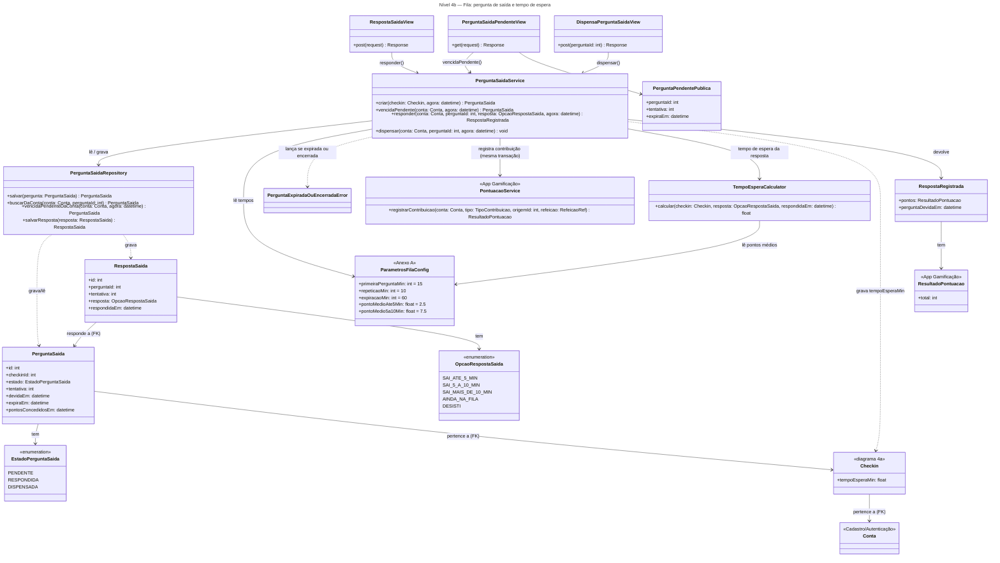
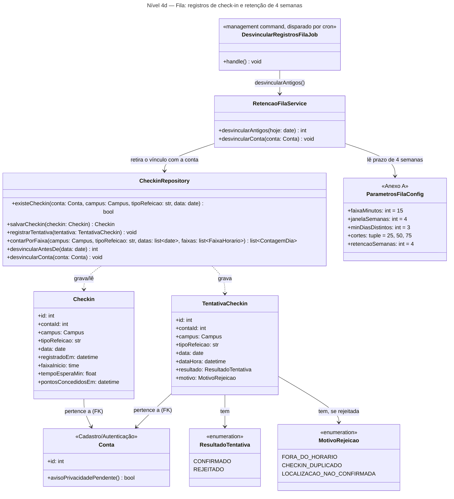

# Arquitetura C4 — Nível 4 (Fila e Previsão de Pico) — Bandejão

> Detalha, em diagrama de classes, o componente **Fila**, desenhado no
> Nível 3 do backend (ver `c4-nivel-3-backend.md`). Cobre o Épico Fila e
> Previsão de Pico: check-in no RU (RF11), confirmação por GPS (RF12),
> previsão de pico por faixa de horário (RF13), pergunta de saída da fila
> (RF21), tempo de espera de cada check-in (RN07), espera estimada por
> faixa (RF22, RN08), retenção de 4 semanas (RNF07.3) e, como item de
> Backlog, nível de fila "agora" (RF14).
>
> Há quatro diagramas: **4a** check-in, **4b** pergunta de saída da fila,
> **4c** previsão de pico e **4d** registros de fila e retenção. Cada diagrama tem no máximo 20 elementos e um título próprio,
> seguindo a skill c4-architecture usada pelo grupo;
> classes compartilhadas (como `Conta` ou as configurações) aparecem em mais de um diagrama.
>
> Todo o épico é **Release 2 / Backlog**: nada aqui faz parte do MVP. O
> diagrama existe para que a decomposição já esteja pensada quando a
> Release 2 começar.
>
> Como nos outros Níveis 4, este componente só **lê** models de outros
> componentes (`Conta`, do Cadastro/Autenticação) por chave estrangeira. A
> única chamada que ele faz a outro componente é a da pontuação: depois de
> salvar um check-in confirmado ou a resposta à pergunta de saída, a Fila
> chama o `PontuacaoService` da Gamificação na mesma transação (ver nota do
> Nível 3 e `c4-nivel-4-gamificacao.md`). Ele também é chamado pelo
> `RemoverContaCommand` do Cadastro/Autenticação, que usa o
> `RetencaoFilaService` para retirar o vínculo dos registros de fila de uma
> conta excluída (RNF07.4).
>
> IDs são inteiros autoincrementais, o padrão do Django (`BigAutoField`),
> como no C4 do banco. Nenhum endpoint autoriza o acesso só porque recebeu
> um ID: as consultas da pergunta de saída sempre filtram pela conta da
> sessão.
>
> **Endpoints deste componente:**
>
> | Endpoint | Acesso | View |
> |---|---|---|
> | `POST /api/checkins/` | Logado | `CheckinView` |
> | `GET /api/fila/previsao/?campus=&refeicao=&data=` | Público | `PrevisaoView` |
> | `GET /api/fila/pergunta-pendente/` | Logado | `PerguntaSaidaPendenteView` |
> | `POST /api/fila/respostas-saida/` | Logado | `RespostaSaidaView` |
> | `POST /api/fila/perguntas-saida/{id}/dispensa/` | Logado | `DispensaPerguntaSaidaView` |

## Nível 4a — Check-in

```mermaid
---
title: "Nível 4a — Fila: check-in com confirmação por GPS"
---
classDiagram
  class CheckinView {
    +post(request) Response
  }
  class CheckinService {
    +registrar(conta: Conta, campus: Campus, tipoRefeicao: str, coordenadas: Coordenadas, agora: datetime) CheckinRegistrado
  }
  class CheckinRegistrado {
    +checkin: Checkin
    +pontos: ResultadoPontuacao
    +perguntaDevidaEm: datetime
  }
  class AvisoPrivacidadePendenteError
  class JanelaCheckinValidator {
    +dentroDoHorario(tipoRefeicao: str, agora: datetime) bool
  }
  class CheckinForaDoHorarioError
  class CheckinRepository {
    +existeCheckin(conta: Conta, campus: Campus, tipoRefeicao: str, data: date) bool
    +salvarCheckin(checkin: Checkin) Checkin
    +registrarTentativa(tentativa: TentativaCheckin) void
    +contarPorFaixa(campus: Campus, tipoRefeicao: str, datas: list~date~, faixas: list~FaixaHorario~) list~ContagemDia~
    +desvincularAntesDe(data: date) int
    +desvincularConta(conta: Conta) void
  }
  class CheckinDuplicadoError
  class ConfirmacaoLocalizacaoService {
    +confirmar(campus: Campus, coordenadas: Coordenadas) bool
  }
  class DistanciaGeografica {
    +metros(a: Coordenadas, b: Coordenadas) float
  }
  class Coordenadas {
    <<transitório, nunca persistido>>
    +latitude: float
    +longitude: float
  }
  class LocalizacaoNaoConfirmadaError
  class LocalizacaoRUConfig {
    <<lê CAMPUS, valores do Anexo A>>
    +centro(campus: Campus) Coordenadas
    +raioMetros(campus: Campus) int
  }
  class HorariosRefeicaoConfig {
    <<Anexo A, compartilhada>>
    +horarioCafe: tuple
    +horarioAlmoco: tuple
    +horarioJantar: tuple
  }
  class Checkin {
    +id: int
    +contaId: int
    +campus: Campus
    +tipoRefeicao: str
    +data: date
    +registradoEm: datetime
    +faixaInicio: time
    +tempoEsperaMin: float
    +pontosConcedidosEm: datetime
  }
  class Conta {
    <<Cadastro/Autenticação>>
    +id: int
    +avisoPrivacidadePendente() bool
  }
  class PerguntaSaidaService {
    <<ver diagrama 4b>>
    +criar(checkin: Checkin, agora: datetime) PerguntaSaida
  }
  class PontuacaoService {
    <<App Gamificação>>
    +registrarContribuicao(conta: Conta, tipo: TipoContribuicao, origemId: int, refeicao: RefeicaoRef) ResultadoPontuacao
  }
  class ResultadoPontuacao {
    <<App Gamificação>>
    +total: int
  }

  CheckinView --> CheckinService : registrar()
  CheckinService ..> Conta : 0. aviso de privacidade aceito?
  CheckinService ..> AvisoPrivacidadePendenteError : lança se pendente (RF11)
  CheckinService --> JanelaCheckinValidator : 1. valida horário
  JanelaCheckinValidator ..> CheckinForaDoHorarioError : lança se fora da refeição
  JanelaCheckinValidator --> HorariosRefeicaoConfig : lê
  CheckinService --> CheckinRepository : 2. verifica duplicidade
  CheckinRepository ..> CheckinDuplicadoError : lança se já existe (RI03)
  CheckinService --> ConfirmacaoLocalizacaoService : 3. confirma localização
  ConfirmacaoLocalizacaoService --> DistanciaGeografica : calcula distância ao RU
  ConfirmacaoLocalizacaoService --> LocalizacaoRUConfig : lê centro e raio
  ConfirmacaoLocalizacaoService ..> LocalizacaoNaoConfirmadaError : lança se fora do raio
  ConfirmacaoLocalizacaoService ..> Coordenadas : usa e descarta
  CheckinService --> CheckinRepository : 4. registra tentativa / salva check-in
  CheckinService --> Checkin : cria, se confirmado
  CheckinService --> PontuacaoService : 5. registra contribuição (mesma transação)
  CheckinService --> PerguntaSaidaService : 6. cria pergunta pendente (mesma transação)
  CheckinService --> CheckinRegistrado : devolve
  CheckinRegistrado --> ResultadoPontuacao : tem
  CheckinRepository ..> Checkin : grava/lê
  Checkin --> Conta : pertence a (FK)
  PerguntaSaidaService --> PontuacaoService : registra contribuição (mesma transação)
  PerguntaSaidaService ..> Checkin : grava tempoEsperaMin
```



### Notas do diagrama (4a)

- **Passo 0, aviso de privacidade (RF11, RNF07.1).** Quem já tinha conta
  antes da Release 2 só faz o primeiro check-in depois de dar ciência ao
  aviso de privacidade atualizado. O `CheckinService` consulta
  `Conta.avisoPrivacidadePendente()` (método do model do
  Cadastro/Autenticação, lido como os demais models de outros componentes,
  sem seta no Nível 3) e, se for verdadeiro, lança
  `AvisoPrivacidadePendenteError`, que a `CheckinView` devolve como
  `403` com `"codigo": "aviso_privacidade_pendente"`. É o primeiro passo
  porque é o mais barato e porque não faz sentido pedir GPS a quem ainda não
  aceitou o aviso. O PWA normalmente mostra o aviso antes, pelo indicador da
  sessão (ver `c4-nivel-4-cadastro-autenticacao.md`); este passo é a
  garantia no servidor.
- **Passo 6, pergunta de saída (RF21.1).** Na mesma transação do check-in
  confirmado, o `PerguntaSaidaService` cria a pergunta pendente, com
  `devidaEm` = hora do check-in + 15 min e `expiraEm` = hora do check-in +
  60 min (Anexo A). O `CheckinRegistrado` devolve `perguntaDevidaEm`, para o
  PWA agendar um aviso local e saber quando consultar a pergunta pendente
  (ver diagrama 4b).
- **Resposta do `POST /api/checkins/` (201):**

  ```json
  {
    "checkin": {"id": 1234, "campus": 1, "tipoRefeicao": "almoco", "data": "2026-10-27"},
    "pontos": {"total": 10, "contribuicao": 10, "avaliacaoLiberada": 0, "bonusSemana": 0},
    "perguntaDevidaEm": "2026-10-27T12:15:00-03:00"
  }
  ```

  Rejeições: `403` (`aviso_privacidade_pendente`) e `422` com o motivo
  (`fora_do_horario`, `checkin_duplicado` ou `localizacao_nao_confirmada`).
- **`Coordenadas` nunca é persistida nem registrada em log** (RI09, RF12). O
  objeto nasce da requisição, é usado só por `ConfirmacaoLocalizacaoService`
  para comparar a distância com o raio do RU e descartado; nenhum model
  (`Checkin`, `TentativaCheckin`) tem campo de latitude/longitude. Na
  implementação, isso vale também para o log de acesso do servidor: o corpo
  da requisição de check-in não deve ser gravado.
- **A ordem das validações do `CheckinService` é deliberada**: aviso de
  privacidade (passo 0), horário, depois duplicidade, depois localização —
  do mais barato ao mais caro, e de
  modo que uma tentativa que já seria rejeitada por outro motivo não
  dependa do GPS.
- **Toda tentativa gera uma `TentativaCheckin`** (decisão 2, tomada com o
  time de banco de dados): confirmada ou rejeitada por horário, por
  duplicidade ou por localização, com o `motivo` da rejeição. O pedido
  recusado no passo 0 (aviso de privacidade pendente) não é uma tentativa e
  não é gravado. Check-ins confirmados ficam em `Checkin`, e as tentativas,
  em `TentativaCheckin`: são duas tabelas no banco (`CHECKIN` e
  `TENTATIVA_CHECKIN`).
- **O passo 5 pontua o check-in confirmado, e só ele.** Depois de salvar o
  `Checkin`, o `CheckinService` chama
  `PontuacaoService.registrarContribuicao(conta, CHECKIN, checkin.id,
  refeicao)`, da Gamificação. Tentativa rejeitada não chega a esse passo e
  não pontua (RN09). O salvamento do `Checkin` e a pontuação ficam na
  **mesma `transaction.atomic()`**: se a pontuação falhar, o check-in não é
  gravado e o usuário recebe erro e pode tentar de novo, em vez de ficar com
  um check-in sem pontos que ninguém consegue recalcular depois (ADR 0011).
  A `TentativaCheckin` rejeitada continua sendo gravada fora dessa
  transação.
- **A `refeicao` enviada à Gamificação é a do próprio check-in**: campus,
  tipo de refeição e data do `Checkin` já confirmado pelo GPS, no horário de
  Brasília. Nunca é um campo vindo do PWA nem o campus detectado no aparelho
  (RN09, ADR 0009, L13). O `PontuacaoService` não olha horário, faixa nem
  nível da fila para decidir os pontos (RI11).
- **`CheckinRegistrado` leva os pontos de volta à `CheckinView`**, que os
  devolve na resposta do 201 para o aviso "+10 pontos" (RF24.2). O
  `ResultadoPontuacao.total` pode passar de 10 quando o mesmo check-in
  também libera os pontos de uma avaliação já feita na refeição ou o bônus
  da semana; o detalhamento está em `c4-nivel-4-gamificacao.md`.
- **`Checkin.pontosConcedidosEm` é o marcador de "pontos já concedidos"**
  (ADR 0011). Quem o preenche é o `PontuacaoService`, no mesmo passo 5; é o
  único campo da Fila que a Gamificação escreve. É a decisão 4, tomada com
  o time de banco de dados: a transação garante que contribuição e pontos
  são gravados juntos, e o marcador impede que duas requisições diferentes
  pontuem a mesma contribuição. O marcador não é dado pessoal e continua no
  registro depois que o vínculo com a conta é retirado.
- **`CheckinDuplicadoError` também é a resposta a uma corrida.** Além da
  verificação prévia em `existeCheckin`, o banco deve ter restrição de
  unicidade em (conta, campus, tipo de refeição, data): um duplo toque no
  botão pode disparar duas requisições simultâneas, e só a restrição do
  banco garante o RI03 nesse caso. A `IntegrityError` resultante é
  convertida no mesmo erro de duplicidade. Tentativa rejeitada não conta
  como check-in (RF11), então o usuário pode tentar de novo depois de sair
  do raio e voltar. O UNIQUE continua valendo depois que `contaId` vira
  vazio (retenção, abaixo): no SQLite e no MySQL, valores nulos não colidem
  entre si.
- **Config de localização:** `LocalizacaoRUConfig` guarda centro e raio por
  RU. O Anexo A exige que o raio do Darcy Ribeiro exclua o Restaurante
  Executivo (RI08); isso só pode ser validado com as coordenadas reais dos
  dois locais, e vale registrar o valor escolhido junto com essa justificativa.
- **IDs inteiros (decisão 3).** `id`, `contaId` e as demais referências são
  inteiros autoincrementais, como no banco.

## Nível 4b — Pergunta de saída da fila



### Notas do diagrama (4b)

- **Uma pergunta por check-in confirmado**, criada no passo 6 do
  `CheckinService` (diagrama 4a), sempre com a hora do servidor:
  `devidaEm` = check-in + 15 min e `expiraEm` = check-in + 60 min (Anexo A).
  Só o autor do check-in a recebe (RI01), em qualquer aparelho em que esteja
  logado (RF21.1), porque o estado fica no servidor.
- **`GET /api/fila/pergunta-pendente/` só devolve pergunta já vencida.** Se
  não houver pergunta `PENDENTE` da conta com `devidaEm ≤ agora < expiraEm`,
  a resposta é **204** (sem corpo). Se houver, é **200** com
  `{perguntaId, tentativa, expiraEm}` (`PerguntaPendentePublica`). Assim o
  PWA não compara o próprio relógio com o do servidor: basta exibir o pop-up
  quando vier 200. A expiração é avaliada na consulta, sem cron: pergunta
  vencida há mais de 60 min do check-in simplesmente deixa de ser devolvida.
- **Quando o PWA consulta (decisão 7):** ao abrir o app, ao voltar ao
  primeiro plano, no horário de `perguntaDevidaEm` (aviso agendado no
  aparelho) e, enquanto houver pergunta não expirada, a cada 2 ou 3 minutos
  com o app aberto. A consulta é invisível; o pop-up só aparece quando a
  pergunta vence. Não há repetição progressiva: a pergunta aparece uma vez e,
  só depois de "Ainda estou na fila", mais uma vez (RF21.2).
- **`POST /api/fila/respostas-saida/`** recebe `{perguntaId, resposta}` e
  grava a `RespostaSaida` com a hora do servidor. Regras (RF21.2, RN07):
  - com `AINDA_NA_FILA` na **primeira** tentativa, a pergunta continua
    `PENDENTE`, com `tentativa = 2` e `devidaEm` = agora + 10 min, desde que
    antes da expiração; a resposta devolve esse novo `perguntaDevidaEm`;
  - qualquer outra resposta, ou qualquer resposta na segunda tentativa,
    encerra a pergunta (`RESPONDIDA`) e devolve `perguntaDevidaEm: null`;
  - pergunta expirada, dispensada ou já respondida devolve `410`
    (`PerguntaExpiradaOuEncerradaError`).

  Resposta (200):

  ```json
  {
    "pontos": {"total": 15, "contribuicao": 15, "avaliacaoLiberada": 0, "bonusSemana": 0},
    "perguntaDevidaEm": "2026-10-27T12:35:00-03:00"
  }
  ```
- **Fechar o pop-up sem responder encerra a pergunta (RF21.2).** O PWA chama
  `POST /api/fila/perguntas-saida/{id}/dispensa/`, e a pergunta passa a
  `DISPENSADA`: não aparece mais em nenhum aparelho. Precisa ser um registro
  no servidor, e não só no aparelho, porque a pergunta vale para todos os
  aparelhos logados. Fechar o pop-up da repetição também encerra. A
  resposta é `204`; se a pergunta já expirou ou foi encerrada em outro
  aparelho, `410`, e o PWA só fecha o pop-up.
- **Pontuação (RN09):** toda resposta chama
  `PontuacaoService.registrarContribuicao(conta, RESPOSTA_SAIDA,
  pergunta.id, refeicao)` na mesma transação, com a `refeicao` do check-in
  da pergunta. Os pontos (15) só são dados uma vez por pergunta, qualquer
  que seja a resposta, inclusive a desistência: o marcador
  `PerguntaSaida.pontosConcedidosEm`, preenchido pela Gamificação, faz a
  segunda resposta (depois de "Ainda estou na fila") voltar com 0. Os pontos
  nunca dependem da resposta escolhida (RI11).
- **O tempo de espera (RN07) é gravado no próprio `Checkin`, no momento em
  que chega a resposta que o define** (decisão tomada com o time de banco de
  dados). O `TempoEsperaCalculator` calcula, e o `PerguntaSaidaService`
  grava `Checkin.tempoEsperaMin` na mesma transação da resposta:
  - "até 5 min" ou "5 a 10 min": hora da resposta − 2,5 ou 7,5 min − hora do
    check-in;
  - "Ainda estou na fila": grava um piso (hora da resposta − hora do
    check-in); se depois vier uma resposta de saída, ela substitui o piso;
  - "mais de 10 min" ou "Desisti": fica vazio; sem resposta, também.

  O tempo é guardado com uma casa decimal (ex.: 12,5 min, como no exemplo
  do RF22.1); só a mediana da espera estimada é arredondada para minutos
  inteiros. Assim, o tempo sobrevive à retirada do vínculo com a conta (a RNF07.3
  manda manter "faixa e tempo de espera") e a espera estimada vira só uma
  mediana sobre `Checkin`.
- **A espera estimada por faixa (RN08) está no diagrama 4c**: é a mediana
  de `Checkin.tempoEsperaMin` por faixa, calculada na consulta da previsão.
- **Unicidade no banco:** `PERGUNTA_SAIDA.checkin_id` é UNIQUE (uma pergunta
  por check-in), e `RESPOSTA_SAIDA` tem UNIQUE (`pergunta_id`, `tentativa`).
  A consulta da pergunta pendente usa um índice em (`estado`, `devida_em`)
  e sempre filtra pela conta do check-in.
- **Retenção (RNF07.3):** `RespostaSaida` não guarda a conta; ela chega à
  conta pela pergunta e pelo check-in, então perde o vínculo junto com o
  `Checkin`, depois de 4 semanas (ver "Retenção de 4 semanas" nas notas do
  diagrama 4d).

## Nível 4c — Previsão de pico

```mermaid
---
title: "Nível 4c — Fila: previsão de pico por faixa de horário"
---
classDiagram
  class PrevisaoView {
    +get(campus: Campus, tipoRefeicao: str, data: date) Response
  }
  class NivelAgoraView {
    <<backlog>>
    +get(campus: Campus, tipoRefeicao: str) Response
  }
  class PrevisaoService {
    +calcular(campus: Campus, tipoRefeicao: str, data: date) PrevisaoPico
  }
  class JanelaHistoricoResolver {
    +datasDaJanela(data: date) list~date~
  }
  class FaixaHorarioGenerator {
    +faixas(tipoRefeicao: str) list~FaixaHorario~
  }
  class FaixaHorario {
    +inicio: time
    +fim: time
  }
  class SuficienciaDadosValidator {
    +suficiente(contagens: list~ContagemDia~) bool
  }
  class MediaPorFaixaCalculator {
    +calcular(contagens: list~ContagemDia~) list~float~
  }
  class ClassificadorNivelFila {
    +classificar(mediaFaixa: float, mediaMaxima: float) NivelFila
  }
  class NivelFila {
    <<enumeration>>
    VAZIA
    CURTA
    MODERADA
    LONGA
  }
  class PrevisaoPico {
    +campus: Campus
    +tipoRefeicao: str
    +data: date
    +status: StatusPrevisao
    +faixas: list~FaixaPrevista~
  }
  class StatusPrevisao {
    <<enumeration>>
    DISPONIVEL
    DADOS_INSUFICIENTES
  }
  class FaixaPrevista {
    +inicio: time
    +fim: time
    +nivel: NivelFila
    +ehPico: bool
    +esperaEstimadaMin: int
  }
  class EsperaEstimadaService {
    +calcular(campus: Campus, tipoRefeicao: str, datas: list~date~, faixas: list~FaixaHorario~) dict
  }
  class SuficienciaEsperaValidator {
    +suficiente(tempos: list~float~, dias: list~date~) bool
  }
  class NivelAgoraService {
    <<backlog>>
    +calcular(campus: Campus, tipoRefeicao: str, agora: datetime) NivelFila
  }
  class CheckinRepository {
    +existeCheckin(conta: Conta, campus: Campus, tipoRefeicao: str, data: date) bool
    +salvarCheckin(checkin: Checkin) Checkin
    +registrarTentativa(tentativa: TentativaCheckin) void
    +contarPorFaixa(campus: Campus, tipoRefeicao: str, datas: list~date~, faixas: list~FaixaHorario~) list~ContagemDia~
    +temposDeEspera(campus: Campus, tipoRefeicao: str, datas: list~date~) list~Checkin~
    +desvincularAntesDe(data: date) int
    +desvincularConta(conta: Conta) void
  }
  class ContagemDia {
    +data: date
    +checkinsPorFaixa: list~int~
  }
  class ParametrosFilaConfig {
    <<Anexo A>>
    +faixaMinutos: int = 15
    +janelaSemanas: int = 4
    +minDiasDistintos: int = 3
    +cortes: tuple = 25, 50, 75
    +minTemposEspera: int = 3
    +minDiasEspera: int = 2
    +retencaoSemanas: int = 4
  }
  class HorariosRefeicaoConfig {
    <<Anexo A, compartilhada>>
    +horarioCafe: tuple
    +horarioAlmoco: tuple
    +horarioJantar: tuple
  }

  PrevisaoView --> PrevisaoService : calcular()
  NivelAgoraView --> NivelAgoraService : calcular()
  CheckinRepository --> ContagemDia : produz
  PrevisaoService --> JanelaHistoricoResolver : 1. datas da janela
  PrevisaoService --> FaixaHorarioGenerator : 2. faixas da refeição
  PrevisaoService --> CheckinRepository : 3. conta check-ins por faixa
  PrevisaoService --> SuficienciaDadosValidator : 4. dados suficientes?
  PrevisaoService --> MediaPorFaixaCalculator : 5. média por faixa
  PrevisaoService --> ClassificadorNivelFila : 6. nível de cada faixa
  PrevisaoService --> EsperaEstimadaService : 7. espera estimada por faixa
  PrevisaoService --> PrevisaoPico : monta
  EsperaEstimadaService --> CheckinRepository : lê tempos de espera da janela
  EsperaEstimadaService --> SuficienciaEsperaValidator : 3 tempos em 2 dias?
  SuficienciaEsperaValidator --> ParametrosFilaConfig : lê mínimos
  JanelaHistoricoResolver --> ParametrosFilaConfig : lê
  FaixaHorarioGenerator --> ParametrosFilaConfig : lê
  FaixaHorarioGenerator --> HorariosRefeicaoConfig : lê
  SuficienciaDadosValidator --> ParametrosFilaConfig : lê
  ClassificadorNivelFila --> ParametrosFilaConfig : lê
  FaixaHorarioGenerator --> FaixaHorario : produz
  ClassificadorNivelFila --> NivelFila : produz
  PrevisaoPico --> StatusPrevisao : tem
  PrevisaoPico *-- FaixaPrevista
  FaixaPrevista --> NivelFila : tem
  NivelAgoraService --> CheckinRepository : lê check-ins recentes
  NivelAgoraService --> NivelFila : produz
```



### Notas do diagrama (4c)

- **Espera estimada (RF22, RN08), passo 7.** Só quando a previsão sai
  `DISPONIVEL`, o `EsperaEstimadaService` lê os `Checkin.tempoEsperaMin` da
  mesma janela (4 semanas, mesmo dia da semana, campus e refeição),
  agrupa por faixa de 15 min (`faixaInicio`) e calcula a **mediana** de cada
  faixa, arredondada para minutos inteiros. A faixa só recebe
  `esperaEstimadaMin` se tiver pelo menos 3 tempos em 2 dias distintos
  (`SuficienciaEsperaValidator`, Anexo A); nas outras, o campo vem vazio e o
  PWA mostra só o nível. Os tempos já estão gravados no check-in (diagrama
  4b), então este passo é só uma consulta. O nível continua calculado só por
  check-ins (ADR 0010); a espera não muda o nível.
- **Resposta do `GET /api/fila/previsao/`:** a mesma `PrevisaoPico`, com
  `esperaEstimadaMin` em cada faixa (`null` quando não há dados
  suficientes). É público (o visitante consulta a espera estimada, RF22).

- **A previsão (RF13) é calculada sob demanda, em seis passos separados**,
  cada um com regra própria e testável sem PDF nem interface: janela de 4
  semanas no mesmo dia da semana, faixas de 15 minutos, suficiência de dados
  (3 dias distintos), média por faixa, e classificação pelos cortes de
  25/50/75%. Todos os números vêm de `ParametrosFilaConfig` e
  `HorariosRefeicaoConfig` (Anexo A), não de constantes espalhadas.
  `HorariosRefeicaoConfig` é a mesma configuração já lida por Exposição do
  Cardápio e Avaliação.
- **"Dias com dados" no `MediaPorFaixaCalculator` (RN06, decidido pelo
  grupo):** dia com dados é o dia da janela com pelo menos um check-in
  confirmado naquela refeição e campus; nesses dias, uma faixa sem check-in
  entra na média como zero. A outra leitura (ignorar o dia só para a faixa
  vazia) faria uma faixa com check-in num único dia atípico virar pico,
  deixando a previsão instável com pouca adesão (L08).
- **Detalhes de cálculo:** a suficiência de dados é
  verificada antes de qualquer média, o que garante que a "faixa mais cheia"
  tem média maior que zero e evita divisão por zero no classificador; em
  caso de empate entre faixas mais cheias, todas são longas e todas têm
  `ehPico = true` (RN06, decidido pelo grupo); e o agrupamento em faixas de 15 minutos deve usar o
  horário local (America/Sao_Paulo), não UTC, senão as faixas ficam
  deslocadas em relação aos horários das refeições.
- **Os níveis são relativos à faixa mais cheia, por definição do RF13.**
  Com pouca adesão (L08), a faixa de pico é "longa" mesmo que a média
  absoluta seja de poucos check-ins; a única proteção é a regra de "dados
  insuficientes". Não é um erro do desenho, mas quem for apresentar a
  previsão na interface deve estar ciente dessa limitação.
- **`PrevisaoView` é pública (sem login) e devolve só agregados** — nenhuma
  informação de conta ou de check-in individual sai desse endpoint. Já
  `CheckinView` exige autenticação (RI01).
- **`NivelAgoraService` (RF14) está marcado como Backlog e fica
  deliberadamente incompleto**: o requisito diz que janela de check-ins e
  limiares serão definidos quando o item for priorizado. Por isso ele não
  depende de `ClassificadorNivelFila`; se os limiares finais seguirem a
  mesma lógica relativa do RF13, a classe pode ser reaproveitada.

## Nível 4d — Registros de fila e retenção



### Notas do diagrama (4d)

- **`Checkin` guarda campus + tipo de refeição + data, e não uma FK para
  `Refeicao` (Cardápio)**, decisão tomada com o time de banco de dados.
  Assim, o check-in e a previsão continuam funcionando mesmo que a leitura
  do PDF do cardápio falhe naquela semana. O banco tem um índice em
  (campus, tipo de refeição, data). "Mesma refeição" é sempre campus + tipo
  + data, nunca só tipo e data; é o que a Gamificação usa na `RefeicaoRef`
  para ligar check-in e avaliação.
- **Retenção de 4 semanas (RNF07.3).** O `DesvincularRegistrosFilaJob`,
  rodado todo dia pelo mesmo cron do SO, chama
  `RetencaoFilaService.desvincularAntigos`, que, para `Checkin` e
  `TentativaCheckin` com `data` anterior a 4 semanas:
  - apaga `contaId` (a coluna é opcional, com `ON DELETE SET NULL`);
  - apaga a hora exata (`registradoEm` no `Checkin`, `dataHora` na
    `TentativaCheckin`); a `data` continua nas duas classes. A faixa de 15 min (`faixaInicio`) já é
    gravada no momento do check-in e é o que a previsão
    (`contarPorFaixa`) usa, então ela continua funcionando;
  - mantém campus, tipo de refeição, data, faixa, tempo de espera e o
    marcador de pontos.

  A `RespostaSaida` perde o vínculo junto, porque chega à conta pelo
  check-in. O mesmo serviço tem `desvincularConta`, usado pelo
  `RemoverContaCommand` do Cadastro/Autenticação quando uma conta é excluída
  (RNF07.4).

## Notas gerais

- Estes diagramas são uma **proposta de decomposição inicial**, não uma
  decisão de arquitetura registrada — ajuste-os se a dupla responsável
  encontrar um desenho diferente ao implementar.
