# Arquitetura C4 — Nível 4 (Gamificação) — Bandejão

> Detalha, em diagrama de classes, o componente **Gamificação**, desenhado no
> Nível 3 do backend (ver `c4-nivel-3-backend.md`). Cobre o Épico
> Gamificação da Release 2: pontos por contribuição (RF24), sequência
> semanal (RF25), patente e tela "Meu progresso" (RF26), ranking semestral
> opcional por campus (RF27) e Bandeja de Ouro (RF33). As regras estão nas
> RN09 a RN13 e os valores, no Anexo A do Documento de Requisitos. Os itens
> de Backlog do épico (RF28 a RF32) não estão desenhados.
>
> É o único componente **chamado** por outros (ver nota do Nível 3), de
> duas formas:
>
> - **para pontuar:** a Fila (check-in confirmado e resposta à pergunta de
>   saída) e a Avaliação chamam o `PontuacaoService`
>   na mesma transação em que gravam a contribuição (diagrama 4a);
> - **para exibir a Bandeja de Ouro:** o `AvaliacaoPublicaMapper`, da
>   Avaliação, consulta o `BandejaOuroResolver`, só para leitura (diagrama
>   4b).
>
> A Gamificação nunca chama outros componentes: só lê os models deles
> (`Conta`, `Checkin`, `Avaliacao`, `Refeicao`) e grava neles apenas o
> marcador de "pontos já concedidos".
>
> Referências: ADR 0011 (`docs/arquitetura/adr/0011-contadores-de-gamificacao-alem-da-janela-de-retencao.md`),
> ADR 0004 (ajuste manual de pontuação pela equipe), ADR 0008 (nenhuma
> resposta pública traz matrícula ou e-mail) e ADR 0010 (por que os pontos
> não podem depender do horário do check-in).

O componente tem duas partes com perfis diferentes, por isso há dois
diagramas: **4a** escreve (pontua, a cada contribuição) e **4b** lê e fecha
(progresso, ranking e, uma vez por semestre, a Bandeja de Ouro).

**Endpoints deste componente** (a pontuação não tem endpoint próprio: os
pontos voltam na resposta do check-in, da resposta de saída e da avaliação):

| Endpoint | Acesso | View |
|---|---|---|
| `GET /api/gamificacao/progresso/` | Logado | `ProgressoView` |
| `POST /api/gamificacao/adesao/` | Logado | `RankingAdesaoView` (ativa) |
| `DELETE /api/gamificacao/adesao/` | Logado | `RankingAdesaoView` (desativa) |
| `GET /api/ranking/{campusId}/` | Público | `RankingView` |

**Formatos compartilhados com o PWA** (decisões 7 e 12 da lista de
ajustes):

```json
"pontos": {"total": 35, "contribuicao": 10, "avaliacaoLiberada": 5, "bonusSemana": 20}
```

```json
"distintivo": null
"distintivo": {"tipo": "BANDEJA_DE_OURO", "campi": [{"id": 1, "nome": "Gama"}, {"id": 2, "nome": "Darcy Ribeiro"}], "semestre": "2026.2"}
```

O bloco `pontos` é o mesmo nas respostas de check-in, de resposta de saída
e de avaliação. O campo `distintivo` é o mesmo nas linhas do ranking, nos
comentários das avaliações e em "Meu progresso", e nunca traz posição nem
pontos (RI12).

## Nível 4a — Pontuação, sequência e patente

```mermaid
classDiagram
  class PontuacaoService {
    +registrarContribuicao(conta: Conta, tipo: TipoContribuicao, origemId: UUID, refeicao: RefeicaoRef) ResultadoPontuacao
  }
  class TipoContribuicao {
    <<enumeration>>
    CHECKIN
    RESPOSTA_SAIDA
    AVALIACAO
  }
  class RefeicaoRef {
    +campus: Campus
    +tipoRefeicao: str
    +data: date
  }
  class ResultadoPontuacao {
    +contribuicao: int
    +avaliacaoLiberada: int
    +bonusSemana: int
    +total: int
  }
  class PontuacaoPolicy {
    +pontosPor(tipo: TipoContribuicao) int
  }

  class OrigemContribuicaoRepository {
    +jaPontuada(tipo: TipoContribuicao, origemId: UUID) bool
    +marcarPontuada(tipo: TipoContribuicao, origemId: UUID, agora: datetime) void
    +temCheckinConfirmado(conta: Conta, refeicao: RefeicaoRef) bool
    +avaliacaoNaoPontuada(conta: Conta, refeicao: RefeicaoRef) Avaliacao
    +diasComCheckin(conta: Conta, segunda: date) int
  }
  class PontuacaoRepository {
    +travarPorConta(conta: Conta) PontuacaoUsuario
    +somarPontosSemestre(conta: Conta, campus: Campus, semestre: str, pontos: int, agora: datetime) void
    +salvar(pontuacao: PontuacaoUsuario) void
  }

  class SequenciaService {
    +aoConfirmarCheckin(pontuacao: PontuacaoUsuario, conta: Conta, data: date) int
    +sequenciaAtual(pontuacao: PontuacaoUsuario, hoje: date) int
  }
  class SemanaResolver {
    +segundaDaSemana(data: date) date
  }
  class SemanaNeutraResolver {
    +ehNeutra(segunda: date) bool
  }
  class SemestreResolver {
    +semestreDe(data: date) str
  }
  class PatenteResolver {
    +patente(pontosTotais: int) Patente
    +faltaParaProxima(pontosTotais: int) int
  }
  class Patente {
    <<enumeration>>
    CALOURO_DE_BANDEJA
    RATO_DE_RU
    VETERANO
    MESTRE_DA_FILA
    LENDA_DO_RU
  }

  class PontuacaoUsuario {
    +contaId: UUID
    +pontosTotais: int
    +sequenciaAtual: int
    +ultimaSemanaCompletada: date
    +participaRanking: bool
    +atualizadoEm: datetime
  }
  class PontosSemestreCampus {
    +contaId: UUID
    +campus: Campus
    +semestreReferencia: str
    +pontos: int
    +posicaoFinal: int
    +atualizadoEm: datetime
  }

  class ParametrosGamificacaoConfig {
    <<Anexo A>>
    +pontosCheckin: int = 10
    +pontosRespostaSaida: int = 15
    +pontosAvaliacao: int = 5
    +minDiasSemana: int = 3
    +bonusSemana: int = 20
    +limiaresPatente: tuple = 0, 150, 450, 900, 1500
    +datasTerminoSemestre: dict
  }

  class Conta {
    <<Cadastro/Autenticação>>
    +id: UUID
  }
  class Checkin {
    <<App Fila>>
    +pontosConcedidosEm: datetime
  }
  class PerguntaSaida {
    <<App Fila>>
    +pontosConcedidosEm: datetime
  }
  class Avaliacao {
    <<App Avaliação>>
    +pontosConcedidosEm: datetime
  }
  class Refeicao {
    <<App Cardápio>>
    +campus: Campus
    +tipo: str
    +data: date
  }

  PontuacaoService --> PontuacaoRepository : 1. trava a pontuação da conta
  PontuacaoService --> OrigemContribuicaoRepository : 2. já pontuou? / 4. marca
  PontuacaoService --> PontuacaoPolicy : 3. quantos pontos
  PontuacaoService --> SemestreResolver : semestre da refeição
  PontuacaoService --> SequenciaService : 5. se check-in, sequência e bônus
  PontuacaoService --> ResultadoPontuacao : devolve
  PontuacaoService ..> TipoContribuicao : usa
  PontuacaoService ..> RefeicaoRef : usa

  PontuacaoPolicy --> ParametrosGamificacaoConfig : lê
  SequenciaService --> SemanaResolver : semana de segunda a domingo
  SequenciaService --> SemanaNeutraResolver : semana neutra?
  SequenciaService --> OrigemContribuicaoRepository : dias com check-in
  SequenciaService --> ParametrosGamificacaoConfig : lê mínimo e bônus
  SemanaNeutraResolver ..> Refeicao : lê dias servidos por campus
  SemestreResolver --> ParametrosGamificacaoConfig : lê datas de término
  PatenteResolver --> ParametrosGamificacaoConfig : lê limiares
  PatenteResolver --> Patente : produz

  OrigemContribuicaoRepository ..> Checkin : lê / marca
  OrigemContribuicaoRepository ..> Avaliacao : lê / marca
  OrigemContribuicaoRepository ..> PerguntaSaida : lê / marca
  PontuacaoRepository ..> PontuacaoUsuario : grava/lê
  PontuacaoRepository ..> PontosSemestreCampus : grava/lê

  PontuacaoUsuario --> Conta : pertence a (uma por conta)
  PontosSemestreCampus --> Conta : pertence a (FK)
```



### Notas do diagrama (4a)

- **`registrarContribuicao` é a única porta de entrada para pontuar.** A
  Fila e a Avaliação não mexem nos contadores diretamente; chamam esta
  função dentro da transação que já abriram para gravar a contribuição, e
  ela devolve os pontos concedidos para a resposta da API (aviso "+10
  pontos", RF24.2). Fila e Avaliação passam o `origemId` (o id do
  `Checkin`, da pergunta de saída ou da `Avaliacao`) e a `RefeicaoRef`
  tirada do registro já gravado no servidor.
- **Os passos, na ordem:**
  1. `travarPorConta` lê a `PontuacaoUsuario` com `select_for_update` (e a
     cria, com zero ponto, se ainda não existir; RN11). A trava serializa as
     contribuições da mesma conta: dois toques quase simultâneos não pontuam
     em dobro. A trava depende do nível de isolamento READ COMMITTED (o
     padrão do Django no MySQL): depois de esperar a trava, a transação
     enxerga o check-in ou a avaliação que a outra acabou de gravar. Não
     mudar esse nível; o teste com duas requisições simultâneas cobre o
     caso;
  2. se o registro de origem já tem o marcador, devolve 0 e para (uma vez
     só, ADR 0011);
  3. `PontuacaoPolicy` diz os pontos do tipo (10, 15 ou 5, Anexo A). Para
     `AVALIACAO`, só pontua se `temCheckinConfirmado` na mesma refeição;
     sem check-in, devolve 0 e não marca, para que os pontos venham depois;
  4. soma aos pontos totais e aos pontos do semestre do **campus da
     refeição**, no semestre que o `SemestreResolver` dá para a data da
     refeição, e marca o registro de origem;
  5. só para `CHECKIN`: procura `avaliacaoNaoPontuada` na mesma refeição
     (a pessoa avaliou antes de fazer o check-in) e, se houver, pontua a
     avaliação e a marca (`avaliacaoLiberada`); depois o
     `SequenciaService` confere se este check-in completou a semana.
- **A regra da avaliação (RN09) mora só aqui.** A avaliação pontua quando a
  refeição passa a ter avaliação e check-in confirmado, o que vier por
  último. Como os dois lados chamam a mesma função, a regra não fica
  duplicada na Fila nem na Avaliação. "Mesma refeição" é sempre campus +
  tipo + data; o conteúdo do cardápio nunca é comparado, então uma
  avaliação feita por engano na refeição de outro campus não pontua.
- **`RefeicaoRef` existe porque Fila e Avaliação identificam a refeição de
  jeitos diferentes:** o `Checkin` guarda campus + tipo + data, sem FK para
  `Refeicao`, e a `Avaliacao` aponta para `Refeicao`. **Ponto para
  alinhar:** é a inconsistência [INC] do item 1.2 da lista de ajustes. Se as
  duplas adotarem `refeicao_id` também no check-in, `RefeicaoRef` pode virar
  uma FK.
- **Os pontos nunca dependem do conteúdo** (RI11): `PontuacaoPolicy` recebe
  só o tipo da contribuição. A resposta escolhida na pergunta de saída, a
  nota, o comentário, o horário do check-in e o nível da fila não chegam a
  esta classe. Recompensar horários vazios distorceria a curva de chegadas
  da previsão (ADR 0010).
- **Marcador de "pontos já concedidos"** (`pontosConcedidosEm`) em `Checkin`,
  na pergunta de saída e em `Avaliacao`: é o único campo de outros
  componentes que a Gamificação escreve, sempre dentro da transação de quem
  chamou. Segue a recomendação da decisão 4 da lista de ajustes, ainda a
  confirmar. Na resposta de saída, o marcador fica na `PerguntaSaida`
  (diagrama 4b da Fila), porque os pontos são uma vez por pergunta, não por
  resposta.
- **Sequência (RN10):** a semana vai de segunda a domingo, no horário de
  Brasília. Ao confirmar um check-in, o `SequenciaService` conta os dias
  distintos com check-in confirmado na semana, em qualquer campus; quando
  chega ao mínimo (3) e a semana ainda não foi completada, soma 1 à
  sequência, grava a segunda-feira em `ultimaSemanaCompletada` e devolve o
  bônus (20), que entra nos pontos totais e **fica fora do ranking**, porque
  não pertence a um campus. A quebra é avaliada **na consulta**
  (`sequenciaAtual`), sem cron: se alguma semana não neutra entre
  `ultimaSemanaCompletada` e a semana corrente terminou sem ser completada,
  a sequência exibida é zero. Semana neutra (nenhum campus serviu refeições
  no mínimo de dias, ou PDF não lido) não zera a sequência se não for
  completada; mas, se o usuário a completar, ela **conta normalmente** e
  soma 1, com bônus (RN10). O desenho já faz isso, porque a semana é
  completada no check-in do 3º dia, antes de qualquer verificação de
  neutralidade.
- **Patente (RN11):** derivada dos pontos totais, nunca gravada
  (recomendação da decisão 8). Como os pontos totais só sobem (salvo ajuste
  manual da equipe, ADR 0004, L14), a patente não regride. **Ponto para
  alinhar:** se os limiares do Anexo A mudarem para cima, a RN11 diz que
  ninguém perde a patente já alcançada; derivar a patente não garante isso,
  então uma mudança de limiar exigiria gravar a patente máxima atingida.
- **`SemestreResolver` usa só as datas de término** (Anexo A). Cada semestre
  vai do dia seguinte ao término do anterior até o seu próprio término,
  então os pontos das férias contam para o semestre seguinte. Sem data de
  término configurada para o semestre corrente, ele continua aberto (RN12).
  Como cada semestre tem a sua linha em `PontosSemestreCampus`, nada é
  zerado na virada.
- **Uma `PontosSemestreCampus` por conta, campus e semestre**, criada na
  primeira contribuição daquele semestre naquele campus. `atualizadoEm` muda
  a cada ponto ganho e serve de desempate no ranking ("quem chegou primeiro à
  pontuação", RN12).

## Nível 4b — Progresso, ranking e Bandeja de Ouro

```mermaid
classDiagram
  class ProgressoView {
    +get(request) Response
  }
  class RankingAdesaoView {
    +post(request) Response
    +delete(request) Response
  }
  class RankingView {
    +get(campus: Campus) Response
  }
  class FechamentoSemestreCommand {
    <<management command, disparado por cron>>
    +handle() void
  }

  class ProgressoService {
    +montar(conta: Conta, hoje: date) Progresso
  }
  class Progresso {
    +patente: Patente
    +pontosTotais: int
    +faltaParaProxima: int
    +sequencia: int
    +diasNaSemana: int
    +minimoDias: int
    +participaRanking: bool
    +posicoesAtuais: list~PosicaoCampus~
    +posicoesSemestreAnterior: list~PosicaoCampus~
    +distintivo: DistintivoPublico
  }
  class PosicaoCampus {
    +campus: Campus
    +semestre: str
    +posicao: int
  }

  class RankingService {
    +classificacao(campus: Campus, semestre: str) list~LinhaRanking~
    +topPublico(campus: Campus) list~LinhaRanking~
    +posicaoDe(conta: Conta, campus: Campus) int
  }
  class LinhaRanking {
    +conta: Conta
    +posicao: int
    +pontos: int
  }
  class RankingPublicoMapper {
    +paraPublico(linha: LinhaRanking) LinhaRankingPublica
  }
  class LinhaRankingPublica {
    +posicao: int
    +apelido: str
    +patente: Patente
    +distintivo: DistintivoPublico
  }
  class RankingPublico {
    +campusId: int
    +semestre: str
    +linhas: list~LinhaRankingPublica~
  }
  class DistintivoPublico {
    +tipo: str = BANDEJA_DE_OURO
    +campi: list~CampusRef~
    +semestre: str
  }
  class CampusRef {
    +id: int
    +nome: str
  }

  class BandejaOuroResolver {
    +distintivoExibivel(conta: Conta, hoje: date) DistintivoPublico
    +distintivosExibiveis(contas: list~Conta~, hoje: date) dict
  }
  class FechamentoSemestreService {
    +fechar(semestre: str) void
  }

  class SemestreResolver {
    +semestreDe(data: date) str
    +ultimoSemestreTerminado(hoje: date) str
  }
  class PatenteResolver {
    +patente(pontosTotais: int) Patente
  }
  class PontuacaoRepository {
    +elegiveis(campus: Campus, semestre: str) list~PontosSemestreCampus~
    +semestreFechado(semestre: str) bool
    +ultimoSemestreFechado() str
    +gravarPosicaoFinal(linha: PontosSemestreCampus, posicao: int) void
    +apagarSemestresAntesDe(semestre: str) void
    +alterarAdesao(conta: Conta, participa: bool) void
  }
  class ParametrosGamificacaoConfig {
    <<Anexo A>>
    +tamanhoRanking: int = 10
    +colocacoesBandeja: int = 30
    +minPontosBandeja: int = 100
    +datasTerminoSemestre: dict
  }

  class Conta {
    <<Cadastro/Autenticação>>
    +apelido: str
    +status: str
  }
  class AvaliacaoPublicaMapper {
    <<App Avaliação>>
  }

  ProgressoView --> ProgressoService : montar()
  RankingAdesaoView --> PontuacaoRepository : ativa / desativa adesão
  RankingView --> RankingService : topPublico()
  RankingView --> RankingPublicoMapper : converte linhas
  RankingView --> RankingPublico : devolve
  RankingPublico *-- LinhaRankingPublica
  FechamentoSemestreCommand --> SemestreResolver : último semestre terminado
  FechamentoSemestreCommand --> PontuacaoRepository : já fechado?
  FechamentoSemestreCommand --> FechamentoSemestreService : fechar(), se não fechado

  ProgressoService --> PatenteResolver : patente e falta
  ProgressoService --> RankingService : posição atual por campus
  ProgressoService --> PontuacaoRepository : posições do último semestre fechado
  ProgressoService --> BandejaOuroResolver : distintivo próprio
  ProgressoService --> Progresso : monta
  Progresso *-- PosicaoCampus

  RankingService --> PontuacaoRepository : elegíveis do semestre
  RankingService --> SemestreResolver : semestre corrente
  RankingService --> ParametrosGamificacaoConfig : tamanho do ranking
  RankingService --> LinhaRanking : produz
  RankingPublicoMapper --> PatenteResolver : patente
  RankingPublicoMapper --> BandejaOuroResolver : distintivo
  RankingPublicoMapper ..> Conta : lê apelido
  RankingPublicoMapper --> LinhaRankingPublica : produz
  LinhaRankingPublica --> DistintivoPublico : tem (opcional)
  DistintivoPublico *-- CampusRef

  BandejaOuroResolver --> PontuacaoRepository : linhas do último semestre fechado
  BandejaOuroResolver --> ParametrosGamificacaoConfig : 30 e 100
  BandejaOuroResolver ..> Conta : status ativo?
  BandejaOuroResolver --> DistintivoPublico : produz

  FechamentoSemestreService --> RankingService : 1. classificação final por campus
  FechamentoSemestreService --> PontuacaoRepository : 2. grava posição final / 3. apaga semestres antigos

  AvaliacaoPublicaMapper ..> BandejaOuroResolver : distintivo do autor (RF15.2)
```



### Notas do diagrama (4b)

- **O ranking (RN12) é calculado na consulta, não gravado.** Entram só
  as contas que aderiram (`participaRanking`), com conta ativa (nem suspensa
  nem removida) e com pelo menos 1 ponto no semestre no campus. A ordem é
  pelos pontos do semestre no campus, do maior para o menor, e o empate vai
  para quem chegou primeiro à pontuação (`atualizadoEm` mais antigo).
  `classificacao` calcula a posição de **todos** os elegíveis, porque "Meu
  progresso" mostra ao usuário a própria posição mesmo fora dos 10 exibidos
  (RF33.3); `topPublico` corta em 10 (Anexo A). Sem elegíveis, a lista vem
  vazia e o PWA mostra "ninguém no ranking ainda" (RF27.2).
- **`RankingPublicoMapper` é o único lugar por onde o ranking fica visível
  para terceiros**, no mesmo padrão do `AvaliacaoPublicaMapper`: expõe só
  posição, apelido, patente e, quando houver, a Bandeja de Ouro (campi e
  semestre). Nunca pontos, matrícula/SIAPE nem e-mail (RI10, RI12). Por isso
  `LinhaRanking` (interna, com pontos) e `LinhaRankingPublica` são classes
  separadas. O teste da ADR 0008 passa a cobrir também o ranking e a
  ausência de pontos e de posição nas respostas públicas.
- **`GET /api/ranking/{campusId}/` (público)** devolve `RankingPublico`:
  `{"campusId": 1, "semestre": "2026.2", "linhas": [{"posicao": 1, "apelido": "…", "patente": "VETERANO", "distintivo": null}]}`.
  Sem elegíveis, `linhas` vem vazia (o PWA mostra "ninguém no ranking
  ainda").
- **Adesão (RF27.1):** desligada por padrão; `RankingAdesaoView` liga
  (`POST /api/gamificacao/adesao/`) e desliga
  (`DELETE /api/gamificacao/adesao/`), ambos com resposta `204`. Desligar
  tira a conta do ranking e esconde a Bandeja de Ouro **na hora**, porque os
  dois são calculados na consulta; por isso o PWA deve buscar de novo o
  progresso e o ranking e descartar os comentários guardados. Quem não
  aderiu continua acumulando pontos. Quem ativa a adesão antes da primeira
  contribuição ainda não tem `PontuacaoUsuario`: `alterarAdesao` a cria,
  com zero ponto, do mesmo jeito que o `travarPorConta` do diagrama 4a.
- **`GET /api/gamificacao/progresso/` (logado)** devolve o `Progresso`. O
  visitante não chama este endpoint: o PWA mostra direto o convite ao
  cadastro.
- **Fechamento do semestre (RF33.1, RN13).** O cron do SO roda
  `FechamentoSemestreCommand` todo dia; o comando pede ao `SemestreResolver`
  o último semestre já terminado e, se ele ainda não foi fechado
  (`semestreFechado`), chama `fechar`. Assim, se o servidor estiver fora no
  dia seguinte ao término, o fechamento acontece na primeira execução
  depois. Para cada campus, o serviço grava a `posicaoFinal` de
  cada elegível (os demais ficam sem posição) e, no fim, apaga as linhas de
  semestres mais antigos que o que acabou de fechar, para guardar só o
  corrente e o anterior (decisões 9 e 10). Cuidados:
  - **idempotente:** se o semestre já tem alguma `posicaoFinal` gravada, o
    comando não fecha de novo;
  - **sem data de término configurada,** nada é fechado e as Bandejas
    vigentes continuam valendo;
  - o primeiro semestre da Release 2 (2026.2) já é fechado normalmente, mesmo
    mais curto (RN13).
- **A Bandeja de Ouro é derivada, não gravada.** `BandejaOuroResolver`
  procura as linhas do **último semestre fechado** (o mais recente com
  `posicaoFinal` gravada) com `posicaoFinal ≤ 30` e `pontos ≥ 100` (Anexo
  A). Usar o último semestre fechado, e não "o semestre anterior ao
  corrente", evita que a Bandeja suma entre a meia-noite do dia seguinte ao
  término e a execução do fechamento, ou se o cron falhar. Quem ficou no top
  30 de mais de um campus recebe **um único** distintivo, com todos esses
  campi (ex.: "Gama e Darcy Ribeiro · 2026.2"). Ela vale até o fechamento
  seguinte, quando o último semestre fechado muda e a Bandeja é renovada ou
  some sozinha. Só é
  exibida com adesão ativa e conta ativa; volta se a adesão for religada ou
  a suspensão acabar, enquanto ainda valer (RF33.2). Não dá pontos nem
  altera patente, sequência ou ranking (RI11).
- **`distintivosExibiveis` busca em lote**, para que o
  `AvaliacaoPublicaMapper` (comentários das avaliações, RF15.2) e o
  `RankingPublicoMapper` não façam uma consulta por autor. A seta da
  Avaliação para o `BandejaOuroResolver` é uma leitura, não uma chamada de
  pontuação: no Nível 3 ela segue pela mesma seta Avaliação → Gamificação,
  e está desenhada no Nível 4 da Avaliação.
- **"Meu progresso" (RF26.2, RF33.3) só é visto pelo próprio usuário.** O
  `Progresso` traz a posição atual em cada campus em que ele é elegível e a
  posição final do semestre anterior (ex.: "2026.2: 12º no Gama"); a quem
  não aderiu, as listas de posição vêm vazias e o PWA mostra o convite
  "Ative o ranking para concorrer à Bandeja de Ouro". A posição nunca sai
  por outro endpoint (RI12).
- **Conta removida (RNF07.4):** os contadores, os pontos do semestre, a
  posição final e, com ela, a Bandeja são apagados, e a conta sai do ranking
  na hora. **Conta suspensa:** fica fora do ranking e do fechamento e não
  exibe a Bandeja, mas nada é apagado. O procedimento de remoção é do
  Cadastro/Autenticação (item 1.3 da lista de ajustes).
- **Módulo crítico de testes (RNF06):** pontuação, sequência, patente,
  ranking e Bandeja de Ouro. Casos mínimos: contribuição pontuada uma vez só
  (inclusive com duas requisições simultâneas), avaliação antes e depois do
  check-in, bônus fora do ranking, semana neutra, top 30, mínimo de 100
  pontos, desempate, vários campi, renovação e retirada da Bandeja, semestre
  sem data de término, pontos nas férias e fechamento rodado duas vezes.
- Este diagrama é uma **proposta de decomposição inicial**, não uma decisão
  de arquitetura registrada — ajuste-o se a dupla responsável encontrar um
  desenho diferente ao implementar.
