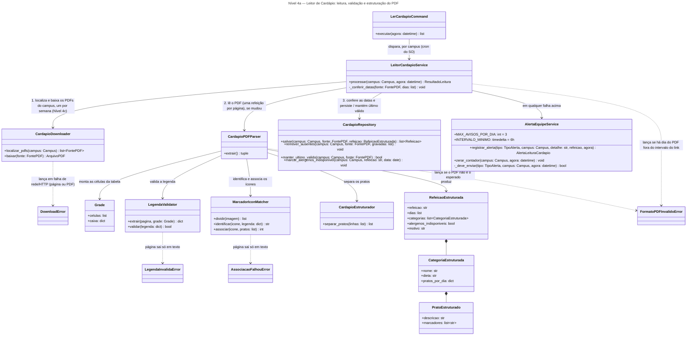
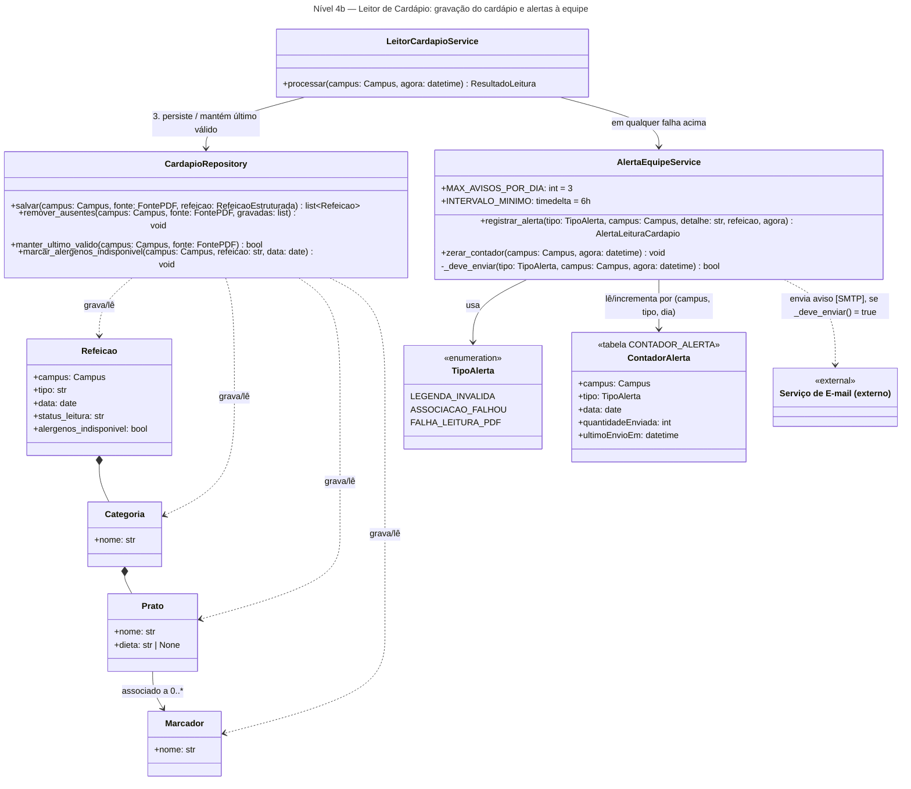
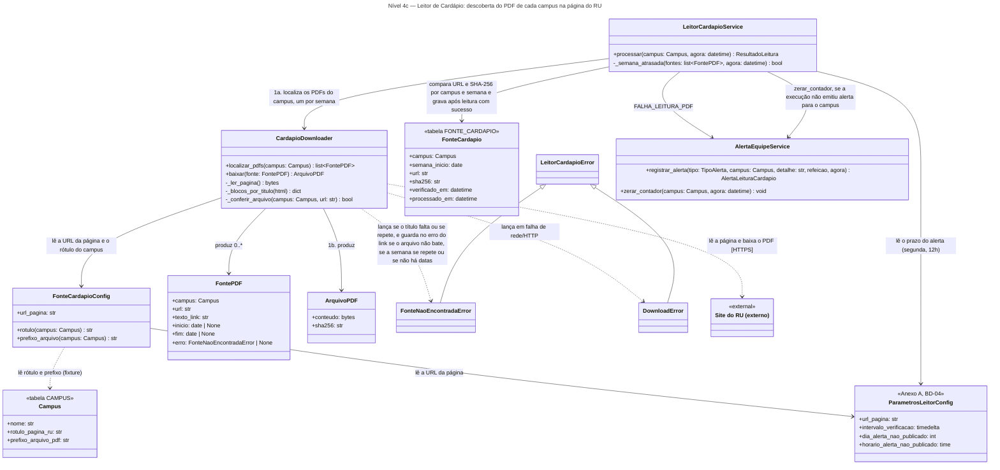

# Arquitetura C4 — Nível 4 (Leitor de Cardápio) — Bandejão

> Detalha, em diagrama de classes, o componente **Leitor de Cardápio**,
> desenhado no Nível 3 do backend dentro da fronteira do App Cardápio (ver
> `c4-nivel-3-backend.md`). Cobre a parte de leitura do Épico Cardápio
> (RF06).
>
> Referências: ADR 0003 — *Leitor de PDF como módulo do backend*
> (`docs/arquitetura/adr/0003-leitor-pdf-como-modulo-do-backend.md`), que
> define o módulo dentro do backend e o disparo por cron do SO, ADR 0006 —
> *Alerta de falha do leitor por e-mail*
> (`docs/arquitetura/adr/0006-alerta-de-falha-do-leitor-por-email.md`), e ADR
> 0014 — *Descoberta do PDF de cada campus na página de cardápios do RU*
> (`docs/arquitetura/adr/0014-descoberta-do-pdf-de-cada-campus.md`). A
> biblioteca de leitura de PDF é o `pdfplumber`, escolhido no teste com os
> PDFs reais do BE-04 (`docs/arquitetura/backend/teste-leitor-pdf-be-04.md`).

Há três diagramas: **4a** leitura do PDF, **4b** gravação e alertas e **4c** descoberta do PDF de cada campus na página do RU. Cada diagrama tem no máximo 20 elementos e um título próprio, seguindo a skill c4-architecture usada pelo grupo; classes compartilhadas (como `Conta` ou as configurações) aparecem em mais de um diagrama.

## Nível 4a — Leitura do PDF

### Notas do diagrama (4a)

- **`LeitorCardapioService` é o orquestrador único**, chamado pelo comando
  de management do Django (`LerCardapioCommand`) que o cron do SO dispara —
  o cron em si segue fora do diagrama, como já registrado no Nível 2. Um
  orquestrador central facilita isolar, em testes, cada etapa (download,
  parsing, validação, associação, estruturação, persistência) separadamente,
  o que ajuda a bater as metas de cobertura (≥ 70%) e de mutação (≥ 50%) dos
  módulos críticos (RNF06, ADR 0013).
- **O PDF é processado só quando mudou.** O `CardapioDownloader` acha os
  links do campus na página do RU, um por semana, e baixa cada arquivo
  (Nível 4c). Se a URL e o SHA-256 forem iguais aos da última leitura com
  sucesso daquele campus e daquela semana (`FonteCardapio`), o
  `LeitorCardapioService` para ali, sem ler o PDF nem gravar nada. Leitura
  com sucesso é a que grava a semana, mesmo com alguma refeição só em texto
  (RF06.3). Assim o cron pode rodar de 3 em 3 horas (ADR 0014) sem
  regravar o cardápio, e uma correção feita pelo RU no meio da semana é
  lida na execução seguinte.
- **`_conferir_datas` confere que todos os dias que o `CardapioPDFParser` leu
  no cabeçalho do PDF estão dentro do intervalo do texto do link**
  ("09/11/2026 À 15/11/2026"). Não exige igualdade, porque o PDF traz só os
  dias em que o campus serve refeição (o Gama tem 5 ou 6, RF06.2). Se algum
  dia ficar fora, o PDF é tratado como `FormatoPDFInvalidoError`: o último
  cardápio válido é mantido e a equipe é alertada (ADR 0014).
- **Cinco exceções específicas, uma por tipo de falha**, todas filhas de
  `LeitorCardapioError`: `FonteNaoEncontradaError` (Nível 4c),
  `DownloadError` (BE-12) e `FormatoPDFInvalidoError` mantêm o último
  cardápio válido; `LegendaInvalidaError` e
  `AssociacaoFalhouError` são tratadas pelo `CardapioPDFParser` **por
  página**: a refeição sai só em texto, com `alergenos_indisponiveis` e o
  motivo, e o filtro (RF08) fica desativado só para ela. As três primeiras
  geram alerta `FALHA_LEITURA_PDF`, com uma mensagem que diz qual etapa
  falhou; as duas últimas geram `LEGENDA_INVALIDA` e `ASSOCIACAO_FALHOU`.
  Detalhes no teste do BE-04
  (`teste-leitor-pdf-be-04.md`).
- **Diagrama atualizado no BE-04**: a proposta inicial tinha uma
  `PaginaExtraida` e um `CardapioEstruturador.estruturar()`. Na
  implementação, o `CardapioPDFParser` monta a refeição com a `Grade` e as
  outras classes, e o `MarcadorIconMatcher` associa um ícone por vez.
- **`CardapioEstruturador.separar_pratos` existe como método próprio** porque
  a regra "ou/OU separa pratos; / não separa" (glossário, Termo Prato) é uma
  regra de negócio testável isoladamente, sem precisar de um PDF real —
  boa candidata a teste unitário dedicado.
- **Implementado na BE-12 (21/11/2026).** As classes têm os nomes do
  diagrama e os métodos em snake_case (`localizar_pdfs`, `registrar_alerta`),
  como na Exposição do Cardápio (BE-11). Um módulo por classe em
  `backend/apps/cardapio/leitor/`; o comando `ler_cardapio` fica em
  `apps/cardapio/management/commands/`, onde o Django procura. O
  `LerCardapioCommand` lê o relógio uma vez (`timezone.now()`) e passa o
  mesmo `agora` a todos os campi; uma exceção inesperada num campus vira log
  de erro e o laço segue. `processar` devolve um `ResultadoLeitura` (lidas,
  sem mudança, alertas), só para o resumo que o comando escreve no stdout.
  O `CardapioPDFParser` recebe o caminho ou um arquivo em memória
  (`io.BytesIO` com os bytes baixados), sem gravar o PDF em disco.
- **PDFs de novembro (BE-12).** Os 10 PDFs publicados nas semanas de 16/11
  e 23/11 trouxeram três casos novos, registrados no teste do BE-04 (casos
  26 a 28): a data do cabeçalho entre parênteses ("2ª FEIRA (16/11/2026)"),
  ícones quase encostados com um vale fino de tinta entre eles (o corte vai
  para o vale, sem subir o `DISTANCIA_MAX_ICONE`) e a barra no fim da linha
  ("Rosé /" / "Limão" é um prato só, RF06.2). Sem o caso 26, todos os PDFs
  eram recusados.
- **`MarcadorIconMatcher` funciona por posição**, não por texto, porque o
  RF06 é explícito: os ícones dos marcadores são imagens sobrepostas ao
  texto do PDF, fora da camada de texto extraível. Essa é provavelmente a
  classe de maior risco técnico do módulo (L03) e a que mais provavelmente
  muda de implementação dependendo da biblioteca de leitura de PDF adotada.
  No teste do BE-04 com o `pdfplumber`, ela identificou cada ícone
  comparando a imagem com as da legenda e associou todos os ícones dos PDFs
  do Gama, da Ceilândia e do Darcy Ribeiro.

## Nível 4b — Gravação e alertas

### Notas do diagrama (4b)

- **`AlertaEquipeService` limita a no máximo 3 avisos por dia, por
  combinação de campus + tipo de falha**, controlado por `ContadorAlerta`
  (campus, tipo, dia, quantidade já enviada, horário do último envio).
  `_deve_enviar()` também impõe um intervalo mínimo de 6 horas entre avisos
  repetidos da mesma falha, para espalhar os 3 avisos ao longo do dia em vez
  de disparar todos de uma vez se o cron rodar mais de uma vez por dia. O
  contador zera (`zerar_contador`) quando a leitura daquele campus volta a
  funcionar, isto é, quando a execução termina sem nenhum alerta emitido
  para o campus (Nível 4c, ADR 0014), ou, no mais tardar, no dia seguinte —
  assim, uma falha de vários dias seguidos continua gerando pelo menos 1
  aviso por dia, em vez de ficar em silêncio total depois do 3º e-mail.
  Decisão registrada na ADR 0006
  (`docs/arquitetura/adr/0006-alerta-de-falha-do-leitor-por-email.md`), que compara o
  e-mail com log passivo e consulta manual ao banco. O e-mail de destino
  desses avisos é `equipe@bandejaounb.com.br`, configurável por variável de
  ambiente (ADR 0012).
- **Como a BE-12 grava (21/11/2026).**
  - O `CardapioRepository.salvar` grava uma página do PDF: uma `Refeicao`
    por dia, **atualizada** se já existe (campus, data, tipo), nunca apagada
    e recriada, porque `AVALIACAO.refeicao` é `ON DELETE CASCADE`. Só
    `Categoria`, `Prato` e `PratoMarcador` são apagados e gravados de novo,
    na ordem do PDF. A categoria sem prato no dia não é gravada. A refeição
    volta a `ok` a cada leitura; a página só em texto passa depois por
    `marcar_alergenos_indisponivel`.
  - O `LeitorCardapioService` grava a semana inteira (todas as páginas,
    `remover_ausentes` e a `FonteCardapio`) numa transação só: ou entra a
    semana inteira, ou nada.
  - **Decisão P1:** quando o RU corrige o PDF e uma refeição que já estava
    no banco some (ex.: o jantar de sexta), `remover_ausentes` apaga as que
    sumiram, **exceto as que já têm avaliação**: essas ficam, com um
    `logger.warning` (campus, data e tipo). Vale só para a semana do PDF
    relido e só para o campus.
  - **Decisão P2:** `manter_ultimo_valido` não toca nas linhas do banco e
    nunca cria linha `leitura_falhou`. Quando o PDF inteiro falha numa
    semana sem cardápio anterior, não há `FonteCardapio` da semana, a
    Exposição mostra `nao_publicado`, e a falha fica em
    `ALERTA_LEITURA_CARDAPIO` com `refeicao` nula. O status continua no
    enum, mas o Leitor não o grava. O método devolve se havia cardápio
    válido da semana, só para a mensagem do alerta.
  - Página só em texto: **uma** linha de alerta por página (refeição da
    semana), com `refeicao` = a do primeiro dia e os dias na mensagem; o
    tipo (`LEGENDA_INVALIDA` ou `ASSOCIACAO_FALHOU`) vem da exceção que o
    parser guardou no `motivo`.
  - Alertas: o destinatário é `settings.EMAIL_EQUIPE` (variável
    `EMAIL_EQUIPE`, padrão `equipe@bandejaounb.com.br`). O dia do contador
    é o de Brasília (`timezone.localdate(agora)`). O intervalo de 6 h conta
    também o último envio da véspera, e `zerar_contador` apaga só as linhas
    do dia corrente do campus. Uma falha no envio (`SMTPException` ou
    `OSError`, como no cadastro) vai para o log, não derruba a leitura e
    não conta como enviada; a linha do alerta continua gravada.
- **`Refeicao`, `Categoria`, `Prato` e `Marcador` são os models Django do
  app Cardápio** (não deste módulo) — aparecem aqui só como o destino da
  persistência do `CardapioRepository`, para deixar explícito o que o Leitor
  de Cardápio grava, sem redefinir o schema completo do app.
- **`Categoria` e `Prato` seguem o dicionário de dados do Nível 4 do banco**
  (seguido pelos models no PR #108): a dieta fica em `Prato.dieta`, nula nas
  categorias comuns a todas as dietas (RF09), e o texto do prato fica em
  `Prato.nome`. O parser continua devolvendo a dieta por categoria
  (`CategoriaEstruturada.dieta`, Nível 4a) e o texto em
  `PratoEstruturado.descricao`. Ao gravar, o `CardapioRepository` copia a
  dieta da categoria para cada prato dela (ver a seção 6 do teste do BE-04)
  e grava `descricao` em `Prato.nome`. Assim, todos os pratos de uma
  categoria têm a mesma dieta, e a Exposição do Cardápio conta com isso no
  `FiltroDietaService`.
- **`Refeicao.status_leitura` é a coluna `REFEICAO.status_leitura` do banco**
  (`ok`, `alergenos_indisponiveis` ou `leitura_falhou`).
  `CardapioRepository.marcarAlergenosIndisponivel` grava
  `alergenos_indisponiveis`, e `alergenos_indisponivel` é uma propriedade
  derivada do model, verdadeira nesse caso; ela não é coluna. É a mesma
  propriedade lida pela Exposição do Cardápio para desativar o filtro de
  marcadores (RF08). Decisão tomada com o time de banco de dados.
- **Cada alerta é gravado em `ALERTA_LEITURA_CARDAPIO`** por
  `registrar_alerta`, para a equipe tratar (campo `resolvido`, ADR 0004), e o
  limite de e-mails é controlado pela tabela `CONTADOR_ALERTA`, que é o
  `ContadorAlerta` deste diagrama (uma linha por campus, tipo e dia). No
  banco, os valores de `TipoAlerta` ficam em minúsculas:
  `legenda_invalida`, `associacao_falhou` e `falha_leitura_pdf`. Ver o Nível 4
  do banco de dados.

## Nível 4c — Descoberta do PDF de cada campus

### Notas do diagrama (4c)

- **O campus vem do nome no título, nunca da ordem dos blocos.**
  `_blocos_por_titulo` percorre a página e, para cada título "Cardápio
  <rótulo>", guarda todos os links para `.pdf` em
  `ru.unb.br/wp-content/uploads/` que aparecem depois dele e antes do próximo
  título. O resultado é um dicionário rótulo → links, consultado pelo rótulo
  do campus. Cada link vira uma `FontePDF`, identificada pela semana das
  datas do texto do link. Assim a semana vigente e a seguinte (RF18) podem
  estar no mesmo bloco. Dois links para a mesma semana geram
  `FonteNaoEncontradaError` para aquela semana. A posição dos blocos na
  página (hoje Darcy Ribeiro, Ceilândia, Gama, Planaltina e Fazenda Água
  Limpa) não é usada, porque o RU não garante essa ordem (ADR 0014).
- **A comparação dos títulos ignora acentos, maiúsculas e espaços extras.**
  Um título que não corresponde a nenhum campus é ignorado. Um campus sem
  título, ou com o título repetido, gera `FonteNaoEncontradaError`, e o
  Leitor não escolhe um dos links.
- **`_conferir_arquivo` confere o nome do arquivo:** ele precisa começar pelo
  `prefixo_arquivo_pdf` do campus (`Darcy-Ribeiro`, `Ceilandia`, `Gama`,
  `Planaltina`, `Fazenda`), sem considerar os sufixos `-1`, `-2` que o
  WordPress acrescenta quando o RU reenvia o arquivo, e com a mesma regra
  dos títulos: ignora acentos e maiúsculas. Se não bater, também é
  `FonteNaoEncontradaError`: um link colado no bloco errado pelo RU não vira
  o cardápio de outro campus.
- **`FontePDF` guarda as datas do texto do link** ("ISM – 09/11/2026 À
  15/11/2026"). O `inicio` identifica a semana, e o
  `LeitorCardapioService._conferir_datas` confere depois que os dias do PDF
  estão dentro do intervalo (Nível 4a).
- **Semana ainda não publicada não é falha.** Se o link ainda é da semana
  anterior, nada muda e a Exposição do Cardápio mostra "cardápio ainda não
  publicado" (RF07.3). `_semana_atrasada` recebe todos os links com datas
  legíveis achados no bloco do campus, inclusive os reprovados em
  `_conferir_arquivo` ou repetidos para a mesma semana, e devolve verdadeiro só
  quando **nenhum** deles é da
  semana vigente depois do prazo do Anexo A (segunda-feira, 12h, no horário
  de Brasília); aí a equipe recebe um alerta `FALHA_LEITURA_PDF` de cardápio
  não publicado. Se o link da semana vigente existe mas a leitura falha, sai
  só o alerta da falha: a decisão vem da página, e não da existência de
  `FonteCardapio`, que só é criada depois de uma leitura com sucesso. Quando
  a descoberta falha para o campus inteiro (página fora do ar, título
  ausente ou repetido), `_semana_atrasada` não é avaliada, e sai só o alerta
  dessa falha.
- **O contador de alertas só zera sem nenhum alerta no campus.** O
  `LeitorCardapioService` só chama `AlertaEquipeService.zerarContador`
  quando a execução termina sem nenhum alerta emitido para o campus: de
  qualquer tipo (inclusive `LEGENDA_INVALIDA` e `ASSOCIACAO_FALHOU`), em
  qualquer semana, e inclusive o de cardápio não publicado. A leitura com
  sucesso da semana seguinte (RF18) não zera a contagem de uma falha da
  semana vigente, e uma execução em que a semana vigente nem aparece na
  página não zera a contagem do "não publicado". Assim o limite de 3 avisos
  por dia é respeitado (ADR 0006, ADR 0014).
- **`FonteCardapioConfig` segue o padrão de `LocalizacaoRUConfig`** (Fila):
  o rótulo e o prefixo de cada campus vêm das colunas de `CAMPUS`, povoadas
  por fixture. Se o RU renomear um título, o ajuste é na fixture, sem mudar
  o código.
- **Duas configurações, sem sobreposição (BD-04).**
  `ParametrosLeitorConfig`, em `backend/config/parametros.py`, guarda os
  parâmetros do Anexo A comuns a todos os campi e não lê `CAMPUS`. A
  `FonteCardapioConfig`, no módulo do Leitor, é a única que lê `CAMPUS`, e
  sua `url_pagina` só repassa `ParametrosLeitorConfig().url_pagina`, que lê
  `settings.URL_PAGINA_CARDAPIO` a cada acesso (propriedade de instância,
  com os parênteses). O `LeitorCardapioService` lê de
  `ParametrosLeitorConfig` o prazo usado por `_semana_atrasada`
  (`dia_alerta_nao_publicado` e `horario_alerta_nao_publicado`); o
  `intervalo_verificacao` (3 horas) é a periodicidade do cron do SO, que fica
  fora do diagrama (BD-07). Assim, a URL
  e o prazo ficam num lugar só, e o que é de cada campus fica no banco.
- **As classes do Leitor entraram na BE-12** (21/11/2026), com as
  assinaturas do diagrama. Aqui não vale a convenção do Cadastro 4c (cheia
  já existe, tracejada é previsto), que é só das setas para a
  `ParametrosCadastroConfig`.
- **Como a descoberta ficou no código (BE-12).**
  - Só elementos de cabeçalho (`h1` a `h6`) contam como título: o menu da
    página tem "Cardápio Darcy Ribeiro" duas vezes, em links, e daria
    título repetido. Qualquer cabeçalho encerra o bloco anterior; o que não
    é "Cardápio <rótulo>" não abre bloco (ex.: "Últimas Notícias", depois
    do último campus).
  - Só entram links `https` com host exatamente `ru.unb.br`, caminho em
    `/wp-content/uploads/` e terminados em `.pdf`; depois do último bloco
    há PDFs de `unb.br` e `unity.unb.br`. Links relativos são resolvidos
    pela URL da página.
  - As datas do texto do link são lidas depois de tirar acentos e
    maiúsculas: aceitam "À", "a", "até", hífen, meia-risca e travessão
    entre elas, e precisam estar em ordem.
  - O prefixo do arquivo é comparado seguido de "-" (`Gama` não aceita
    `Gamaxyz-…`), ou o nome é só o prefixo. Os dois PDFs da Fazenda
    (`Fazenda-Semana-…` e `Fazenda-Agua-Limpa-Semana-…`) passam.
  - Os problemas de um link só (arquivo de outro campus, semana repetida,
    datas ilegíveis) ficam no campo `erro` da `FontePDF` daquele link, em
    vez de uma exceção: assim o `LeitorCardapioService` alerta aquele link,
    não o baixa, e ainda conta a semana dele no `_semana_atrasada`. O
    título ausente ou repetido continua lançando `FonteNaoEncontradaError`
    para o campus inteiro.
  - Página fora do ar ou HTTP diferente de 200 na página é `DownloadError`
    (ADR 0014), tratado pelo serviço como falha do campus inteiro, igual ao
    título ausente: alerta, nenhum link baixado e sem "não publicado".
  - A página é lida uma vez por execução (o comando cria um
    `CardapioDownloader` só, que guarda a página ou a falha dela), e não uma
    vez por campus.
  - As requisições levam `User-Agent` `BandejaoUnB/1.0
    (+https://bandejaounb.com.br)`, tempo limite de 30 s, nenhuma repetição
    e não seguem redirecionamento (um redirecionamento vira falha visível).
    O `baixar` confere que a resposta começa com `%PDF`; senão,
    `FormatoPDFInvalidoError`.
  - `verificado_em` anda em toda execução que acha o link (válido) da
    semana, mesmo que o download ou a leitura falhem depois.
  - A semana vigente é a que contém o dia de hoje (no horário de Brasília):
    um link é dela se `inicio <= hoje <= fim`. O domingo pertence à semana
    da segunda anterior. O prazo vale a partir de segunda, 12h00.
- **`FonteCardapio` é a tabela `FONTE_CARDAPIO`**, com uma linha por campus
  e semana, criada na primeira leitura com sucesso daquela semana. Depois
  disso, `verificado_em` é atualizado a cada execução que acha o link, e
  `url`, `sha256` e `processado_em` só a cada nova leitura com sucesso, para
  que um PDF com falha seja tentado de novo na execução seguinte. Uma semana
  que nunca foi lida com sucesso não tem linha. Ver o Nível 4 do banco de
  dados.
- **A biblioteca de HTML é o `beautifulsoup4`**, com o `requests` para as
  requisições HTTPS. As requisições levam `User-Agent` do projeto e tempo
  limite.

## Notas gerais

- Este diagrama é uma **proposta de decomposição interna**, não uma
  decisão de arquitetura registrada — se a dupla responsável pela leitura do
  PDF adotar um desenho de classes diferente ao implementar, vale atualizar
  este arquivo (ou registrar o desenho final como ADR, se a mudança for
  relevante o suficiente).
