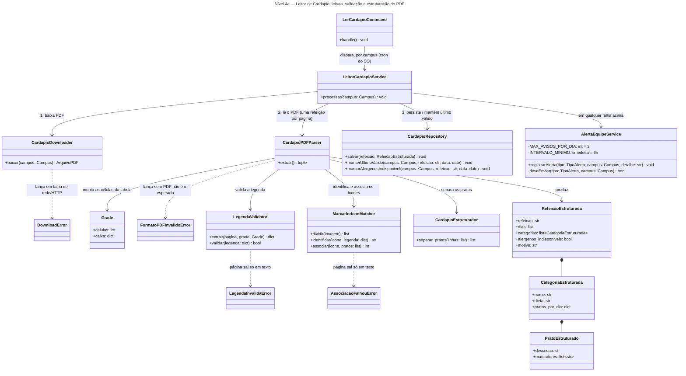

# Arquitetura C4 — Nível 4 (Leitor de Cardápio) — Bandejão

> Detalha, em diagrama de classes, o componente **Leitor de Cardápio**,
> desenhado no Nível 3 do backend dentro da fronteira do App Cardápio (ver
> `c4-nivel-3-backend.md`). Cobre a parte de leitura do Épico Cardápio
> (RF06).
>
> Referências: ADR 0003 — *Leitor de PDF como módulo do backend*
> (`docs/arquitetura/adr/0003-leitor-pdf-como-modulo-do-backend.md`), que
> define o módulo dentro do backend e o disparo por cron do SO, e ADR 0006 —
> *Alerta de falha do leitor por e-mail*
> (`docs/arquitetura/adr/0006-alerta-de-falha-do-leitor-por-email.md`). A
> biblioteca de leitura de PDF é o `pdfplumber`, escolhido no teste com os
> PDFs reais do BE-04 (`docs/arquitetura/backend/teste-leitor-pdf-be-04.md`).

Há dois diagramas: **4a** leitura do PDF e **4b** gravação e alertas. Cada diagrama tem no máximo 20 elementos e um título próprio, seguindo a skill c4-architecture usada pelo grupo; classes compartilhadas (como `Conta` ou as configurações) aparecem em mais de um diagrama.

## Nível 4a — Leitura do PDF

### Notas do diagrama (4a)

- **`LeitorCardapioService` é o orquestrador único**, chamado pelo comando
  de management do Django (`LerCardapioCommand`) que o cron do SO dispara —
  o cron em si segue fora do diagrama, como já registrado no Nível 2. Um
  orquestrador central facilita isolar, em testes, cada etapa (download,
  parsing, validação, associação, estruturação, persistência) separadamente,
  o que ajuda a bater as metas de cobertura (≥ 70%) e de mutação (≥ 50%) dos
  módulos críticos (RNF06, ADR 0013).
- **Quatro exceções específicas, uma por tipo de falha**, todas filhas de
  `LeitorCardapioError`: `DownloadError` (BE-12) e `FormatoPDFInvalidoError`
  mantêm o último cardápio válido; `LegendaInvalidaError` e
  `AssociacaoFalhouError` são tratadas pelo `CardapioPDFParser` **por
  página**: a refeição sai só em texto, com `alergenos_indisponiveis` e o
  motivo, e o filtro (RF08) fica desativado só para ela. Cada uma gera um
  alerta de tipo diferente para a equipe. Detalhes no teste do BE-04
  (`teste-leitor-pdf-be-04.md`).
- **Diagrama atualizado no BE-04**: a proposta inicial tinha uma
  `PaginaExtraida` e um `CardapioEstruturador.estruturar()`. Na
  implementação, o `CardapioPDFParser` monta a refeição com a `Grade` e as
  outras classes, e o `MarcadorIconMatcher` associa um ícone por vez.
- **`CardapioEstruturador.separar_pratos` existe como método próprio** porque
  a regra "ou/OU separa pratos; / não separa" (glossário, Termo Prato) é uma
  regra de negócio testável isoladamente, sem precisar de um PDF real —
  boa candidata a teste unitário dedicado.
- **`MarcadorIconMatcher` funciona por posição**, não por texto, porque o
  RF06 é explícito: os ícones dos marcadores são imagens sobrepostas ao
  texto do PDF, fora da camada de texto extraível. Essa é provavelmente a
  classe de maior risco técnico do módulo (L03) e a que mais provavelmente
  muda de implementação dependendo da biblioteca de leitura de PDF adotada.
  No teste do BE-04 com o `pdfplumber`, ela identificou cada ícone
  comparando a imagem com as da legenda e associou todos os ícones dos PDFs
  do Gama, da Ceilândia e do Darcy Ribeiro.

## Nível 4b — Gravação e alertas

### Notas do diagrama (4b)

- **`AlertaEquipeService` limita a no máximo 3 avisos por dia, por
  combinação de campus + tipo de falha**, controlado por `ContadorAlerta`
  (campus, tipo, dia, quantidade já enviada, horário do último envio).
  `deveEnviar()` também impõe um intervalo mínimo de 6 horas entre avisos
  repetidos da mesma falha, para espalhar os 3 avisos ao longo do dia em vez
  de disparar todos de uma vez se o cron rodar mais de uma vez por dia. O
  contador zera quando a leitura daquele campus volta a funcionar (ou, no
  mais tardar, no dia seguinte) — assim, uma falha de vários dias seguidos
  continua gerando pelo menos 1 aviso por dia, em vez de ficar em silêncio
  total depois do 3º e-mail. Decisão registrada na ADR 0006
  (`docs/arquitetura/adr/0006-alerta-de-falha-do-leitor-por-email.md`), que compara o
  e-mail com log passivo e consulta manual ao banco. O e-mail de destino
  desses avisos é `equipe@bandejaounb.com.br`, configurável por variável de
  ambiente (ADR 0012).
- **`Refeicao`, `Categoria`, `Prato` e `Marcador` são os models Django do
  app Cardápio** (não deste módulo) — aparecem aqui só como o destino da
  persistência do `CardapioRepository`, para deixar explícito o que o Leitor
  de Cardápio grava, sem redefinir o schema completo do app.
- **`Categoria` e `Prato` seguem o dicionário de dados do Nível 4 do banco**
  (seguido pelos models no PR #108): a dieta fica em `Prato.dieta`, nula nas
  categorias comuns a todas as dietas (RF09), e o texto do prato fica em
  `Prato.nome`. O parser continua devolvendo a dieta por categoria
  (`CategoriaEstruturada.dieta`, Nível 4a) e o texto em
  `PratoEstruturado.descricao`. Ao gravar, o `CardapioRepository` copia a
  dieta da categoria para cada prato dela (ver a seção 6 do teste do BE-04)
  e grava `descricao` em `Prato.nome`. Assim, todos os pratos de uma
  categoria têm a mesma dieta, e a Exposição do Cardápio conta com isso no
  `FiltroDietaService`.
- **`Refeicao.statusLeitura` é a coluna `REFEICAO.status_leitura` do banco**
  (`ok`, `alergenos_indisponiveis` ou `leitura_falhou`).
  `CardapioRepository.marcarAlergenosIndisponivel` grava
  `alergenos_indisponiveis`, e `alergenosIndisponivel()` é uma propriedade
  derivada do model, verdadeira nesse caso; ela não é coluna. É a mesma
  propriedade lida pela Exposição do Cardápio para desativar o filtro de
  marcadores (RF08). Decisão tomada com o time de banco de dados.
- **Cada alerta é gravado em `ALERTA_LEITURA_CARDAPIO`** por
  `registrarAlerta`, para a equipe tratar (campo `resolvido`, ADR 0004), e o
  limite de e-mails é controlado pela tabela `CONTADOR_ALERTA`, que é o
  `ContadorAlerta` deste diagrama (uma linha por campus, tipo e dia). No
  banco, os valores de `TipoAlerta` ficam em minúsculas:
  `legenda_invalida`, `associacao_falhou` e `falha_leitura_pdf`. Ver o Nível 4
  do banco de dados.

## Notas gerais

- Este diagrama é uma **proposta de decomposição interna**, não uma
  decisão de arquitetura registrada — se a dupla responsável pela leitura do
  PDF adotar um desenho de classes diferente ao implementar, vale atualizar
  este arquivo (ou registrar o desenho final como ADR, se a mudança for
  relevante o suficiente).
