# Arquitetura C4 — Nível 4 — Banco de Dados — Bandejão

> Fontes: `docs/requisitos/CONTEXT-DOMINIO.md` (glossário do domínio),
> Documento de Requisitos de Software (RF01–RF33, RN01–RN13, RNF01–RNF09,
> RI01–RI12, Anexo A) e ADRs 0001 a 0011 (`docs/arquitetura/adr/`). Nomes de
> entidades seguem o vocabulário canônico do glossário — não os nomes usados
> no rascunho da issue (#32): "Cardápio" não existe como entidade única, pois
> o glossário já decompõe esse conceito em Refeição → Categoria → Prato;
> "Relato" foi mapeado para `AlertaLeituraCardapio`, a estrutura que registra
> os alertas de leitura de PDF previstos em RF06.
>
> Este documento segue a skill c4-architecture (título em cada diagrama, até
> 20 entidades por diagrama), e os nomes de tabelas e colunas correspondem aos
> models dos Níveis 4 do backend (`docs/arquitetura/backend/`).
>
> O Nível 3 (entidades e relacionamentos) está em
> [`C4-nivel-3-banco-de-dados-bandejao.md`](C4-nivel-3-banco-de-dados-bandejao.md).

---

## Nível 4 — Diagrama Entidade-Relacionamento completo

```mermaid
---
title: "Nível 4 — Banco de Dados: diagrama entidade-relacionamento completo"
---
erDiagram
    USUARIO {
        int id PK
        string tipo_usuario "estudante | professor_servidor"
        string matricula_siape UK "9 digitos (estudante) ou 7 (professor/servidor); privado, nunca exposto (RI10)"
        string apelido "3-20 chars, sem espaco; unicidade via apelido_normalizado"
        string apelido_normalizado UK "sem acentos e minusculas; unicidade identica entre engines"
        string email_institucional UK
        string senha_hash "hash, nunca texto plano (RI04/RNF04)"
        boolean email_confirmado "default false"
        string status "pendente | ativo | suspenso | removido"
        datetime aceite_privacidade_em
        string versao_aviso_aceita "versão do aviso de privacidade aceita; antiga nas contas anteriores à Release 2"
        datetime criado_em
        int tentativas_login_falhas "default 0"
        datetime bloqueado_ate "nullable"
        datetime removido_em "nullable"
    }

    CAMPUS {
        int id PK
        string nome UK "Darcy Ribeiro | Ceilandia | Gama | Planaltina | Fazenda Agua Limpa"
        decimal ru_latitude
        decimal ru_longitude
        int raio_confirmacao_metros "confirmação do check-in (RF12)"
        decimal centro_latitude
        decimal centro_longitude
        int raio_deteccao_metros "detecção do campus no aparelho (ADR 0009)"
    }

    REFEICAO {
        int id PK
        int campus_id FK
        date data
        string tipo "cafe | almoco | jantar"
        time horario_inicio "copiado do Anexo A no momento da leitura"
        time horario_fim
        string status_leitura "ok | alergenos_indisponiveis | leitura_falhou"
        string fonte_pdf_url
        datetime lida_em
    }

    CATEGORIA {
        int id PK
        int refeicao_id FK
        string nome "texto extraido do PDF"
        int ordem
    }

    PRATO {
        int id PK
        int categoria_id FK
        string nome
        string dieta "nullable: padrao | ovolacto | vegetariano_estrito"
        int ordem
    }

    MARCADOR {
        int id PK
        string nome UK "10 valores fixos (RF06)"
    }

    PRATO_MARCADOR {
        int prato_id PK, FK
        int marcador_id PK, FK
    }

    AVALIACAO {
        int id PK
        int usuario_id FK "nullable; anulado so em exclusao fisica (RNF07)"
        int refeicao_id FK
        smallint nota "1 a 5, CHECK"
        string comentario "nullable, max 500 chars"
        datetime criada_em
        datetime editada_em "nullable; editavel ate 23h59 do mesmo dia (RF15)"
        datetime pontos_concedidos_em "nullable; marcador de pontos (ADR 0011)"
    }

    CHECKIN {
        int id PK
        int usuario_id FK "nullable; vazio após 4 semanas (RNF07.3)"
        int campus_id FK
        string tipo_refeicao "cafe | almoco | jantar"
        date data
        datetime registrado_em "nullable; apagado na retenção"
        time faixa_inicio "início da faixa de 15 min"
        decimal tempo_espera_min "nullable; 1 casa decimal; gravado pela resposta de saída (RN07)"
        datetime pontos_concedidos_em "nullable; marcador de pontos (ADR 0011)"
    }

    TENTATIVA_CHECKIN {
        int id PK
        int usuario_id FK "nullable; vazio após 4 semanas (RNF07.3)"
        int campus_id FK
        string tipo_refeicao "cafe | almoco | jantar"
        date data
        datetime data_hora "nullable; apagado na retenção"
        string resultado "confirmado | rejeitado"
        string motivo "nullable: fora_do_horario | checkin_duplicado | localizacao_nao_confirmada"
    }

    PERGUNTA_SAIDA {
        int id PK
        int checkin_id FK,UK "uma pergunta por check-in"
        string estado "pendente | respondida | dispensada"
        smallint tentativa "1 ou 2"
        datetime devida_em
        datetime expira_em
        datetime pontos_concedidos_em "nullable; marcador de pontos"
    }

    RESPOSTA_SAIDA {
        int id PK
        int pergunta_id FK
        smallint tentativa
        string resposta "sai_ate_5_min | sai_5_a_10_min | sai_mais_de_10_min | ainda_na_fila | desisti"
        datetime respondida_em "hora do servidor"
    }

    PONTUACAO_USUARIO {
        int id PK
        int usuario_id FK,UK
        int pontos_totais "CHECK >= 0"
        int sequencia_atual "CHECK >= 0"
        date ultima_semana_completada "nullable; segunda-feira da semana"
        boolean participa_ranking "default false"
        datetime atualizado_em
    }

    PONTOS_SEMESTRE_CAMPUS {
        int id PK
        int usuario_id FK
        int campus_id FK
        string semestre_referencia "ex.: 2026.2"
        int pontos "CHECK >= 0"
        int posicao_final "nullable; preenchida no fechamento"
        datetime atualizado_em "desempate do ranking"
    }

    ALERTA_LEITURA_CARDAPIO {
        int id PK
        int campus_id FK
        int refeicao_id FK "nullable: alerta pode preceder criacao da refeicao"
        string tipo "icone_desconhecido | leitura_falhou | alergenos_indisponiveis"
        string mensagem
        datetime ocorrido_em
        boolean resolvido "default false"
        datetime resolvido_em "nullable"
    }

    TOKEN {
        int id PK
        int usuario_id FK
        string tipo "confirmacao_email | redefinicao_senha"
        string token_hash UK "sha-256 do token enviado por e-mail"
        datetime criado_em
        datetime expira_em
        datetime usado_em "nullable"
    }

    USUARIO |o--o{ AVALIACAO : escreve
    USUARIO |o--o{ CHECKIN : registra
    USUARIO |o--o{ TENTATIVA_CHECKIN : tenta
    USUARIO ||--o{ TOKEN : recebe
    USUARIO ||--|| PONTUACAO_USUARIO : acumula
    USUARIO ||--o{ PONTOS_SEMESTRE_CAMPUS : pontua_no_semestre
    CAMPUS ||--o{ REFEICAO : oferece
    CAMPUS ||--o{ CHECKIN : recebe
    CAMPUS ||--o{ TENTATIVA_CHECKIN : recebe
    CAMPUS ||--o{ PONTOS_SEMESTRE_CAMPUS : classifica
    CAMPUS ||--o{ ALERTA_LEITURA_CARDAPIO : gera
    REFEICAO ||--o{ CATEGORIA : contem
    REFEICAO ||--o{ AVALIACAO : recebe
    REFEICAO |o--o{ ALERTA_LEITURA_CARDAPIO : relaciona-se_a
    CATEGORIA ||--o{ PRATO : contem
    PRATO ||--o{ PRATO_MARCADOR : tem
    MARCADOR ||--o{ PRATO_MARCADOR : classifica
    CHECKIN ||--o| PERGUNTA_SAIDA : gera
    PERGUNTA_SAIDA ||--o{ RESPOSTA_SAIDA : recebe
```

---

## Dicionário de dados

Tipos expressos como tipo lógico do Django (portátil entre SQLite e MySQL,
ver [Estratégia de migração](#estratégia-de-migração-sqlite--mysql)), não como
tipo físico de um banco específico.

Todos os `id` são **`BigAutoField`**, o padrão do Django
(`DEFAULT_AUTO_FIELD`, decisão 3); as chaves estrangeiras seguem o mesmo tipo.

### `USUARIO`

Conta de acesso ao aplicativo (não a pessoa; glossário: "Usuário").

| Campo | Tipo | Constraints | Descrição |
|---|---|---|---|
| `id` | BigAutoField | PK | Identificador interno da conta. |
| `tipo_usuario` | CharField(20) | NOT NULL, choices | `estudante` ou `professor_servidor` (ADR 0002; "Professor" e "Servidor" da tela de cadastro colapsam neste único valor). |
| `matricula_siape` | CharField(9) | NOT NULL, **UNIQUE**, index | 9 dígitos (estudante, extraída do e-mail) ou 7 dígitos (professor/servidor, digitada). Dado privado (RI10, RNF07): nunca retornado em resposta de API pública. |
| `apelido` | CharField(20) | NOT NULL, 3–20 chars, sem espaço | Nome público exibido nas avaliações. Definido uma única vez no cadastro (RF01); imutável depois. |
| `apelido_normalizado` | CharField(20) | NOT NULL, **UNIQUE** | `apelido` sem acentos e em minúsculas, gerado na gravação. Garante a unicidade sem distinção de maiúsculas/minúsculas (RF01) e de acentos, de forma idêntica em SQLite e MySQL (ver seção de migração). |
| `email_institucional` | EmailField | NOT NULL, **UNIQUE** | `matricula@aluno.unb.br` (estudante) ou `nome@unb.br` (professor/servidor). Único canal de confirmação e recuperação (RF02, RF04, L07). |
| `senha_hash` | CharField(128) | NOT NULL | Hash da senha (Django `PBKDF2`/`Argon2`); nunca texto plano (RI04, RNF04). |
| `email_confirmado` | BooleanField | NOT NULL, default `false` | Conta só autentica com `true` (RF02, RF03). |
| `status` | CharField(20) | NOT NULL, choices, default `pendente` | `pendente` \| `ativo` \| `suspenso` \| `removido` (RNF08 — moderação manual da equipe). |
| `aceite_privacidade_em` | DateTimeField | NOT NULL | Momento em que a pessoa confirmou ciência do aviso de privacidade (RF01); cadastro não se conclui sem isso. Atualizado também quando a pessoa aceita o aviso da Release 2. |
| `versao_aviso_aceita` | CharField(20) | NOT NULL | Versão do aviso de privacidade aceita. Quem tinha conta antes da Release 2 fica com a versão antiga, o que bloqueia o primeiro check-in até a ciência (RF11, RNF07.1). |
| `criado_em` | DateTimeField | NOT NULL, auto | Data do cadastro. |
| `tentativas_login_falhas` | IntegerField | NOT NULL, default `0` | Contador para o bloqueio de login (RF03, Anexo A: 5 tentativas/10 min). Zerado a cada login bem-sucedido ou a cada nova janela de 10 min. |
| `bloqueado_ate` | DateTimeField | nullable | Fim do bloqueio de 10 minutos (RF03), quando aplicável. |
| `removido_em` | DateTimeField | nullable | Preenchido pelo `RemoverContaCommand` quando a equipe processa uma exclusão de conta (RNF07); a linha de `USUARIO` **não é apagada**. A partir daqui as avaliações do usuário passam a ser exibidas como "usuário removido" (ver `AVALIACAO.usuario_id`). |

### `CAMPUS`

Um dos 5 campi com RU; tabela de apoio povoada por fixture.

| Campo | Tipo | Constraints | Descrição |
|---|---|---|---|
| `id` | BigAutoField | PK | Identificador interno do registro. |
| `nome` | CharField(50) | NOT NULL, **UNIQUE** | Um dos 5 campi com RU (glossário): Darcy Ribeiro, Ceilândia, Gama, Planaltina, Fazenda Água Limpa. Povoado por fixture; não é criado pelo usuário. |
| `ru_latitude` / `ru_longitude` | DecimalField | NOT NULL, fixture (Anexo A) | Coordenadas do RU, usadas apenas na conferência de GPS do check-in (RF12). O raio do Darcy Ribeiro deve excluir o Restaurante Executivo. |
| `raio_confirmacao_metros` | IntegerField | NOT NULL, fixture (Anexo A) | Raio de confirmação do check-in por GPS (RF12), medido a partir do RU. As colunas `ru_*` e este raio são lidos pela `LocalizacaoRUConfig` da Fila. |
| `centro_latitude` / `centro_longitude` | DecimalField | NOT NULL, fixture (Anexo A) | Centro do campus, usado na detecção do campus no aparelho (ADR 0009). Publicado em `GET /api/campi/` e lido pela `LocalizacaoCampusConfig` da Exposição do Cardápio. |
| `raio_deteccao_metros` | IntegerField | NOT NULL, fixture (Anexo A) | Raio de detecção do campus no aparelho (ADR 0009); diferente do raio de confirmação do check-in. Publicado em `GET /api/campi/` junto com as colunas `centro_*`. |

### `REFEICAO`

Refeição de um tipo, em um campus e um dia, lida do PDF do cardápio (RF06, RF07).

| Campo | Tipo | Constraints | Descrição |
|---|---|---|---|
| `id` | BigAutoField | PK | Identificador interno do registro. |
| `campus_id` | ForeignKey → `CAMPUS` | NOT NULL, `ON DELETE PROTECT` | Campus que serve a refeição. |
| `data` | DateField | NOT NULL | Dia do serviço, conforme datas do PDF (RF07). |
| `tipo` | CharField(10) | NOT NULL, choices | `cafe` \| `almoco` \| `jantar`. |
| `horario_inicio` / `horario_fim` | TimeField | NOT NULL | Copiados do parâmetro configurável (Anexo A) no momento da leitura do PDF; usados para liberar a avaliação (RF15) apenas durante a janela. O check-in (RF11) usa o mesmo horário do Anexo A, sem depender desta linha. |
| `status_leitura` | CharField(30) | NOT NULL, choices, default `ok` | `ok` \| `alergenos_indisponiveis` (RF06: ícone desconhecido ou associação falhou) \| `leitura_falhou` (RF06: se já existe cardápio lido com sucesso, ele é mantido e a linha não é sobrescrita — a falha fica só em `ALERTA_LEITURA_CARDAPIO`; este status só aparece numa linha criada quando não havia cardápio anterior). |
| `fonte_pdf_url` | URLField | NOT NULL | PDF de origem, para rastreabilidade da leitura (RF06). |
| `lida_em` | DateTimeField | NOT NULL, auto | Quando a leitura automatizada gravou/atualizou esta refeição. |
| — | — | **UNIQUE** (`campus_id`, `data`, `tipo`) | Não existem duas refeições do mesmo tipo, no mesmo campus, no mesmo dia. |

### `CATEGORIA`

Grupo de pratos de uma refeição, na ordem do PDF (RF07).

| Campo | Tipo | Constraints | Descrição |
|---|---|---|---|
| `id` | BigAutoField | PK | Identificador interno do registro. |
| `refeicao_id` | ForeignKey → `REFEICAO` | NOT NULL, `ON DELETE CASCADE` | Refeição a que a categoria pertence. |
| `nome` | CharField(100) | NOT NULL | Texto extraído do PDF (ex.: "Bebidas", "Guarnição", "Sopa", "Prato principal ovolactovegetariano"). |
| `ordem` | IntegerField | NOT NULL | Posição de exibição, refletindo a ordem do PDF (RF07: "lista hierarquizada"). |

### `PRATO`

Opção de uma categoria, usada para exibição e filtros; nunca avaliada isoladamente (RF08, RF09, RF15).

| Campo | Tipo | Constraints | Descrição |
|---|---|---|---|
| `id` | BigAutoField | PK | Identificador interno do registro. |
| `categoria_id` | ForeignKey → `CATEGORIA` | NOT NULL, `ON DELETE CASCADE` | Categoria a que o prato pertence. |
| `nome` | CharField(200) | NOT NULL | Uma opção dentro da categoria; "ou/OU" separa pratos distintos, "/" não separa (glossário). |
| `dieta` | CharField(20) | nullable, choices | `padrao` \| `ovolacto` \| `vegetariano_estrito`, preenchido só quando a categoria é uma linha de prato principal (almoço/jantar) ou de complemento (café da manhã); `NULL` para categorias comuns a todas as dietas (saladas, guarnição, sopa etc. — RF09). |
| `ordem` | IntegerField | NOT NULL | Posição dentro da categoria. |

### `MARCADOR`

Tabela de apoio com os 10 marcadores fixos do cardápio (RF06).

| Campo | Tipo | Constraints | Descrição |
|---|---|---|---|
| `id` | BigAutoField | PK | Identificador interno do registro. |
| `nome` | CharField(30) | NOT NULL, **UNIQUE** | Um dos 10 valores fixos do glossário: cogumelo, leite_e_derivados, mel, pimenta, soja, trigo_gluten, amendoim, oleaginosa, ovo, suino. Povoado por fixture/migration de dados; RF06 valida que a legenda do PDF contém exatamente estes 10. |

### `PRATO_MARCADOR` (associativa)

Associação entre prato e marcador (muitos para muitos). PK composta exige Django 5.2+ (`CompositePrimaryKey`); em versões anteriores o `ManyToManyField` gera `id` próprio + `UNIQUE (prato_id, marcador_id)`.

| Campo | Tipo | Constraints | Descrição |
|---|---|---|---|
| `prato_id` | ForeignKey → `PRATO` | PK composta, `ON DELETE CASCADE` | Prato que recebe o marcador. |
| `marcador_id` | ForeignKey → `MARCADOR` | PK composta, `ON DELETE PROTECT` | Marcadores não são removidos enquanto houver prato associado. |

### `AVALIACAO`

Nota e comentário de uma conta sobre uma refeição inteira (RF15).

| Campo | Tipo | Constraints | Descrição |
|---|---|---|---|
| `id` | BigAutoField | PK | Identificador interno do registro. |
| `usuario_id` | ForeignKey → `USUARIO` | **nullable**, `ON DELETE SET NULL` | Ao excluir a conta, a avaliação permanece, mas passa a ser exibida como "usuário removido" (RNF07), em vez de ser apagada. O `SET NULL` só vale para exclusão física, que não é usada: na exclusão de conta a linha de `USUARIO` fica com `status = removido`, e a avaliação mantém o vínculo (RNF08). |
| `refeicao_id` | ForeignKey → `REFEICAO` | NOT NULL, `ON DELETE CASCADE` | A avaliação é da refeição inteira (campus + dia + tipo), nunca de um prato (RF15). |
| `nota` | SmallIntegerField | NOT NULL, **CHECK** `1 <= nota <= 5` | Obrigatória (RF15). |
| `comentario` | TextField | nullable, **CHECK** `CHAR_LENGTH(comentario) <= 500` (via `Length` do Django) | Opcional (RF15); sanitizado contra XSS na camada de aplicação (RNF04). |
| `criada_em` | DateTimeField | NOT NULL, auto | Data e hora em que a avaliação foi criada. |
| `editada_em` | DateTimeField | nullable | Preenchido a cada edição; a janela de edição (até 23h59 do mesmo dia) é validada na aplicação, não no banco. |
| `pontos_concedidos_em` | DateTimeField | nullable | Marcador de "pontos já concedidos", preenchido pela Gamificação na primeira vez que a avaliação pontua (ADR 0011, decisão 4). |
| — | — | **UNIQUE** (`usuario_id`, `refeicao_id`) | No máximo uma avaliação por usuário por refeição (RF15); uma segunda tentativa é tratada como `UPDATE`, não `INSERT`. |

### `CHECKIN` (Release 2)

Guarda só os check-ins **confirmados**; as tentativas, inclusive as rejeitadas,
ficam em `TENTATIVA_CHECKIN` (decisão 2). Não há FK para `REFEICAO`: o check-in
aponta para a refeição por campus + tipo de refeição + data, para a fila
funcionar mesmo se a leitura do PDF falhar. **Dado pessoal (RNF07)** enquanto
estiver ligado à conta.

| Campo | Tipo | Constraints | Descrição |
|---|---|---|---|
| `id` | BigAutoField | PK | Identificador interno do registro. |
| `usuario_id` | ForeignKey → `USUARIO` | **nullable**, `ON DELETE SET NULL` | O vínculo é retirado depois de 4 semanas (RNF07.3) e na exclusão de conta. Como a exclusão de conta não apaga `USUARIO`, o `RemoverContaCommand` anula este campo explicitamente; o `SET NULL` só cobre exclusão física. |
| `campus_id` | ForeignKey → `CAMPUS` | NOT NULL, `ON DELETE PROTECT` | Campus do check-in (a refeição é identificada por campus + tipo + data). |
| `tipo_refeicao` | CharField(10) | NOT NULL, choices | `cafe` \| `almoco` \| `jantar`. |
| `data` | DateField | NOT NULL, index | Dia da refeição. |
| `registrado_em` | DateTimeField | nullable | Hora exata do check-in, apagada na retenção. |
| `faixa_inicio` | TimeField | NOT NULL | Início da faixa de 15 min, gravado no check-in e usado pela previsão (RF13). |
| `tempo_espera_min` | DecimalField(5,1) | nullable | Em minutos, com uma casa decimal (ex.: 12,5 min, RF22.1); gravado quando chega a resposta à pergunta de saída que o define (RN07): resposta − 2,5 ou 7,5 min − check-in; piso com "Ainda estou na fila"; vazio com "mais de 10 min", "Desisti" ou sem resposta. |
| `pontos_concedidos_em` | DateTimeField | nullable | Marcador de pontos (ADR 0011, decisão 4). |
| — | — | **UNIQUE** (`usuario_id`, `campus_id`, `tipo_refeicao`, `data`) | Um check-in confirmado por conta por refeição (RF11, RI03). Valores nulos em `usuario_id` não colidem no UNIQUE, no SQLite e no MySQL. |
| — | — | **Índice** (`campus_id`, `tipo_refeicao`, `data`) | Consulta da previsão de pico e da espera estimada. |

### `TENTATIVA_CHECKIN` (Release 2)

Todas as tentativas de check-in, confirmadas ou rejeitadas (RF12). **Dado
pessoal (RNF07)** enquanto estiver ligado à conta.

| Campo | Tipo | Constraints | Descrição |
|---|---|---|---|
| `id` | BigAutoField | PK | Identificador interno do registro. |
| `usuario_id` | ForeignKey → `USUARIO` | **nullable**, `ON DELETE SET NULL` | O vínculo é retirado depois de 4 semanas (RNF07.3), como no `CHECKIN`, e na exclusão de conta (anulado explicitamente pelo `RemoverContaCommand`). |
| `campus_id` | ForeignKey → `CAMPUS` | NOT NULL, `ON DELETE PROTECT` | Campus da tentativa. |
| `tipo_refeicao` | CharField(10) | NOT NULL, choices | `cafe` \| `almoco` \| `jantar`. |
| `data` | DateField | NOT NULL | Dia da refeição; permanece depois que `data_hora` é apagada na retenção. |
| `data_hora` | DateTimeField | nullable | Hora exata da tentativa, apagada na retenção. |
| `resultado` | CharField(10) | NOT NULL, choices | `confirmado` \| `rejeitado`. |
| `motivo` | CharField(30) | nullable, choices | `fora_do_horario` \| `checkin_duplicado` \| `localizacao_nao_confirmada`; vazio quando `resultado = confirmado`. |
| — | — | sem UNIQUE | Várias tentativas da mesma conta na mesma refeição são permitidas. Mesma retenção do `CHECKIN`: `usuario_id` e `data_hora` apagados depois de 4 semanas, `data` fica. |

### `PERGUNTA_SAIDA` (Release 2)

Pergunta de saída gerada por cada check-in confirmado (RF21). **Dado pessoal
(RNF07)** enquanto o check-in estiver ligado à conta.

| Campo | Tipo | Constraints | Descrição |
|---|---|---|---|
| `id` | BigAutoField | PK | Identificador interno do registro. |
| `checkin_id` | ForeignKey → `CHECKIN` | NOT NULL, **UNIQUE**, `ON DELETE CASCADE` | Uma pergunta por check-in. |
| `estado` | CharField(20) | NOT NULL, choices | `pendente` \| `respondida` \| `dispensada`. |
| `tentativa` | SmallIntegerField | NOT NULL | `1` ou `2`. |
| `devida_em` | DateTimeField | NOT NULL | Check-in + 15 min (Anexo A). |
| `expira_em` | DateTimeField | NOT NULL | Check-in + 60 min (Anexo A); a expiração é avaliada na consulta, sem cron. |
| `pontos_concedidos_em` | DateTimeField | nullable | Marcador de pontos. |
| — | — | **Índice** (`estado`, `devida_em`) | Consulta da pergunta pendente. |

### `RESPOSTA_SAIDA` (Release 2)

Respostas à pergunta de saída; a segunda só existe depois de "Ainda estou na
fila". **Dado pessoal (RNF07)** enquanto o check-in estiver ligado à conta.

| Campo | Tipo | Constraints | Descrição |
|---|---|---|---|
| `id` | BigAutoField | PK | Identificador interno do registro. |
| `pergunta_id` | ForeignKey → `PERGUNTA_SAIDA` | NOT NULL, `ON DELETE CASCADE` | Não guarda a conta: chega a ela pela pergunta e pelo check-in. |
| `tentativa` | SmallIntegerField | NOT NULL | Tentativa da pergunta a que esta resposta se refere. |
| `resposta` | CharField(20) | NOT NULL, choices | `sai_ate_5_min` \| `sai_5_a_10_min` \| `sai_mais_de_10_min` \| `ainda_na_fila` \| `desisti`. |
| `respondida_em` | DateTimeField | NOT NULL | Hora do servidor. |
| — | — | **UNIQUE** (`pergunta_id`, `tentativa`) | No máximo uma resposta por tentativa (RF21.2). |

### `PONTUACAO_USUARIO` (Release 2)

Contadores de gamificação da conta (ADR 0011). **Dado pessoal (RNF07)**: a
tabela inteira.

| Campo | Tipo | Constraints | Descrição |
|---|---|---|---|
| `id` | BigAutoField | PK | Identificador interno do registro. |
| `usuario_id` | ForeignKey → `USUARIO` | NOT NULL, **UNIQUE**, `ON DELETE CASCADE` | Uma pontuação por conta. A linha é criada no cadastro e, para as contas antigas, por *data migration*. |
| `pontos_totais` | IntegerField | NOT NULL, **CHECK** `>= 0` | Pontos acumulados (RN09). Não existe coluna de patente: ela é derivada (decisão 8). |
| `sequencia_atual` | IntegerField | NOT NULL, **CHECK** `>= 0` | Sequência atual (RN10). |
| `ultima_semana_completada` | DateField | nullable | Segunda-feira da semana. |
| `participa_ranking` | BooleanField | NOT NULL, default `false` | Adesão ao ranking (RN12). |
| `atualizado_em` | DateTimeField | NOT NULL | Data e hora da última atualização dos contadores. |

### `PONTOS_SEMESTRE_CAMPUS` (Release 2)

Uma linha por conta, campus e semestre (decisão 5: nada é zerado na virada do
semestre). **Dado pessoal (RNF07)**: a tabela inteira, incluindo a posição
final.

| Campo | Tipo | Constraints | Descrição |
|---|---|---|---|
| `id` | BigAutoField | PK | Identificador interno do registro. |
| `usuario_id` | ForeignKey → `USUARIO` | NOT NULL, `ON DELETE CASCADE` | Conta a que a linha de pontos pertence. |
| `campus_id` | ForeignKey → `CAMPUS` | NOT NULL, `ON DELETE PROTECT` | Campus do ranking a que a linha pertence. |
| `semestre_referencia` | CharField(10) | NOT NULL | Ex.: `2026.2`. Vai do dia seguinte ao término do semestre anterior até o seu término (RN12), então os pontos das férias entram no semestre seguinte. |
| `pontos` | IntegerField | NOT NULL, **CHECK** `>= 0` | Pontos da conta no campus e semestre. |
| `posicao_final` | IntegerField | nullable, **CHECK** `>= 1` | Preenchida no fechamento do semestre (decisão 9); só o semestre corrente e o último fechado ficam guardados. |
| `atualizado_em` | DateTimeField | NOT NULL | Desempate do ranking. |
| — | — | **UNIQUE** (`usuario_id`, `campus_id`, `semestre_referencia`) | Uma linha por conta, campus e semestre. |
| — | — | **Índice** (`campus_id`, `semestre_referencia`, `pontos` decrescente, `atualizado_em` crescente) | Ranking e desempate. O fechamento apaga as linhas mais antigas que o semestre fechado. |

### `ALERTA_LEITURA_CARDAPIO`

Alerta da leitura do PDF do cardápio, tratado pela equipe (RF06, ADR 0003).

| Campo | Tipo | Constraints | Descrição |
|---|---|---|---|
| `id` | BigAutoField | PK | Identificador interno do registro. |
| `campus_id` | ForeignKey → `CAMPUS` | NOT NULL, `ON DELETE CASCADE` | Campus a que o alerta se refere. |
| `refeicao_id` | ForeignKey → `REFEICAO` | nullable, `ON DELETE SET NULL` | Nulo quando o alerta é sobre a leitura do PDF como um todo, antes de qualquer refeição ser criada/atualizada (RF06). |
| `tipo` | CharField(30) | NOT NULL, choices | `icone_desconhecido` \| `leitura_falhou` \| `alergenos_indisponiveis`. |
| `mensagem` | TextField | NOT NULL | Detalhe técnico do alerta, para a equipe (RF06, módulo Leitor de Cardápio — ADR 0003). |
| `ocorrido_em` | DateTimeField | NOT NULL, auto | Data e hora em que o alerta ocorreu. |
| `resolvido` | BooleanField | NOT NULL, default `false` | Marcado manualmente pela equipe (RNF08: sem tela administrativa no escopo — atualização provavelmente via acesso direto ao banco, ADR 0004). |
| `resolvido_em` | DateTimeField | nullable | Data e hora em que a equipe marcou o alerta como resolvido. |

### `TOKEN`

Link de uso único para confirmação de e-mail e redefinição de senha (RF02, RF04).

| Campo | Tipo | Constraints | Descrição |
|---|---|---|---|
| `id` | BigAutoField | PK | Identificador interno do registro. |
| `usuario_id` | ForeignKey → `USUARIO` | NOT NULL, `ON DELETE CASCADE` | Conta dona do token. |
| `tipo` | CharField(20) | NOT NULL, choices | `confirmacao_email` (RF02) \| `redefinicao_senha` (RF04). |
| `token_hash` | CharField(64) | NOT NULL, **UNIQUE** | SHA-256 do token enviado por e-mail; o token em si nunca é persistido em claro (RNF04: "token aleatório imprevisível"). |
| `criado_em` | DateTimeField | NOT NULL, auto | Usado também para aplicar o limite de "3 solicitações de redefinição por hora por matrícula/SIAPE" (Anexo A, RF04), contando linhas de `tipo = redefinicao_senha` na última hora. |
| `expira_em` | DateTimeField | NOT NULL | `criado_em` + 24h (confirmação) ou + 1h (redefinição), conforme Anexo A. |
| `usado_em` | DateTimeField | nullable | Preenchido no uso; um token com `usado_em` preenchido ou `expira_em` no passado é inválido (validado na aplicação). |

---

## Constraints principais

Nem toda regra do Documento de Requisitos vira uma constraint de banco —
algumas exigem lógica (data corrente, janelas de horário, contagem em
período) e ficam na camada de aplicação (Django). A tabela abaixo separa as
duas categorias.

| Regra | Origem | Onde é aplicada |
|---|---|---|
| Uma avaliação por usuário por refeição (segunda tentativa vira edição) | RF15 | **Banco**: `UNIQUE (usuario_id, refeicao_id)` em `AVALIACAO`. |
| Nota entre 1 e 5 | RF15 | **Banco**: `CHECK` em `AVALIACAO.nota`. |
| Comentário com no máximo 500 caracteres | RF15 | **Banco**: `CHECK` de tamanho + `max_length` no Serializer (DRF valida antes de chegar ao banco). |
| Matrícula/SIAPE pertence a uma única conta | RF01 | **Banco**: `UNIQUE` em `USUARIO.matricula_siape`. |
| E-mail institucional único | RF01 | **Banco**: `UNIQUE` em `USUARIO.email_institucional`. |
| Apelido único, sem distinção de maiúsculas/minúsculas, 3–20 chars, sem espaço | RF01 | **Banco**: `UNIQUE` em `USUARIO.apelido_normalizado` (maiúsculas/minúsculas e acentos garantidos pela normalização — ver migração). **Aplicação**: comprimento e ausência de espaço (`CHECK`/validação no Serializer). |
| Apelido imutável após o cadastro | RF01 | **Aplicação**: campo não exposto em `PATCH/PUT` do Serializer; não é uma constraint de banco expressável diretamente. |
| Um check-in **confirmado** por usuário por refeição ("mesma refeição" = campus + tipo + data), sem cooldown de tempo adicional (o primeiro check-in confirmado já esgota a possibilidade de novo check-in naquela refeição, o que cobre RI03: "não computar mais de um check-in do mesmo usuário para a mesma refeição no mesmo dia") — **confirmado com a equipe em 26/09/2026**: não haverá regra contra tentativas repetidas em sequência, e o check-in confirmado já entra no cálculo da previsão de pico (RF13) | RF11, RI03 | **Banco**: `UNIQUE (usuario_id, campus_id, tipo_refeicao, data)` em `CHECKIN`, que guarda só os confirmados (decisão 2). As tentativas, inclusive as *rejeitadas* (RF12), vão para `TENTATIVA_CHECKIN`, sem UNIQUE; por isso não é preciso um índice único parcial ("somente quando `resultado = confirmado`"), que não é portátil entre SQLite e MySQL (ver seção de migração). |
| Refeição não pode ser avaliada antes de começar, nem em outro dia, nem depois de 23h59 para edição | RF15 | **Aplicação**: depende da data/hora corrente, não é expressável como constraint estática de banco. |
| Check-in só entre início e fim da refeição | RF11 | **Aplicação**: idem — depende de `now()` comparado ao horário de início e fim do `tipo_refeicao` no Anexo A (configuração). O check-in não consulta `REFEICAO`, para funcionar mesmo se a leitura do PDF falhar. |
| Confirmação de check-in por GPS dentro do raio do **RU** | RF12 | **Aplicação**: cálculo de distância acontece na view, com `CAMPUS.ru_latitude`/`ru_longitude` e `CAMPUS.raio_confirmacao_metros` (diferente do raio de detecção do campus, `raio_deteccao_metros`); coordenadas do dispositivo **não são persistidas** (RI09) — não há coluna para elas em nenhuma tabela. |
| Uma refeição por campus/dia/tipo | Decorre de RF06/RF07 | **Banco**: `UNIQUE (campus_id, data, tipo)` em `REFEICAO`. |
| Exatamente 10 marcadores conhecidos | RF06 | **Banco**: `MARCADOR` populada por fixture com exatamente 10 linhas; a leitura do PDF só referencia marcadores já existentes na tabela, nunca cria um novo marcador dinamicamente — um ícone fora desses 10 vira `ALERTA_LEITURA_CARDAPIO` (`icone_desconhecido`), não uma nova linha em `MARCADOR`. |
| Senha nunca em texto plano | RI04, RNF04 | **Aplicação**: Django `AbstractBaseUser`/hashers cuidam do hash antes de qualquer `INSERT`/`UPDATE`; o banco só enxerga o hash. |
| Matrícula/SIAPE e e-mail nunca expostos a outros usuários | RI10 | **Aplicação**: Serializers de leitura pública de `USUARIO` (ex.: autor de uma avaliação) nunca incluem `matricula_siape` nem `email_institucional` — não é uma constraint de banco, é uma escolha de quais colunas cada Serializer expõe. |
| Limite de 3 solicitações de redefinição de senha por hora por matrícula/SIAPE | RF04, Anexo A | **Aplicação**: `COUNT` de linhas em `TOKEN` (`tipo = redefinicao_senha`, `usuario_id`, `criado_em` na última hora) antes de criar uma nova. |
| Bloqueio de login após 5 tentativas em 10 minutos | RF03, Anexo A | **Aplicação**: `USUARIO.tentativas_login_falhas` e `bloqueado_ate`, geridos pela view de login. |
| Avaliações de conta removida ficam anônimas ("usuário removido") | RNF07 | **Aplicação**: a equipe **não** apaga a linha de `USUARIO`: o `RemoverContaCommand` marca `status = removido` (decisão tomada com o backend) e a exibição mostra "usuário removido". **Banco**: `AVALIACAO.usuario_id` nullable com `ON DELETE SET NULL` cobre só uma eventual exclusão física (e, como `on_delete` é do ORM do Django, não vale para DELETE feito direto no banco). |
| Nenhuma coordenada de localização armazenada | RI09 | **Banco**: ausência deliberada de coluna de latitude/longitude do usuário em qualquer tabela (`CAMPUS.ru_*` e `CAMPUS.centro_*` são do **RU** e do **campus**, não do usuário). |
| Uma pergunta de saída por check-in | RF21 | **Banco**: `UNIQUE` em `PERGUNTA_SAIDA.checkin_id`. |
| No máximo uma resposta por tentativa da pergunta | RF21.2 | **Banco**: `UNIQUE (pergunta_id, tentativa)` em `RESPOSTA_SAIDA`. |
| Cada contribuição pontua uma vez só | RN09, ADR 0011 | **Aplicação**: marcador `pontos_concedidos_em` + trava `select_for_update` em `PONTUACAO_USUARIO` (depende do READ COMMITTED). |
| Pontos não dependem da resposta, da nota, do horário nem do nível da fila | RI11 | **Aplicação**, com teste. |
| Pontos e sequência nunca negativos | RN09, RN10 | **Banco**: `CHECK >= 0` em `PONTUACAO_USUARIO` e `PONTOS_SEMESTRE_CAMPUS`. |
| Uma pontuação por conta; uma linha por conta, campus e semestre | ADR 0011 | **Banco**: `UNIQUE` em `PONTUACAO_USUARIO.usuario_id` e em (`usuario_id`, `campus_id`, `semestre_referencia`). |
| Ranking só com adesão, conta ativa e pelo menos 1 ponto no semestre | RN12, RI12 | **Aplicação**: consulta filtra `participa_ranking`, `USUARIO.status = ativo` e `pontos ≥ 1`. |
| Ranking sem pontos, matrícula nem e-mail; posição só para o próprio usuário | RI10, RI12 | **Aplicação**: serializers públicos. |
| No máximo 30 Bandejas de Ouro por campus | RN13 | **Aplicação**: no fechamento do semestre. |
| Só o semestre corrente e o último fechado ficam guardados | RN13, ADR 0011 | **Aplicação**: o fechamento apaga as linhas mais antigas. |
| Vínculo dos registros de fila retirado em 4 semanas | RNF07.3 | **Aplicação**: tarefa diária `DesvincularRegistrosFilaJob` (cron) e, na exclusão de conta, `RemoverContaCommand` (ambos anulam `usuario_id` explicitamente); **Banco**: `usuario_id` nullable (o `SET NULL` só cobre exclusão física). |
| Contadores apagados na exclusão de conta, sem apagar a conta | RNF07.4, RNF08 | **Aplicação**: `RemoverContaCommand`; **Banco**: `ON DELETE CASCADE` dos contadores para o caso de exclusão física do cadastro pendente. |
| Primeiro check-in só depois da ciência do aviso atualizado | RF11, RNF07.1 | **Aplicação**: compara `USUARIO.versao_aviso_aceita` com a versão em vigor. |

> **Nota sobre a "janela de cooldown de 15 minutos"** citada no rascunho da
> issue #32: essa regra existia num modelo anterior de fila por **votação**
> (ver `backlog.md`, RI03 antigo). O Documento de Requisitos vigente substituiu
> a votação por **check-in geolocalizado** (RF11–RF13, RI05), e a constraint
> equivalente hoje é "no máximo um check-in por usuário por refeição" (linha
> acima), sem uma janela de tempo separada. Os 15 minutos que sobrevivem no
> documento atual são a **faixa de horário da previsão de pico** (Anexo A,
> RF13) — uma unidade de agregação temporal, não um cooldown de escrita.
> **Confirmado com a equipe (Álvaro Bento, 26/09/2026):** o cooldown foi
> removido de propósito na transição para o modelo de check-in — como o
> primeiro check-in confirmado já impede qualquer novo check-in naquela
> refeição e já entra no cálculo da previsão de pico, uma janela de tempo
> extra contra spam seria redundante. Não há necessidade de adicionar esse
> cooldown ao Documento de Requisitos.

### Sobre a Previsão de pico e o Nível agora

`PREVISAO_PICO` e `NIVEL_AGORA` (RF13, RF14) **não são tabelas**: são
consultas agregadas sobre `CHECKIN`, agrupadas por `CHECKIN.faixa_inicio` (a
faixa de 15 minutos já gravada no check-in; últimas 4 semanas, mesmo dia da
semana/campus/refeição — RF13), calculadas sob demanda
ou em uma tarefa periódica que apenas *lê* `CHECKIN`. Modelá-las como tabela
persistente criaria uma segunda fonte de verdade para um dado inteiramente
derivável, o que violaria a própria justificativa de RI05 ("a previsão deve
se basear exclusivamente nos check-ins"). Caso o cálculo se mostre caro
demais para rodar sob demanda, a evolução recomendada é uma tabela de
**cache**, reconstruída periodicamente — não uma tabela transacional
editável.

Pelo mesmo motivo (seriam uma segunda fonte de verdade para um dado
derivável), também **não são tabelas**:

- **espera estimada** (RN08): mediana de `CHECKIN.tempo_espera_min` na janela
  de 4 semanas (ADR 0010);
- **ranking** (RN12): consulta sobre `PONTOS_SEMESTRE_CAMPUS`,
  `PONTUACAO_USUARIO.participa_ranking` e `USUARIO.status`;
- **patente** (RN11): derivada de `PONTUACAO_USUARIO.pontos_totais` e dos
  limiares do Anexo A (decisão 8);
- **Bandeja de Ouro** (RN13): derivada das linhas do último semestre fechado
  com `posicao_final ≤ 30` e `pontos ≥ 100`.

Os quatro indicadores de adesão da RNF09 (pergunta de saída respondida,
check-ins por usuário ativo, sequência de 2 semanas ou mais e adesão ao
ranking) também são consultas manuais, sem tabela própria.

---

## Estratégia de migração SQLite → MySQL

A base já nasce com essa transição prevista (ADR 0001): SQLite em
desenvolvimento, MySQL em produção. As migrations continuam sendo geradas e
aplicadas via Django (`makemigrations`/`migrate`) nos dois ambientes; a
estratégia abaixo é sobre **como escrever o schema e os testes para que a
mesma migration funcione, com o mesmo comportamento, nos dois bancos** — não
sobre migrar dados de um banco para o outro (não há dado de produção em
SQLite a ser migrado: o MVP nasce direto em MySQL quando for para produção).

1. **Só usar tipos de campo do Django, nunca SQL nativo de um banco
   específico.** `CharField`, `IntegerField`, `BooleanField`, `DateTimeField`
   etc. já geram o `CREATE TABLE` correto para cada *backend* (`TEXT`/`INTEGER`
   no SQLite; `VARCHAR`/`INT`/`DATETIME` no MySQL). Migrations com `RunSQL`
   cru devem ser evitadas; quando inevitáveis, isolar por
   `connection.vendor` (`'sqlite'` vs `'mysql'`).

2. **Unicidade de texto *case-insensitive* (o caso do `apelido`) não é
   portátil por padrão.** SQLite compara `TEXT` como *case-sensitive* por
   padrão; o MySQL, com a collation padrão (`utf8mb4_0900_ai_ci` ou
   `utf8mb4_general_ci`, dependendo da versão), compara como
   *case-insensitive*. Se a `UNIQUE` fosse colocada direto em `apelido`, o
   mesmo par de valores (`"Ana"`, `"ana"`) seria aceito em desenvolvimento e
   rejeitado em produção, ou vice-versa. Por isso o dicionário de dados usa
   uma coluna adicional `apelido_normalizado` (gravada por um `save()`
   customizado no Model: `self.apelido_normalizado = remover_acentos(self.apelido).lower()`)
   com `UNIQUE` — o comportamento fica idêntico nos dois bancos porque a
   comparação deixa de depender da collation.
   A normalização também remove acentos (`unicodedata`, NFKD), porque a collation `ai_ci` do MySQL ignora acentos e o SQLite não: sem isso, "José" e "Jose" colidiriam só em produção. Incluir esse caso nos testes rodados contra MySQL.

3. **Foreign keys precisam estar habilitadas no SQLite.** O SQLite ignora
   FKs por padrão a menos que `PRAGMA foreign_keys = ON` seja executado por
   conexão; o Django já faz isso automaticamente para conexões SQLite, mas
   isso deve ser confirmado nos testes (uma FK "furada" pode passar
   despercebida em desenvolvimento e só quebrar em produção).

4. **Charset e acentuação.** O MySQL deve ser configurado com
   `utf8mb4` (não `utf8mb3`/`latin1`), tanto para acentos dos nomes extraídos
   do PDF/e-mail quanto por segurança para caracteres fora do padrão em
   comentários de avaliação (RF15). SQLite já é UTF-8 por padrão; não há
   ajuste equivalente a fazer lá.

5. **Nenhum índice único parcial ("`WHERE` na constraint").** Índices únicos
   parciais não são um recurso comum às duas engines da mesma forma (SQLite e
   PostgreSQL suportam `CREATE UNIQUE INDEX ... WHERE`; o MySQL, não). A
   separação de `CHECKIN` e `TENTATIVA_CHECKIN` (decisão 2) é a forma de
   garantir "um check-in confirmado por refeição" sem índice parcial:
   `CHECKIN` guarda só os confirmados e usa um `UNIQUE` comum. Regras de outro
   tipo que não cabem em constraint ficam na aplicação.

6. **Testar contra os dois bancos antes de mesclar mudanças de schema.** A
   suíte de testes (RNF06: cobertura mínima nos módulos críticos) deve rodar
   pelo menos uma vez contra MySQL antes do merge de qualquer migration,
   além de rodar normalmente contra SQLite no dia a dia — via uma variável de
   ambiente que troca o `DATABASES` do Django em CI (ex.: um segundo job do
   GitHub Actions subindo um serviço MySQL). Isso pega diferenças de
   comportamento (ordenação, truncamento de string, `CHECK` constraints —
   ver item 7) antes de chegarem à produção.

7. **`CHECK` constraints têm suporte diferente por versão.** MySQL só passou
   a *validar de fato* `CHECK` a partir da 8.0.16 (antes disso, aceitava a
   sintaxe e ignorava); SQLite valida desde sempre. Isso significa que um
   `CHECK` (ex.: `nota BETWEEN 1 AND 5`) que "passa" em desenvolvimento pode
   não estar protegendo nada em uma instância de MySQL mais antiga — a
   validação de `nota` e de tamanho de `comentario` deve, portanto, ser
   **duplicada no Serializer do DRF**, tratando o `CHECK` do banco como uma
   segunda linha de defesa, não a única.
   O `CHECK` de tamanho do comentário deve usar o `Length` do Django (vira `CHAR_LENGTH` no MySQL), nunca `LENGTH` cru: no MySQL ele conta bytes e rejeitaria comentários acentuados com menos de 500 caracteres.

8. **Sem dado legado para migrar.** Como o projeto não herda um banco
   existente, não há um passo de "copiar dados de SQLite para MySQL": o
   ambiente de produção nasce com `migrate` rodado do zero contra o MySQL,
   seguido da fixture inicial de `CAMPUS` (5 linhas) e `MARCADOR` (10 linhas).
   O único "dado" que precisa atravessar os ambientes é o **schema**
   (as migrations em si), não as linhas. A partir da Release 2, porém, as
   mudanças de schema em tabelas com dados (ex.: separar `CHECKIN` de
   `TENTATIVA_CHECKIN`) precisam de migration de dados, não só de schema.

9. **Nível de isolamento.** O MySQL fica em **READ COMMITTED**, o padrão do
   Django. A trava da pontuação (`select_for_update` em `PONTUACAO_USUARIO`)
   depende disso; não mudar. No SQLite, `select_for_update` não tem efeito, então o teste de concorrência da pontuação só vale rodando contra MySQL.

10. **Fuso horário.** `USE_TZ = True` e `TIME_ZONE = "America/Sao_Paulo"`.
    Semana, semestre letivo, faixa de 15 min e fechamento do semestre são
    calculados no horário de Brasília, nos dois bancos.

11. **Sessões (ADR 0007).** A tabela `django_session` e a rotina
    `clearsessions`, rodada pelo cron junto com o `DesvincularRegistrosFilaJob`
    e o fechamento do semestre.

12. **Data migrations da Release 2.** Criar `PONTUACAO_USUARIO` com zero ponto
    para as contas que já existem; preencher as colunas novas de `CAMPUS` por
    fixture; deixar `versao_aviso_aceita` com a versão antiga nas contas
    existentes.

---

## Referências

- `docs/requisitos/CONTEXT-DOMINIO.md` — glossário do domínio (fonte dos
  nomes de entidade).
- `docs/requisitos/documento-de-requisitos-bandejao.md` — Documento de
  Requisitos de Software — Bandejão (RF01–RF33, RN01–RN13, RNF01–RNF09,
  RI01–RI12, Anexo A).
- `docs/arquitetura/adr/0001-escolha-stack-backend.md` — Python/DRF, SQLite
  (dev) / MySQL (prod).
- `docs/arquitetura/adr/0002-matricula-apelido-extraidos-do-email.md` — origem
  dos campos `matricula_siape`/`apelido` de `USUARIO`.
- `docs/arquitetura/adr/0003-leitor-pdf-como-modulo-do-backend.md` — origem de
  `ALERTA_LEITURA_CARDAPIO` como parte do módulo Leitor de Cardápio.
- `docs/arquitetura/adr/0004-acesso-direto-da-equipe-ao-banco.md` — por que
  não há tela administrativa e a moderação (`AVALIACAO`, `USUARIO.status`,
  `ALERTA_LEITURA_CARDAPIO.resolvido`) é operada via acesso direto ao banco.
- ADR 0007 (sessão por cookie), ADR 0009 (detecção de campus no aparelho),
  ADR 0010 (nível por chegadas com espera estimada) e ADR 0011 (contadores de
  gamificação), em `docs/arquitetura/adr/`.
- `docs/arquitetura/c4-niveis-1-2.md` — Níveis 1 e 2, onde o Banco de Dados
  aparece como um único container.
- `docs/arquitetura/backend/` — Níveis 4 do backend (Fila, Avaliação,
  Gamificação, Cadastro/Autenticação e Exposição do Cardápio), cujos models
  são a referência dos campos e dos nomes.
- [`C4-nivel-3-banco-de-dados-bandejao.md`](C4-nivel-3-banco-de-dados-bandejao.md) — Nível 3
  (entidades e relacionamentos), que este arquivo detalha.
