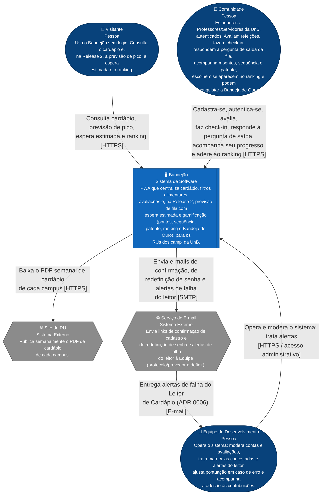
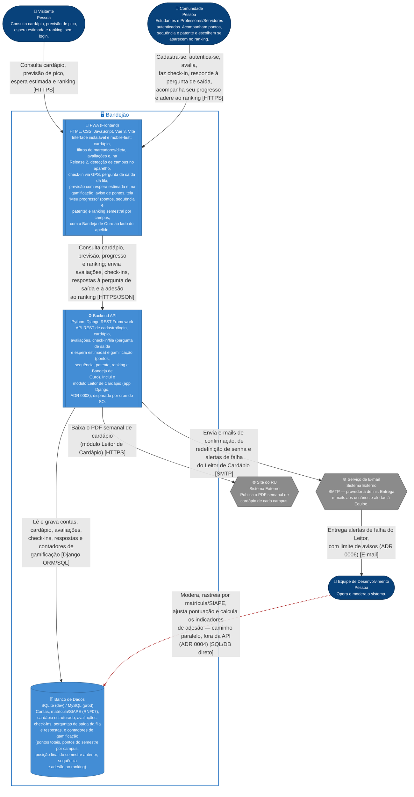

# Arquitetura C4 — Níveis 1 e 2 — Bandejão

> Estes dois níveis são comuns às três frentes do projeto (backend, frontend
> e banco de dados). Os Níveis 3 (Components) e 4 (Code) ficam a cargo de
> cada dupla responsável por sua frente e não são tratados neste documento.
>
> Decisões de arquitetura referenciadas aqui:
> `docs/arquitetura/adr/0001-escolha-stack-backend.md`,
> `docs/arquitetura/adr/0002-matricula-apelido-extraidos-do-email.md`,
> `docs/arquitetura/adr/0003-leitor-pdf-como-modulo-do-backend.md`,
> `docs/arquitetura/adr/0004-acesso-direto-da-equipe-ao-banco.md`,
> `docs/arquitetura/adr/0005-filtros-de-marcador-e-dieta-no-backend.md`,
> `docs/arquitetura/adr/0006-alerta-de-falha-do-leitor-por-email.md`,
> `docs/arquitetura/adr/0007-sessao-autenticada-por-cookie-httponly.md`,
> `docs/arquitetura/adr/0008-matricula-siape-em-texto-claro.md`,
> `docs/arquitetura/adr/0009-deteccao-de-campus-no-aparelho.md`,
> `docs/arquitetura/adr/0010-nivel-por-chegadas-com-espera-estimada.md`,
> `docs/arquitetura/adr/0011-contadores-de-gamificacao-alem-da-janela-de-retencao.md`.
>
> Esta versão incorpora a Release 2 (pergunta de saída da fila, espera
> estimada e detecção de campus no aparelho) e a gamificação (pontos,
> sequência, patente, ranking e o distintivo Bandeja de Ouro). A gamificação **não cria container novo nem
> sistema externo**: ela é um app Django dentro do Backend e guarda seus
> contadores no mesmo Banco de Dados. Por isso os elementos e as relações dos
> dois níveis continuam os mesmos; mudam as descrições.
>
> Os diagramas usam `flowchart` em vez do tipo `C4Context`/`C4Container`
> nativo do Mermaid — que, por design do próprio C4 Model, renderiza todo
> elemento como um retângulo, variando apenas cor/ícone —, o que permite dar
> uma **forma geométrica diferente a cada tipo de elemento**. A leitura
> continua sendo C4 (Contexto e Containers); só o desenho ficou mais fácil
> de distinguir à primeira vista.

### Legenda de formas

| Forma | Tipo de elemento | Exemplo |
|---|---|---|
| ⬭ Oval (estádio) | Pessoa | Visitante, Comunidade, Equipe |
| ▤ Retângulo de barras duplas | Sistema/Container em foco (o Bandejão e suas partes) | Bandejão, PWA, Backend API |
| ⬡ Hexágono | Sistema externo | Site do RU, Serviço de E-mail |
| ⛁ Cilindro | Banco de dados | Banco de Dados |

---

## Nível 1 — Diagrama de Contexto do Sistema

### Notas do diagrama

- **Estudante e Professor/Servidor** aparecem como uma única pessoa,
  **Comunidade** — termo já usado no Documento de Visão (seção 1.3) para o
  mesmo conjunto. O sistema os trata de forma idêntica: muda apenas o tipo de
  identificador (matrícula ou SIAPE) capturado no cadastro. Evitou-se cunhar
  o termo "Usuário cadastrado" porque, no glossário do projeto, "Usuário" é a
  **conta**, não a pessoa (ver `CONTEXT-DOMINIO.md`).
- **Pessoas em oval, sistema externo em hexágono, Bandejão em retângulo de
  destaque.** A diferença de forma já indica, antes mesmo de ler o texto,
  quem é usuário humano, o que é o sistema sendo construído e o que é
  integração de terceiros fora do controle da equipe.
- **GPS não é um sistema externo.** A detecção de campus (RF20) e a
  confirmação de check-in por localização (RF12), ambas da Release 2, usam um
  recurso do próprio navegador do dispositivo, não uma integração com
  terceiros — por isso não aparecem neste diagrama. A **detecção de campus
  acontece no aparelho**: o PWA compara a posição com as coordenadas e os
  raios publicados pelo backend, e as coordenadas não saem do dispositivo.
  Elas só vão ao servidor **no check-in**, para a conferência, e são
  descartadas em seguida (ADR 0009, RI09).
- **Ausência deliberada: nenhuma integração com sistemas da UnB para validar
  matrícula/SIAPE.** O sistema confere apenas o formato do identificador
  (RF01); não verifica existência, situação ativa nem titularidade (L01). A
  ausência dessa integração é uma decisão de escopo, não um esquecimento.
- **A Equipe recebe alertas por e-mail.** Quando a leitura do PDF falha, o
  Bandejão avisa a Equipe pelo mesmo Serviço de E-mail usado no cadastro e na
  recuperação de senha (ADR 0006). Por isso há uma seta do Serviço de E-mail
  para a Equipe: é por ela que a Equipe fica sabendo dos alertas que trata.
- O acesso da Equipe ao banco de dados por fora da API (ADR 0004) é um
  detalhe de implementação de Nível 2; no Nível 1 ele aparece de forma
  genérica, como "opera e modera o sistema".

---

## Nível 2 — Diagrama de Containers

### Notas do diagrama

- **A relação Equipe → Banco de Dados é tracejada e vermelha**, e não uma
  seta cheia como as demais: ela precisa se distinguir do fluxo normal
  (Frontend → Backend → Banco) por ser um **caminho paralelo e independente**,
  que não passa pela API. É a leitura adotada para "consulta administrativa
  manual" e "sem tela administrativa no escopo" (RNF08 e ADR 0004). Hoje é o
  caminho principal de moderação; a equipe já sinalizou a intenção de
  automatizar a moderação de rotina no futuro, deixando esse acesso direto
  reservado a casos extremos de rastreamento por matrícula/SIAPE — a seta
  tracejada e a ADR já refletem essa transição prevista. Pelo mesmo acesso
  direto, a Equipe também **ajusta a pontuação em caso de erro**: como só os
  totais de gamificação ficam ligados à conta, um erro de pontuação não pode
  ser recalculado e se corrige apenas manualmente (L14, ADR 0011). É
  também por consulta manual ao banco, sem ferramenta de análise nem tela
  administrativa, que a Equipe calcula os quatro indicadores de adesão
  (respostas à pergunta de saída, check-ins por usuário ativo, sequências de
  2 semanas ou mais e adesão ao ranking, RNF09).
- **O Banco de Dados é o único cilindro do diagrama** — reforça, pela forma,
  que é o único armazenamento persistente do sistema, diferente dos dois
  containers de aplicação (PWA e Backend, em retângulo de destaque).
- **Leitor de Cardápio não é um container à parte.** É um módulo (app Django)
  dentro do Backend, com fronteira nítida, conforme ADR 0003. Só seria
  promovido a container separado se a melhor biblioteca de leitura de PDF
  exigisse outra linguagem — o que ainda depende de um teste com o PDF real
  do RU do Gama.
- **Gamificação também não é um container à parte.** Pontos, sequência,
  patente e ranking (RF24 a RF27) ficam em um app Django próprio dentro do
  Backend (RNF06), e os contadores ficam no mesmo Banco de Dados, ligados à
  conta por mais tempo que a janela de 4 semanas dos registros de fila
  (ADR 0011). Quatro regras pesam na arquitetura:
  - **Recompensa o ato, não o conteúdo:** os pontos não dependem da resposta
    à pergunta de saída, da nota, do comentário, do horário do check-in nem
    do nível da fila, e a gamificação não altera nenhum cálculo da fila nem
    nenhuma nota (RI11). Ela só lê o que a Fila e a Avaliação registram.
  - **Só pontua quem está logado e com check-in confirmado por GPS** (RI01,
    RN09); o Visitante consulta o ranking, mas não pontua.
  - **O ranking é público e opcional:** só aparece quem aderiu, com conta
    ativa, e a resposta expõe apenas posição, apelido e patente, nunca os
    pontos, a matrícula/SIAPE ou o e-mail (RI10, RI12).
  - **A Bandeja de Ouro é o único dado de colocação que fica público:** no
    fechamento de cada semestre letivo, o Backend guarda só a posição final
    de cada usuário por campus e concede o distintivo aos 30 primeiros de
    cada campus com o mínimo de pontos (RN13). O PWA exibe o distintivo ao
    lado do apelido no ranking e nas avaliações, e a posição aparece apenas
    para o próprio usuário, em "Meu progresso" (RF33). O distintivo não dá
    pontos (RI11).
- **O agendador (cron do sistema operacional) não aparece como elemento no
  diagrama.** É infraestrutura de deploy, não um container da aplicação
  (ADR 0003). Além de disparar a leitura do cardápio, o mesmo agendador roda
  as tarefas periódicas do Backend: o `clearsessions` do Django (ADR 0007),
  a exclusão de cadastro pendente expirado (RF02.3) e a remoção do vínculo
  com a conta dos registros de fila após 4 semanas (RNF07.3). Na
  gamificação, a quebra da sequência é avaliada na consulta, sem tarefa
  agendada. O ranking é semestral e separado por campus (RN12): se os
  pontos do semestre serão zerados por rotina ou na primeira gravação do
  semestre letivo ainda está em decisão entre as duplas (recomendação: sem
  rotina). O fechamento do semestre, que grava a posição final e concede a
  Bandeja de Ouro (RN13), é uma tarefa desse mesmo agendador: roda no dia
  seguinte à data de término do semestre letivo configurada a partir do
  calendário acadêmico (Anexo A).
- **Alertas do Leitor de Cardápio por e-mail.** Quando a leitura do PDF
  falha (falha de leitura, legenda inválida ou associação de ícone
  impossível), o módulo Leitor de Cardápio avisa a Equipe pelo Serviço de
  E-mail, com no máximo 3 avisos por dia e intervalo mínimo de 6 horas para
  cada combinação de campus e tipo de falha (ADR 0006). A seta Serviço de
  E-mail → Equipe foi desenhada depois da seta tracejada, para que o
  `linkStyle 6` continue marcando a relação Equipe → Banco de Dados. Uma
  falha no envio do alerta não interrompe a leitura nem o uso do último
  cardápio válido.
- **Serviço de E-mail com tecnologia em aberto.** O protocolo (SMTP) é uma
  suposição de trabalho; o provedor concreto ainda não foi escolhido pela
  equipe. Atualizar este diagrama e a ADR correspondente quando essa decisão
  for tomada.
