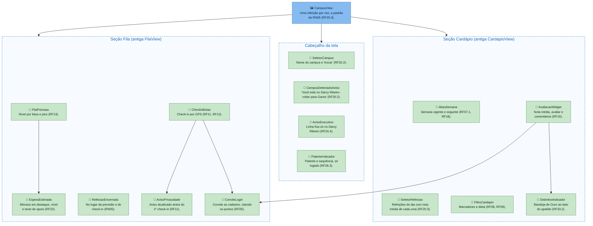
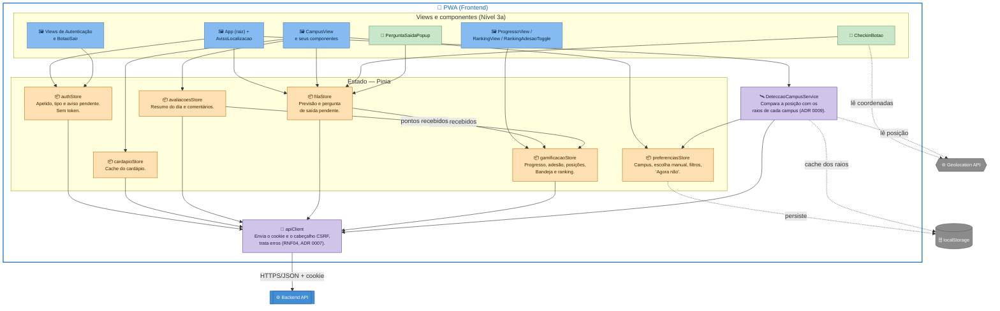
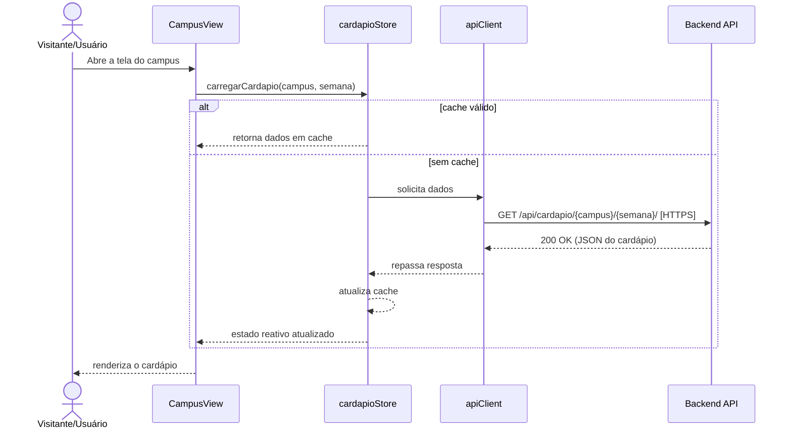
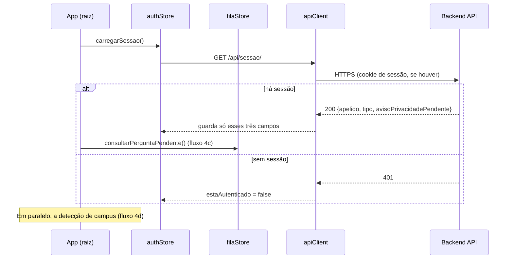
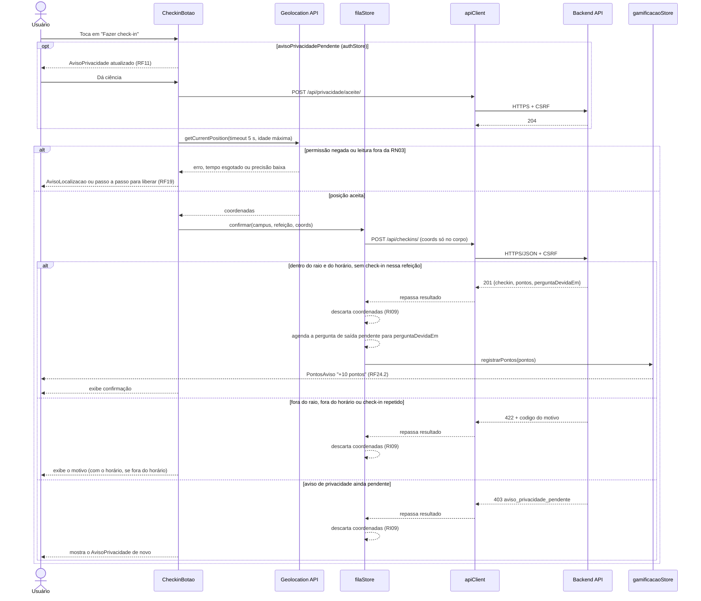
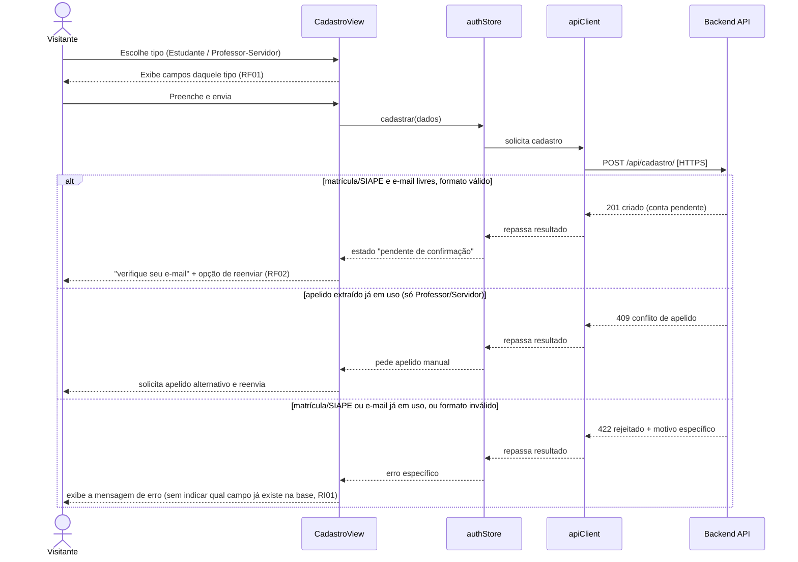
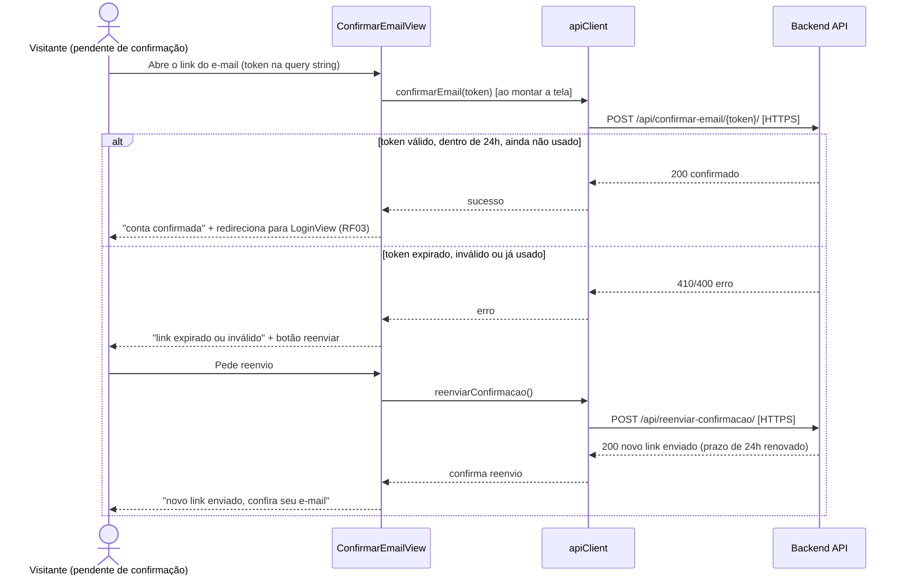
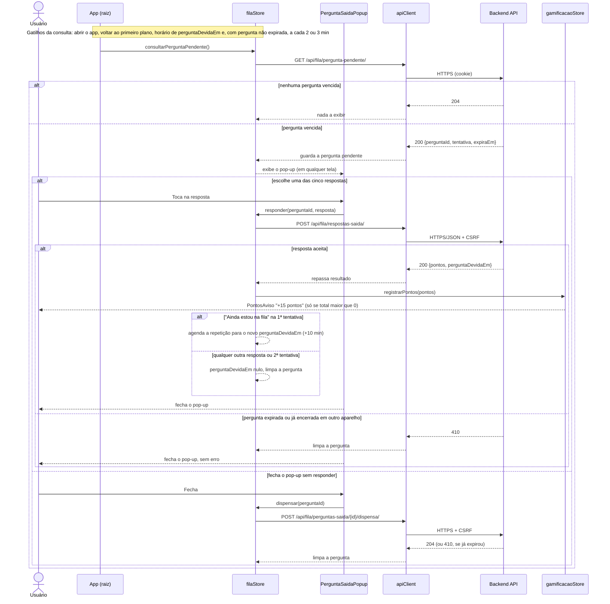
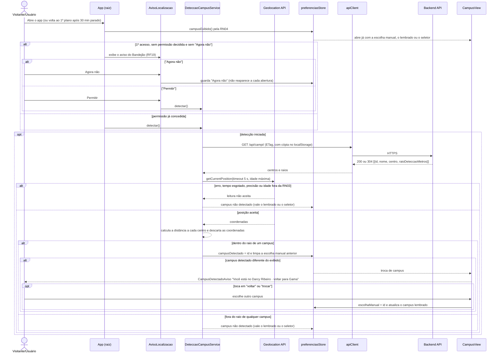

# Arquitetura C4 — Nível 3 (e Nível 4) — Frontend — Bandejão

> Complementa `c4-niveis-1-2.md` (comum às três frentes) com o detalhamento
> interno do container **PWA (Frontend)** — Vue 3 + Vite + Pinia —,
> conforme pedido na issue #31 (Sprint 4) e atualizado na Sprint 8 (issues
> #77, #78 e #79) para a **Release 2**: gamificação, Bandeja de Ouro, tela do
> campus, detecção de campus no aparelho, pergunta de saída da fila e sessão
> por cookie. Segue a mesma técnica de desenho adotada no Nível 1/2:
> `flowchart` do Mermaid em vez do tipo `C4Component` nativo, para dar uma
> forma geométrica diferente a cada tipo de elemento. Os fluxos dinâmicos
> usam `sequenceDiagram`, que é o tipo do Mermaid feito para isso e não
> cruza linhas por design.
>
> **Estado atual do código (`frontend/src`, branch `main`):** a Release 1
> (MVP) está implementada com Pinia (`authStore`, `preferenciasStore`,
> `cardapioStore`, `avaliacoesStore`), `apiClient` e um servidor simulado
> (`services/mock`). Os elementos da Release 2 descritos aqui (tela do
> campus, gamificação, detecção de campus, pergunta de saída) ainda **não
> estão no código**: este documento formaliza a arquitetura para orientar a
> implementação. Onde uma decisão depende de confirmação da dupla de
> frontend, isso é sinalizado explicitamente.
>
> **Contrato com o backend.** Endpoints, códigos de resposta e formatos de
> campo seguem as decisões da issue #66 e os Níveis 4 do backend
> (`backend/c4-nivel-4-*.md`). A conferência entre as duas frentes é a
> issue #69; os nomes finais ficam no contrato OpenAPI.
>
> **Vocabulário (glossário).** "Distintivo" e "Bandeja de Ouro" (nunca
> "ícone" nem "selo"); ranking "do semestre" (nunca "do mês").
>
> **Nível 4 é seletivo, por design.** Só entram aqui os fluxos complexos o
> bastante para justificar o detalhamento (ver critério no início da seção
> "Nível 4"). São quatro: **check-in por GPS** (4a), **cadastro +
> confirmação de e-mail** (4b), **pergunta de saída da fila** (4c) e
> **detecção de campus no aparelho** (4d).

### Legenda de formas

| Forma | Tipo de elemento | Exemplo |
|---|---|---|
| ⬭ Oval (estádio) | Pessoa | Visitante, Usuário |
| ▤ Retângulo de barras duplas | Container já detalhado no Nível 2 (fora de foco aqui) | Backend API |
| ⬡ Hexágono | Capacidade externa ao app (API do navegador) | Geolocation API |
| ⛁ Cilindro | Armazenamento | localStorage do navegador |
| ▭ Retângulo simples | Componente interno do Frontend (o foco deste diagrama) — cor indica a camada (view, componente, store, serviço) | View, componente Vue, store, serviço |

Para reduzir cruzamento de setas e manter cada diagrama abaixo de 20
elementos, o Nível 3 foi dividido em quatro diagramas: **(3a.1)** telas e
navegação, **(3a.2)** tela do campus, **(3a.3)** gamificação e **(3b)**
estado e comunicação com a API.

---

## Nível 3a — Telas, navegação e componentes

### 3a.1 — Telas e navegação

#### Notas

- **Três componentes são globais e ficam na raiz (`App.vue`), não numa
  tela.** `PerguntaSaidaPopup` precisa aparecer em qualquer tela em que o
  usuário esteja quando a pergunta vence (RF21.1); `AvisoLocalizacao`
  aparece no primeiro acesso, antes de qualquer tela (RF19); e
  `PontosAviso` é disparado por três contribuições diferentes (check-in,
  resposta de saída e avaliação), em telas diferentes (RF24.2). Deixá-los na
  raiz evita repetir o mesmo componente em várias views.
- **`CampusView` substitui `CardapioView` e `FilaView`** (Release 2, RF20):
  as duas telas do MVP viram **seções** de uma única tela do campus,
  detalhada em 3a.2. O login leva a ela (RF03.4) e a raiz `/` também
  (RN04).
- **O seletor de campus do MVP (hoje `views/CampusView.vue`, rota
  `/campus`) passa a ser o componente `SeletorCampus`**, usado dentro da
  tela do campus (botão "trocar") e sozinho quando nenhum campus foi
  resolvido pela RN04. O nome `CampusView` fica com a tela do campus.
- **`HomeView`, `BoasVindasView` e `NotFoundView`** existem no código, mas
  ficam de fora do diagrama por não agregarem componentes próprios — são
  apenas destino de rota.
- **`authViews` agrupa cinco telas com pesos bem diferentes**: `CadastroView`
  e `ConfirmarEmailView` concentram a maior parte da complexidade do épico
  Login (RF01/RF02) — por isso são elas que ganham detalhamento em Nível 4
  (4b), e não o grupo inteiro.

### 3a.2 — Tela do campus (Release 2)

#### Notas

- **A tela abre na hora, sem esperar o GPS** (RF20.2, RNF03): o campus
  inicial vem da RN04 (`preferenciasStore`) e a detecção corre em paralelo
  (fluxo 4d). Se a detecção trocar o campus, `CampusDetectadoAviso` aparece
  com a opção de voltar ao anterior.
- **Cada seção carrega por conta própria.** O backend não tem um endpoint
  que junte tudo: a `CampusView` pede em paralelo o cardápio, o resumo de
  notas do dia (`GET /api/avaliacoes/resumo/`, uma chamada para todas as
  refeições) e a previsão. Uma parte que falhe (ex.: previsão com "dados
  insuficientes") não derruba as outras.
- **"Refeição encerrada"** vem do próprio cardápio (`refeicaoEncerrada`,
  calculado com `ultimaRefeicaoDoDia` no backend, RN05): quando verdadeiro,
  `RefeicaoEncerrada` ocupa o lugar de `FilaPrevisao` e de `CheckinBotao`,
  e a avaliação continua aberta até 23h59 (RF15.1).
- **`EsperaEstimada` fica dentro de `FilaPrevisao`**: mostra os minutos em
  destaque só nas faixas com `esperaEstimadaMin` diferente de `null`; nas
  demais, só o nível. O texto de apoio (L12) explica que o nível é relativo
  ao pico do dia e que os minutos são uma estimativa.
- **`AvisoExecutivo` é uma linha fixa de texto**, sem pop-up nem botão de
  fechar, exibida sempre que o campus é o Darcy Ribeiro (RF20.4).
- **`AvaliacaoWidget` usa o `DistintivoIndicador` ao lado do apelido de
  cada comentário** (RF15.2), lendo o campo opcional `distintivo` de cada
  avaliação.
- **`ConviteLogin` aparece no lugar das ações que exigem conta** (avaliar e
  fazer check-in), sem redirecionar; na Release 2 o texto menciona os pontos
  da gamificação (RF05).
- **`AvisoPrivacidade` é mostrado antes de pedir a localização no primeiro
  check-in** de quem tinha conta antes da Release 2
  (`avisoPrivacidadePendente` da sessão, RF11, RNF07.1). O aviso cita fila,
  localização, gamificação, ranking e Bandeja de Ouro.
- **A estrutura exata da tela (componentes filhos e layout) fica a
  critério da dupla de frontend**; o diagrama fixa só quais peças existem e
  onde cada requisito aparece.

### 3a.3 — Gamificação

#### Notas

- **`ProgressoView` ("Meu progresso", rota `/progresso`)** mostra ao
  usuário logado a patente, os pontos totais, quanto falta para a próxima
  patente (ou "patente máxima"), a `SequenciaSemana`, o
  `RankingAdesaoToggle`, a `PosicaoRanking` e a própria Bandeja de Ouro. Para
  o **visitante**, a rota abre normalmente e mostra o `ConviteLogin` (seta
  tracejada), sem redirecionar.
- **`RankingView` (rota `/ranking/:campusId`) é pública** e mostra o ranking
  **do semestre** do campus escolhido no `SeletorCampus`: até 10 linhas
  (Anexo A) com posição, apelido, patente e, quando houver, a Bandeja de
  Ouro — **nunca os pontos** (RN12, RI12). Com a lista vazia, mostra
  `RankingVazio` ("ninguém no ranking ainda").
- **`PosicaoRanking` só existe dentro de `ProgressoView`**, porque a
  posição é vista apenas pelo próprio usuário (RF33.3): a posição atual em
  cada campus em que é elegível (ex.: "17º no Gama") e a final do semestre
  anterior (ex.: "2026.2: 12º no Gama"). Para quem não aderiu, mostra o
  convite "Ative o ranking para concorrer à Bandeja de Ouro" junto ao
  interruptor.
- **O aviso do `RankingAdesaoToggle`** explica, antes de ligar, que o
  apelido, a patente e, se conquistada, a Bandeja de Ouro ficam visíveis a
  todos, **no ranking e nos comentários das avaliações**. Desligar o
  interruptor esconde a Bandeja na hora (ver `gamificacaoStore` em 3b).
- **`DistintivoIndicador` é um único componente usado em três lugares**:
  `RankingView` (cada `LinhaRanking`), comentários das avaliações
  (`AvaliacaoWidget`, 3a.2) e `ProgressoView`. Recebe o campo `distintivo`
  (`null` ou `{tipo, campi, semestre}`) e:
  - desenha a bandeja dourada com estrela, legível em 16 px e diferente dos
    ícones dos marcadores do cardápio, com texto alternativo
    "Bandeja de Ouro";
  - ao tocar, mostra os campi e o semestre (ex.: "Gama e Darcy Ribeiro ·
    2026.2"), **sem posição nem pontos**;
  - o desenho final é da equipe de frontend, seguindo o guia de estilo
    (RF17).
- **`PatenteIndicador`** (linha discreta de patente e sequência) fica na
  tela do campus (3a.2), não aqui, porque o RF26.3 o põe junto do cardápio
  sem acrescentar interações (RNF03).
- **`BotaoSair` fica em "Meu progresso"**, que é a área da conta do
  usuário logado (RF03.3). A dupla pode movê-lo para um menu de conta sem
  mudar a arquitetura: ele só chama `authStore.sair()`.

---

## Nível 3b — Estado e comunicação com a API

### Notas

- **Nenhuma View ou componente chama a API diretamente.** Toda comunicação
  passa por uma *store* (ou pelo `DeteccaoCampusService`) e, dali, pela
  camada única `apiClient` — reflexo, no frontend, da separação por módulo
  já exigida pelo RNF06 no backend.
- **Sessão por cookie (ADR 0007).** O `authStore` **não guarda token**. Ao
  abrir o app, a raiz chama `authStore.carregarSessao()`, que consulta
  `GET /api/sessao/` ("quem sou eu") e guarda só `apelido`, `tipo` e
  `avisoPrivacidadePendente` — nunca matrícula/SIAPE ou e-mail (RI10). O
  login é `POST /api/sessao/` e o `BotaoSair` chama
  `DELETE /api/sessao/` (RF03.3). Como a sessão vive no cookie `HttpOnly`,
  ela sobrevive a recargas e à reabertura do PWA, sem nada legível por
  JavaScript.
- **O `apiClient` não injeta token.** Ele envia o cookie de sessão
  (`credentials: 'same-origin'`, já que PWA e API ficam no mesmo domínio) e,
  nas requisições de escrita (POST, PUT, PATCH, DELETE), o cabeçalho CSRF do
  Django (`X-CSRFToken`, lido do cookie `csrftoken`). É o único ponto do
  PWA que faz isso. Um `401` limpa o `authStore` (sessão expirada ou
  encerrada em outro aparelho).
- **Dois componentes falam com a Geolocation API, com fins diferentes**
  (substitui a nota do MVP de que só o `CheckinBotao` falava com ela):
  - **`DeteccaoCampusService` (RF20.1, ADR 0009)** lê a posição para
    **detectar o campus no aparelho**. Compara a posição com o centro e o
    raio de detecção de cada campus publicados pelo backend
    (`GET /api/campi/`, guardados também no `localStorage` para caber no
    limite de 5 s com rede lenta) e grava **só o identificador** do campus
    detectado no `preferenciasStore`. As coordenadas **nunca saem do
    aparelho** nem ficam em estado reativo. Regras: tempo limite de 5
    segundos, precisão mínima e idade máxima da posição (RN03, Anexo A) —
    leitura fora disso vale como "campus não detectado" —, e nova detecção
    ao voltar ao primeiro plano depois de 30 minutos parado.
  - **`CheckinBotao` (RF12)** lê as coordenadas só no momento do check-in e
    as envia no corpo do `POST /api/checkins/`. Elas passam pela `filaStore`
    só como argumento e são descartadas no fim da chamada, em qualquer
    desfecho (RI09).
- **A conta de distância existe em dois lugares**: no PWA
  (`DeteccaoCampusService`, raio de detecção do campus) e no backend
  (confirmação do check-in, raio do RU). As duas precisam concordar e **cada
  lado precisa de testes próprios** (ADR 0009, RNF06). O raio de
  confirmação do check-in não é publicado: quem decide o check-in é sempre
  o servidor.
- **`preferenciasStore` guarda no `localStorage`**: campus lembrado (último
  escolhido manualmente, RF07.2), filtros (RF08, RF09), a **escolha manual
  de campus feita depois da última detecção** (RN04, item 1) e o **"Agora
  não" do aviso de localização** (RF19), para o aviso não reaparecer a cada
  abertura. O campus detectado fica só em memória, junto com a hora da
  última detecção, porque vale até a próxima.
- **`filaStore`** guarda a previsão (com `esperaEstimadaMin` por faixa,
  RF22) e a **pergunta de saída pendente** (`perguntaId`, `tentativa`,
  `expiraEm`) e o próximo `perguntaDevidaEm`. Seguindo a decisão 7 da #66,
  a raiz consulta `GET /api/fila/pergunta-pendente/` **ao abrir o app, ao
  voltar ao primeiro plano, no horário de `perguntaDevidaEm`** e, enquanto
  houver pergunta não expirada, **a cada 2 ou 3 minutos** com o app aberto
  (fluxo 4c). Nunca guarda coordenadas (RI09).
- **`gamificacaoStore` (nova)** guarda, em memória e ligada ao `apiClient`:
  - o progresso (`GET /api/gamificacao/progresso/`): patente, pontos totais,
    quanto falta, sequência, dias na semana e mínimo, adesão ao ranking,
    posição própria por campus, posição do semestre anterior e a própria
    Bandeja de Ouro;
  - o ranking por campus (`GET /api/ranking/{campusId}/`);
  - o último bloco `pontos` recebido, que dispara o `PontosAviso`.

  **Ao mudar a adesão** (`POST`/`DELETE /api/gamificacao/adesao/`), a store
  recarrega o progresso e o ranking e pede ao `avaliacoesStore` que descarte
  os comentários guardados, porque a Bandeja de Ouro de quem desligou some
  na hora (RF27.1).
- **Pontos recebidos (decisão 7 da #66, RF24.2).** Não há endpoint de
  pontos: as respostas de check-in, de resposta de saída e de avaliação
  trazem o mesmo bloco
  `"pontos": {"total", "contribuicao", "avaliacaoLiberada", "bonusSemana"}`.
  `filaStore` e `avaliacoesStore` repassam esse bloco à `gamificacaoStore`
  (setas "pontos recebidos"), que mostra o `PontosAviso` quando `total > 0`
  e marca o progresso como desatualizado.
- **Bandeja de Ouro nas respostas públicas (decisão 12 da #66).** Cada linha
  do ranking e cada autor de comentário traz o campo opcional
  `distintivo`: `null` ou
  `{"tipo": "BANDEJA_DE_OURO", "campi": [{id, nome}], "semestre": "2026.2"}`.
  **Nunca a posição nem os pontos.** O nome e o formato do campo são os
  mesmos do Nível 4 da Gamificação no backend (conferência na #69).
- **`preferenciasStore → localStorage` e as leituras da Geolocation API
  são linhas pontilhadas**: são uso local do aparelho, não chamadas de
  rede, por isso ficam visualmente distintas das setas cheias que levam ao
  backend.
- **Backend API aparece em retângulo de barras duplas, sem decompor** — já
  foi decomposto no Nível 2 e nos Níveis 3/4 do backend; aqui é só o
  destino das chamadas do `apiClient`.

---

## Estratégia de roteamento

O roteamento está implementado em `src/router/index.js`. Este documento
formaliza os padrões nele observados e os estende para a Release 2:

- **Rotas nomeadas e com lazy-loading**, via `component: () => import(...)`
  — cada rota carrega sua View sob demanda, e não no bundle inicial.
- **`meta.title` por rota**, lido em `router.afterEach` para atualizar
  `document.title` (`"<título> · Bandejão"`), já implementado.
- **Campus como parâmetro de rota, não só de estado**: `/campus/:campusId`
  permite compartilhar/favoritar o link de um campus. A raiz `/` resolve o
  campus pela RN04 (escolha manual depois da última detecção → campus
  detectado → campus lembrado → seletor) e leva à tela do campus.

| Rota | View | Observação |
|---|---|---|
| `/` | — (redireciona) | Resolve o campus pela RN04 e vai para `/campus/:campusId`, ou para o seletor |
| `/campus` | `SeletorCampus` | Quando a RN04 não resolve nenhum campus |
| `/campus/:campusId` | `CampusView` | Tela do campus (RF20). Destino do login (RF03.4) |
| `/cardapio/:campusId`, `/fila` | — (redireciona) | Rotas do MVP mantidas só para links antigos |
| `/avaliacoes` | `AvaliacoesView` | Histórico (RF16) |
| `/progresso` | `ProgressoView` | **Nova.** Meu progresso (RF26.2) |
| `/ranking/:campusId` | `RankingView` | **Nova.** Pública (RF27.2) |
| `/login`, `/cadastro`, `/confirmar-email`, `/recuperar-senha`, `/redefinir-senha` | Views de Autenticação | Inalteradas |
| `/:pathMatch(.*)*` | `NotFoundView` | 404, já implementada |

- **Guarda de navegação: nenhuma rota exige login.** RF05 pede convite ao
  cadastro/login, não erro nem redirecionamento, mesmo para ações que
  exigem conta. Os componentes de ação leem `authStore.estaAutenticado` e,
  se falso, exibem o `ConviteLogin` inline. Isso vale também para
  **"Meu progresso": para o visitante, `/progresso` mostra o convite ao
  cadastro, sem redirecionar**. O ranking é público.
- **Rota `/confirmar-email` lê o token de confirmação pela query string**
  (ex. `?token=...`), não por parâmetro de rota — o link enviado por e-mail
  (RF02) aponta direto para essa URL. É o token do link de uso único, não
  de sessão.

---

## Estratégia de gerenciamento de estado

**Pinia**, a biblioteca de estado oficial do ecossistema Vue 3 (já no
`package.json`). Divisão em stores por responsabilidade, espelhando a
separação por app do backend (RNF06):

| Store | Responsabilidade | Persistência |
|---|---|---|
| `authStore` | Sessão do usuário: apelido, tipo de usuário e `avisoPrivacidadePendente`, lidos de `GET /api/sessao/`. Login, logout, cadastro e reenvio de confirmação. **Sem token** (ADR 0007) | Nenhuma no PWA: a sessão está no cookie `HttpOnly`; a store é recarregada ao abrir o app |
| `preferenciasStore` | Campus lembrado, escolha manual depois da última detecção, campus detectado, refeição selecionada, filtros de marcador e dieta, "Agora não" do aviso de localização | `localStorage` (RF07, RF08, RF09, RF19, RN04), exceto o campus detectado (memória) |
| `cardapioStore` | Cache do cardápio já lido da API, por campus/semana (inclui `refeicaoEncerrada`) | Em memória |
| `avaliacoesStore` | Resumo do dia (notas de todas as refeições, `GET /api/avaliacoes/resumo/`), comentários com `distintivo` e envio/edição da avaliação do usuário | Em memória |
| `filaStore` | Previsão (com espera estimada), check-in e pergunta de saída pendente | Em memória; nunca guarda coordenadas (RI09) |
| `gamificacaoStore` | Progresso, adesão ao ranking, posição própria por campus, posição do semestre anterior, Bandeja de Ouro própria, ranking por campus e último bloco `pontos` | Em memória |

Critério de decisão: **o que precisa sobreviver a um recarregamento de
página e é preferência do aparelho vira `localStorage`; o resto fica em
memória ou no servidor.** Isso restringe a persistência ao mínimo pedido
pelos requisitos e evita guardar, mesmo sem querer, dado sensível (sessão,
coordenadas) fora do que a LGPD e o RNF07/RI09 permitem.

---

## Fluxo de comunicação com a API do backend

Padrão único para toda chamada, ilustrado aqui com a consulta de cardápio
(fluxo mais simples, sem autenticação):

O `apiClient` é o único ponto que conhece a URL base da API, envia o
cookie de sessão e o cabeçalho CSRF nas escritas, e trata erros de forma
centralizada (rede indisponível, 401 → sessão expirada, 4xx → mensagem
específica do backend) — nunca a View trata `fetch` diretamente. Esse
mesmo padrão vale para escrita (avaliação, check-in, cadastro), variando
apenas o verbo HTTP e a store de origem.

A abertura do app segue o mesmo padrão, com as chamadas iniciais disparadas
pela raiz, em paralelo e sem bloquear a tela do campus:

---

## Nível 4 — Fluxos detalhados

O C4 Model recomenda Nível 4 só onde o código concentra complexidade real —
não para todo componente. Aqui, quatro fluxos passam nesse critério: cada
um envolve ao menos dois de (a) uma restrição externa ao controle da equipe
(hardware do usuário, permissão do navegador ou tempo), (b) uma regra de
negócio de tratamento de dado sensível (RI09 nas coordenadas;
formato-apenas de matrícula/SIAPE no cadastro — ver L01) e (c) mais de um
desfecho possível que a interface precisa tratar de forma diferente. Os
demais fluxos (login, recuperação de senha, filtros, avaliação, ranking)
são majoritariamente request/response linear e já estão bem representados
pelo padrão genérico da seção anterior.

### 4a — Check-in com confirmação por GPS

Dos componentes do sistema, o check-in (RF11 + RF12) é o que mais justifica
um detalhamento de Nível 4: envolve o aviso de privacidade, permissão do
navegador, uma API externa ao controle da equipe (Geolocation), uma regra
de negócio de descarte imediato do dado sensível (RI09), várias condições
de rejeição e, na Release 2, os pontos recebidos e a pergunta de saída
pendente.

#### Notas do fluxo

- **O aviso de privacidade vem antes do pedido de localização.** O
  `authStore` já sabe, pela sessão, se há `avisoPrivacidadePendente`; por
  isso o `CheckinBotao` mostra o aviso antes de acionar o GPS, e não depois
  de um `403`. O `403` do backend é só a garantia no servidor.
- **O descarte das coordenadas (RI09) acontece em todos os desfechos**,
  sucesso ou rejeição — não é um efeito colateral do caminho feliz.
- **A validação de raio e de horário é feita no backend, não no frontend.**
  `CheckinBotao` só encaminha as coordenadas; o raio de confirmação do RU
  nem é publicado (ver nota da conta de distância em 3b).
- **Um usuário sem permissão de localização, ou com leitura fora da RN03,
  nunca chega a enviar a requisição.** O fluxo para no primeiro `alt` com o
  `AvisoLocalizacao` (se o navegador ainda pode perguntar) ou com um passo a
  passo para liberar a localização (se já bloqueou), sem contar como
  tentativa de check-in (RF19).
- **Depois do `201`, duas coisas acontecem além da confirmação**: a
  `gamificacaoStore` recebe o bloco `pontos` e mostra o `PontosAviso`; e a
  `filaStore` registra que a pergunta de saída ficou pendente, agendando a
  consulta para `perguntaDevidaEm` (o pop-up em si é o fluxo 4c). O PWA não
  cria a pergunta: ela já foi registrada no servidor, na mesma transação do
  check-in, e por isso aparece em qualquer aparelho logado.

### 4b — Cadastro e confirmação de e-mail

RF01 e RF02 concentram, juntos, a lógica de UI mais ramificada do épico
Login: um formulário de duas etapas com campos condicionais por tipo de
usuário, extração automática de matrícula (Estudante) ou apelido
(Professor/Servidor) a partir do e-mail informado, três desfechos distintos
de submissão, e um ciclo de vida assíncrono da conta (pendente → confirmada
ou expirada) que a interface precisa refletir sem que o usuário perca o
progresso. Diferente do check-in, a restrição externa aqui não é hardware —
é o **tempo**: o link de confirmação vale 24h (RF02), e cada reenvio o
renova.

O acesso ao próprio link de confirmação é um segundo fluxo, independente do
formulário acima — o usuário chega a ele pelo e-mail, não navegando dentro
do app:

#### Notas do fluxo

- **O reenvio de link tem duas entradas na interface, não uma só**: pela
  própria `ConfirmarEmailView` quando o token já expirou (acima), e pela
  `LoginView`, quando alguém tenta entrar com credenciais corretas numa
  conta ainda não confirmada — nesse caso a tela de login, não a de
  cadastro, é quem oferece o reenvio (RF02). As duas chamam o mesmo
  `authStore.reenviarConfirmacao()`, evitando duplicar a lógica.
- **O frontend não decide se um formato de matrícula/SIAPE ou e-mail é
  válido — ele só reflete a resposta do backend.** As regras de validação
  (checagem dos 3 primeiros dígitos da matrícula, sequências rejeitadas nos
  6 dígitos restantes, domínio do e-mail por tipo de usuário) pertencem à
  API (RNF06); duplicá-las no cliente criaria duas fontes de verdade para a
  mesma regra. O `CadastroView` só formata o campo (ex. limitar a dígitos
  numéricos) para reduzir erros óbvios antes do envio.
- **A mensagem de rejeição nunca revela qual campo colidiu com uma conta
  existente** (RI01, e por analogia à proteção contra enumeração de contas
  do RF03) — "matrícula ou e-mail já cadastrados", nunca "esta matrícula já
  existe" isoladamente, para não confirmar a existência de uma matrícula
  específica a quem não é o dono dela.
- **A colisão de apelido é o único caso em que o cadastro é reapresentado
  com um campo a mais**, não apenas re-exibido com erro — o formulário
  precisa manter os demais campos preenchidos e adicionar o campo de
  apelido manual, já que esse dado normalmente nem aparece na tela para
  Professor/Servidor (é extraído automaticamente).
- **Nenhum dado do formulário é persistido em `localStorage` durante o
  fluxo.** Diferente de `preferenciasStore`, os campos de cadastro (que
  incluem senha) ficam apenas em estado de componente, descartados ao sair
  da tela — mesmo raciocínio de minimização de dado sensível do RI09.
- **Depois do login (`POST /api/sessao/`), o usuário vai direto para a
  tela do campus** (`/campus/:campusId`, campus resolvido pela RN04,
  RF03.4), sem passo adicional.

### 4c — Pergunta de saída da fila

A pergunta de saída (RF21) é o único fluxo em que **o servidor decide
quando a interface deve falar com o usuário**: a pergunta nasce no
check-in, vence 15 minutos depois, pode ser repetida uma vez e expira 60
minutos depois do check-in (Anexo A), valendo para todos os aparelhos em
que o usuário está logado. O PWA não tem push (RF23 é Backlog), então
precisa consultar o servidor nos momentos certos e tratar cinco respostas,
a repetição, o fechamento sem resposta e a expiração.

#### Notas do fluxo

- **As cinco respostas (RN07)** são, no contrato,
  `SAI_ATE_5_MIN`, `SAI_5_A_10_MIN`, `SAI_MAIS_DE_10_MIN`, `AINDA_NA_FILA`
  e `DESISTI`, com textos na interface como "Saí da fila agora há pouco (até
  5 min)" e "Desisti de comer no RU". Uma resposta, um toque (RF21).
- **O PWA nunca compara o próprio relógio com o do servidor.** O pop-up só
  aparece quando `GET /api/fila/pergunta-pendente/` devolve `200`, e o
  servidor só devolve pergunta já vencida e ainda não expirada. O
  `perguntaDevidaEm` serve apenas para o PWA agendar uma consulta no
  momento certo; a consulta periódica de 2 ou 3 minutos cobre o caso de o
  agendamento falhar (aba em segundo plano, aparelho dormindo).
- **A repetição acontece uma única vez**, só depois de "Ainda estou na
  fila" na primeira tentativa: o `200` traz o novo `perguntaDevidaEm` (+10
  min, Anexo A) e a `filaStore` agenda a próxima consulta. Na segunda
  tentativa, qualquer resposta encerra a pergunta e volta com
  `perguntaDevidaEm: null`.
- **Pontos só na primeira resposta.** A primeira resposta, qualquer que
  seja (inclusive a desistência), devolve `pontos.total = 15`; a resposta à
  repetição volta com `0`, e o `PontosAviso` não aparece (RN09).
- **Fechar o pop-up sem responder encerra a pergunta no servidor**
  (`dispensa`), e não só no aparelho, porque a pergunta vale para todos os
  aparelhos logados (RF21.2). Fechar o pop-up da repetição também encerra.
- **Expiração é silenciosa.** Depois de 60 minutos do check-in o servidor
  deixa de devolver a pergunta; um `410` numa resposta ou dispensa
  (expirada ou já respondida em outro aparelho) só fecha o pop-up, sem
  mensagem de erro.
- **Visitante nunca consulta.** A consulta só é feita com
  `authStore.estaAutenticado`; sem sessão, não há pergunta (RI01).

### 4d — Detecção de campus no aparelho

A detecção de campus (RF19, RF20, ADR 0009) é o fluxo mais frequente que
usa a localização: roda a cada abertura do app, para visitante e logado.
Ela combina uma permissão em duas etapas (aviso do Bandejão e pedido do
navegador), uma leitura de GPS com tempo limite e critérios de qualidade
(RN03), a comparação com raios publicados pelo backend e a hierarquia da
RN04 entre escolha manual, campus detectado e campus lembrado — tudo sem
atrasar a abertura do cardápio (RNF03) e sem que as coordenadas saiam do
aparelho (RI09).

#### Notas do fluxo

- **A tela abre antes da detecção terminar** (RF20.2, RNF03): a
  `CampusView` aparece com o campus da RN04 e só troca se a detecção apontar
  outro campus. O usuário nunca espera o GPS para ver o cardápio.
- **Hierarquia da RN04 no `preferenciasStore`**: (1) a escolha manual feita
  depois da última detecção, (2) o campus detectado, (3) o campus lembrado,
  (4) o seletor. Uma nova detecção (abertura do app ou volta ao primeiro
  plano depois de 30 minutos) limpa a escolha manual anterior. O **campus
  lembrado é sempre o último escolhido manualmente**: a detecção nunca o
  substitui.
- **As coordenadas nunca saem do aparelho.** O backend só fornece centros e
  raios (`GET /api/campi/`, público e com cache) e depois recebe apenas o
  identificador do campus nas chamadas de cardápio, avaliações e previsão
  (ADR 0009, RI09). A distância é calculada no `DeteccaoCampusService`, que
  precisa de testes próprios (a mesma conta existe no backend, para o
  check-in).
- **Leitura ruim equivale a "não detectado"** (RN03): erro de permissão,
  tempo esgotado (5 s), precisão abaixo da mínima ou posição velha demais
  levam ao campus lembrado ou ao seletor, sem mensagem de erro.
- **O "Agora não" não aciona o navegador** e fica guardado no
  `localStorage`, para o aviso não reaparecer a cada abertura (RF19). O
  aviso continua acessível em "Usar minha localização", e reaparece no
  check-in se a permissão for necessária (fluxo 4a).
- **Os raios ficam em cópia no `localStorage`**, para que a detecção caiba
  nos 5 segundos mesmo com rede lenta; o `ETag` evita baixar de novo quando
  nada mudou.

---

## Rastreabilidade — componentes × requisitos

| Componente | Requisitos atendidos | Nível 4? |
|---|---|---|
| `CampusView` | RF20, RF03.4, RN04, RN05 | ✅ 4d |
| `CardapioView` (seção cardápio da `CampusView`) | RF05, RF06, RF07 | — |
| `FilaView` (seção fila da `CampusView`) / `FilaPrevisao` | RF13, RF21, RF22, L08 | — |
| `EsperaEstimada` | RF22 | — |
| `RefeicaoEncerrada` | RN05, RF20.3 | — |
| `SeletorCampus` / `CampusDetectadoAviso` | RF07.2, RF20.2, RN04 | ✅ 4d |
| `AvisoExecutivo` | RF20.4, RI08, L11 | — |
| `AbasSemana` | RF07.1, RF18 | — |
| `FiltroCardapio` | RF08, RF09 | — |
| `AvaliacaoWidget` | RF15, RF15.2, RI01, RI10 | — |
| `AvaliacoesView` | RF16 | — |
| `CheckinBotao` | RF11, RF12, RI03, RI09 | ✅ 4a |
| `AvisoPrivacidade` | RF11, RNF07.1 | ✅ 4a |
| `AvisoLocalizacao` | RF19 | ✅ 4d |
| `DeteccaoCampusService` | RF20, RI09 | ✅ 4d |
| `PerguntaSaidaPopup` | RF21 | ✅ 4c |
| `PontosAviso` | RF24.2 | ✅ 4a, 4c |
| `PatenteIndicador` | RF26.3 | — |
| `ProgressoView` | RF26, RF27, RF33 | — |
| `SequenciaSemana` | RF25, RF26.2 | — |
| `RankingView` | RF27, RF33 | — |
| `RankingAdesaoToggle` | RF27, RF33 | — |
| `DistintivoIndicador` | RF33.2, RF15.2 | — |
| `PosicaoRanking` | RF33.3 | — |
| `ConviteLogin` | RF05 | — |
| `BotaoSair` | RF03.3 | — |
| `CadastroView` | RF01, RI01, RI07, L01 | ✅ 4b |
| `ConfirmarEmailView` | RF02 | ✅ 4b |
| Demais Views de Autenticação (Login, Recuperar/Redefinir senha) | RF03, RF04 | — |
| `authStore` | RF01, RF02, RF03, RNF04, ADR 0007 | — |
| `preferenciasStore` | RF07, RF08, RF09, RF19, RN04, RNF03 | ✅ 4d |
| `filaStore` | RF11, RF13, RF21, RF22, RI09 | ✅ 4a, 4c |
| `gamificacaoStore` | RF24 a RF27, RF33 | — |
| `apiClient` | RNF01, RNF04, ADR 0007 | — |
