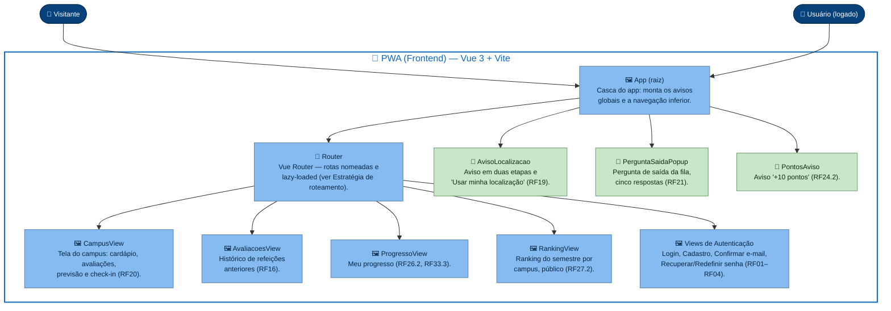
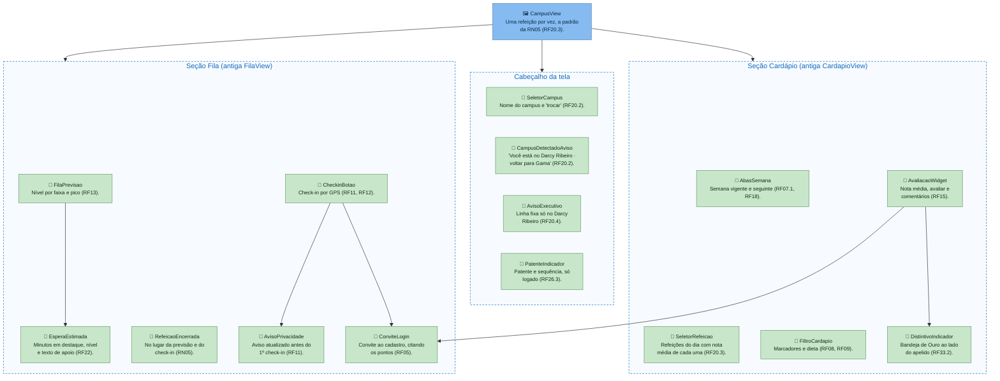
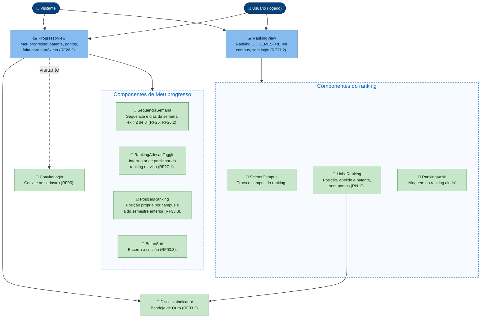
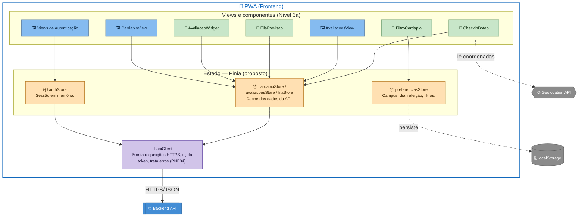
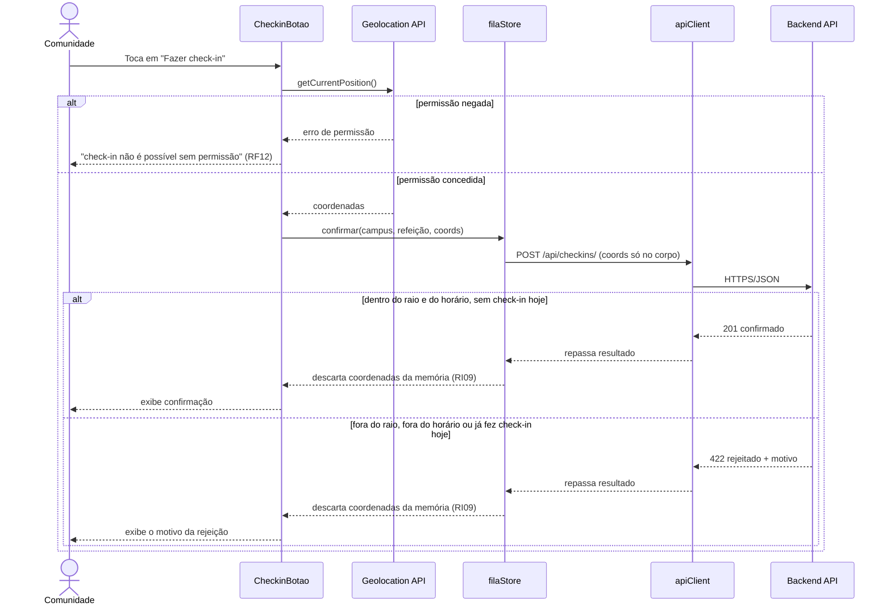
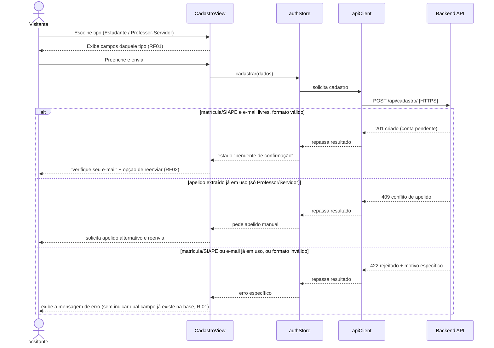
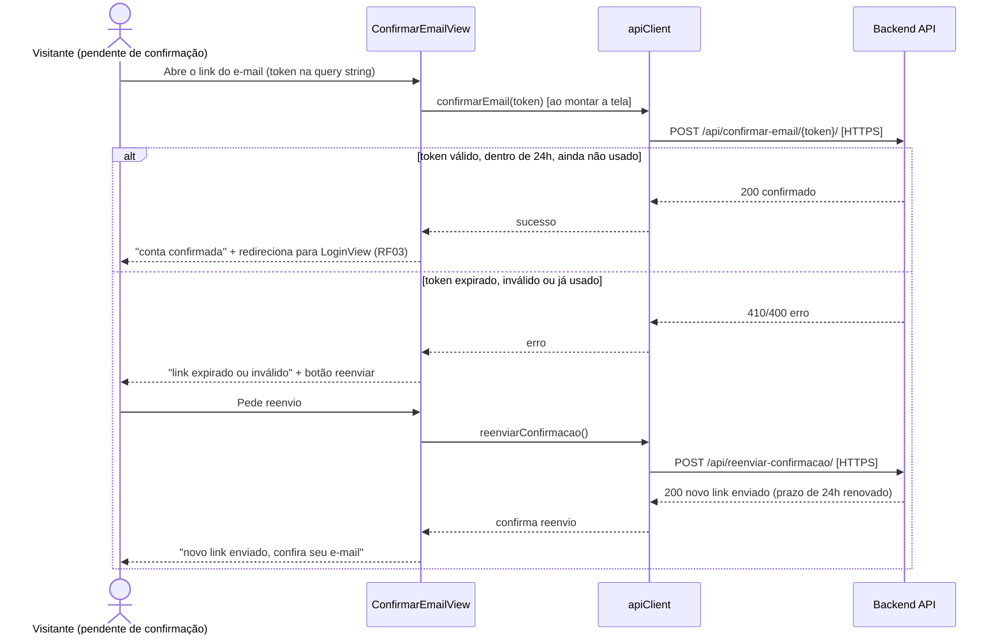

# Arquitetura C4 — Nível 3 (e Nível 4) — Frontend — Bandejão

> Complementa `arquitetura-c4-niveis-1-2-bandejao.md` (comum às três frentes) com o
> detalhamento interno do container **PWA (Frontend)** — Vue 3 + Vite —, conforme
> pedido na issue #31 (Sprint 4). Segue a mesma técnica de desenho adotada no
> Nível 1/2: `flowchart` do Mermaid em vez do tipo `C4Component` nativo, para dar
> uma forma geométrica diferente a cada tipo de elemento. Os fluxos
> dinâmicos (comunicação com a API, check-in por GPS e cadastro/confirmação de
> e-mail) usam `sequenceDiagram`, que é o tipo do Mermaid feito para isso e não
> cruza linhas por design.
>
> **Estado atual do código (`frontend/src`, branch `develop`):** existem apenas
> as *Views* e o *Router* (cada view é um placeholder com `TODO: implementar`).
> Não há ainda pasta `components/`, `stores/` nem `services/`, e o Pinia não está
> no `package.json`. Este documento formaliza a decisão de arquitetura interna
> — componentes, roteamento, estado e comunicação com a API — para orientar a
> implementação das próximas sprints; não é uma engenharia reversa de código já
> escrito. Onde uma decisão ainda depende de confirmação da dupla de frontend,
> isso é sinalizado explicitamente.
>
> **Nível 4 é seletivo, por design.** Só entram aqui os fluxos complexos o
> bastante para justificar o detalhamento de código (ver critério no início da
> seção "Nível 4"). Hoje são dois: **check-in por GPS** (RF11/RF12) e
> **cadastro + confirmação de e-mail** (RF01/RF02).

### Legenda de formas

| Forma | Tipo de elemento | Exemplo |
|---|---|---|
| ⬭ Oval (estádio) | Pessoa | Visitante, Comunidade |
| ▤ Retângulo de barras duplas | Container já detalhado no Nível 2 (fora de foco aqui) | Backend API |
| ⬡ Hexágono | Capacidade externa ao app (API do navegador) | Geolocation API |
| ⛁ Cilindro | Armazenamento | localStorage do navegador |
| ▭ Retângulo simples | Componente interno do Frontend (o foco deste diagrama) — cor indica a camada (view, componente, store, serviço) | View, componente Vue, store, serviço |

Para reduzir cruzamento de setas, o Nível 3 foi dividido em dois diagramas:
**(a)** estrutura de telas e componentes (navegação), e **(b)** estado e
comunicação com a API. Cada um sozinho tem poucas arestas e um fluxo único de
cima para baixo.

---

## Nível 3a — Telas, navegação e componentes

### 3a.1 — Telas e navegação

#### Notas

- **Três componentes são globais e ficam na raiz (`App.vue`), não numa
  tela.** `PerguntaSaidaPopup` precisa aparecer em qualquer tela em que o
  usuário esteja quando a pergunta vence (RF21.1); `AvisoLocalizacao`
  aparece no primeiro acesso, antes de qualquer tela (RF19); e
  `PontosAviso` é disparado por três contribuições diferentes (check-in,
  resposta de saída e avaliação), em telas diferentes (RF24.2). Deixá-los na
  raiz evita repetir o mesmo componente em várias views.
- **`CampusView` substitui `CardapioView` e `FilaView`** (Release 2, RF20):
  as duas telas do MVP viram **seções** de uma única tela do campus,
  detalhada em 3a.2. O login leva a ela (RF03.4) e a raiz `/` também
  (RN04).
- **O seletor de campus do MVP (hoje `views/CampusView.vue`, rota
  `/campus`) passa a ser o componente `SeletorCampus`**, usado dentro da
  tela do campus (botão "trocar") e sozinho quando nenhum campus foi
  resolvido pela RN04. O nome `CampusView` fica com a tela do campus.
- **`HomeView`, `BoasVindasView` e `NotFoundView`** existem no código, mas
  ficam de fora do diagrama por não agregarem componentes próprios — são
  apenas destino de rota.
- **`authViews` agrupa cinco telas com pesos bem diferentes**: `CadastroView`
  e `ConfirmarEmailView` concentram a maior parte da complexidade do épico
  Login (RF01/RF02) — por isso são elas que ganham detalhamento em Nível 4
  (4b), e não o grupo inteiro.

### 3a.2 — Tela do campus (Release 2)

#### Notas

- **A tela abre na hora, sem esperar o GPS** (RF20.2, RNF03): o campus
  inicial vem da RN04 (`preferenciasStore`) e a detecção corre em paralelo
  (fluxo 4d). Se a detecção trocar o campus, `CampusDetectadoAviso` aparece
  com a opção de voltar ao anterior.
- **Cada seção carrega por conta própria.** O backend não tem um endpoint
  que junte tudo: a `CampusView` pede em paralelo o cardápio, o resumo de
  notas do dia (`GET /api/avaliacoes/resumo/`, uma chamada para todas as
  refeições) e a previsão. Uma parte que falhe (ex.: previsão com "dados
  insuficientes") não derruba as outras.
- **"Refeição encerrada"** vem do próprio cardápio (`refeicaoEncerrada`,
  calculado com `ultimaRefeicaoDoDia` no backend, RN05): quando verdadeiro,
  `RefeicaoEncerrada` ocupa o lugar de `FilaPrevisao` e de `CheckinBotao`,
  e a avaliação continua aberta até 23h59 (RF15.1).
- **`EsperaEstimada` fica dentro de `FilaPrevisao`**: mostra os minutos em
  destaque só nas faixas com `esperaEstimadaMin` diferente de `null`; nas
  demais, só o nível. O texto de apoio (L12) explica que o nível é relativo
  ao pico do dia e que os minutos são uma estimativa.
- **`AvisoExecutivo` é uma linha fixa de texto**, sem pop-up nem botão de
  fechar, exibida sempre que o campus é o Darcy Ribeiro (RF20.4).
- **`AvaliacaoWidget` usa o `DistintivoIndicador` ao lado do apelido de
  cada comentário** (RF15.2), lendo o campo opcional `distintivo` de cada
  avaliação.
- **`ConviteLogin` aparece no lugar das ações que exigem conta** (avaliar e
  fazer check-in), sem redirecionar; na Release 2 o texto menciona os pontos
  da gamificação (RF05).
- **`AvisoPrivacidade` é mostrado antes de pedir a localização no primeiro
  check-in** de quem tinha conta antes da Release 2
  (`avisoPrivacidadePendente` da sessão, RF11, RNF07.1). O aviso cita fila,
  localização, gamificação, ranking e Bandeja de Ouro.
- **A estrutura exata da tela (componentes filhos e layout) fica a
  critério da dupla de frontend**; o diagrama fixa só quais peças existem e
  onde cada requisito aparece.

### 3a.3 — Gamificação

#### Notas

- **`ProgressoView` ("Meu progresso", rota `/progresso`)** mostra ao
  usuário logado a patente, os pontos totais, quanto falta para a próxima
  patente (ou "patente máxima"), a `SequenciaSemana`, o
  `RankingAdesaoToggle`, a `PosicaoRanking` e a própria Bandeja de Ouro. Para
  o **visitante**, a rota abre normalmente e mostra o `ConviteLogin` (seta
  tracejada), sem redirecionar.
- **`RankingView` (rota `/ranking/:campusId`) é pública** e mostra o ranking
  **do semestre** do campus escolhido no `SeletorCampus`: até 10 linhas
  (Anexo A) com posição, apelido, patente e, quando houver, a Bandeja de
  Ouro — **nunca os pontos** (RN12, RI12). Com a lista vazia, mostra
  `RankingVazio` ("ninguém no ranking ainda").
- **`PosicaoRanking` só existe dentro de `ProgressoView`**, porque a
  posição é vista apenas pelo próprio usuário (RF33.3): a posição atual em
  cada campus em que é elegível (ex.: "17º no Gama") e a final do semestre
  anterior (ex.: "2026.2: 12º no Gama"). Para quem não aderiu, mostra o
  convite "Ative o ranking para concorrer à Bandeja de Ouro" junto ao
  interruptor.
- **O aviso do `RankingAdesaoToggle`** explica, antes de ligar, que o
  apelido, a patente e, se conquistada, a Bandeja de Ouro ficam visíveis a
  todos, **no ranking e nos comentários das avaliações**. Desligar o
  interruptor esconde a Bandeja na hora (ver `gamificacaoStore` em 3b).
- **`DistintivoIndicador` é um único componente usado em três lugares**:
  `RankingView` (cada `LinhaRanking`), comentários das avaliações
  (`AvaliacaoWidget`, 3a.2) e `ProgressoView`. Recebe o campo `distintivo`
  (`null` ou `{tipo, campi, semestre}`) e:
  - desenha a bandeja dourada com estrela, legível em 16 px e diferente dos
    ícones dos marcadores do cardápio, com texto alternativo
    "Bandeja de Ouro";
  - ao tocar, mostra os campi e o semestre (ex.: "Gama e Darcy Ribeiro ·
    2026.2"), **sem posição nem pontos**;
  - o desenho final é da equipe de frontend, seguindo o guia de estilo
    (RF17).
- **`PatenteIndicador`** (linha discreta de patente e sequência) fica na
  tela do campus (3a.2), não aqui, porque o RF26.3 o põe junto do cardápio
  sem acrescentar interações (RNF03).
- **`BotaoSair` fica em "Meu progresso"**, que é a área da conta do
  usuário logado (RF03.3). A dupla pode movê-lo para um menu de conta sem
  mudar a arquitetura: ele só chama `authStore.sair()`.

---

## Nível 3b — Estado e comunicação com a API

### Notas

- **Nenhuma View ou componente chama a API diretamente.** Toda comunicação
  passa por uma *store* e, dali, pela camada única `apiClient` — reflexo, no
  frontend, da separação por módulo já exigida pelo RNF06 no backend.
- **`dadosStore` é um "hub" de propósito**: várias telas e componentes leem
  ou escrevem nele porque ele representa o cache compartilhado de
  cardápio/avaliações/fila — não é bagunça, é o ponto único de verdade dos
  dados vindos da API.
- **`CheckinBotao` é o único componente que fala com a Geolocation API.** As
  coordenadas nascem no navegador, passam para `dadosStore` (linha
  pontilhada, por ser um uso pontual e não uma leitura/escrita de estado
  contínua) e seguem para o `apiClient` só dentro do corpo da requisição —
  nunca ficam gravadas em nenhuma propriedade reativa (RI09).
- **`preferenciasStore → localStorage` também é linha pontilhada**: é
  persistência local do aparelho, não uma chamada de rede, por isso é
  visualmente distinta das setas cheias que representam o fluxo principal
  até o backend.
- **`authStore` não persiste em `localStorage`.** O token de sessão fica em
  memória; ao recarregar a página, o usuário perde a sessão até
  implementarmos um mecanismo de renovação — decisão deliberadamente simples
  para o MVP, a revisitar se a equipe priorizar "lembrar login".
- **Backend API aparece em retângulo de barras duplas, sem decompor** — já
  foi decomposto no Nível 2; aqui é só o destino das chamadas do
  `apiClient`.
- **Pinia ainda não está no `package.json`.** É a biblioteca de estado
  proposta neste documento (ver seção seguinte); a dupla de frontend precisa
  confirmar a adoção antes de criar as stores.

---

## Estratégia de roteamento

O roteamento está implementado em `src/router/index.js`. Este documento
formaliza os padrões nele observados e os estende para a Release 2:

- **Rotas nomeadas e com lazy-loading**, via `component: () => import(...)`
  — cada rota carrega sua View sob demanda, e não no bundle inicial.
- **`meta.title` por rota**, lido em `router.afterEach` para atualizar
  `document.title` (`"<título> · Bandejão"`), já implementado.
- **Campus como parâmetro de rota, não só de estado**: `/campus/:campusId`
  permite compartilhar/favoritar o link de um campus. A raiz `/` resolve o
  campus pela RN04 (escolha manual depois da última detecção → campus
  detectado → campus lembrado → seletor) e leva à tela do campus.

| Rota | View | Observação |
|---|---|---|
| `/` | — (redireciona) | Resolve o campus pela RN04 e vai para `/campus/:campusId`, ou para o seletor |
| `/campus` | `SeletorCampus` | Quando a RN04 não resolve nenhum campus |
| `/campus/:campusId` | `CampusView` | Tela do campus (RF20). Destino do login (RF03.4) |
| `/cardapio/:campusId`, `/fila` | — (redireciona) | Rotas do MVP mantidas só para links antigos |
| `/avaliacoes` | `AvaliacoesView` | Histórico (RF16) |
| `/progresso` | `ProgressoView` | **Nova.** Meu progresso (RF26.2) |
| `/ranking/:campusId` | `RankingView` | **Nova.** Pública (RF27.2) |
| `/login`, `/cadastro`, `/confirmar-email`, `/recuperar-senha`, `/redefinir-senha` | Views de Autenticação | Inalteradas |
| `/:pathMatch(.*)*` | `NotFoundView` | 404, já implementada |

- **Guarda de navegação: nenhuma rota exige login.** RF05 pede convite ao
  cadastro/login, não erro nem redirecionamento, mesmo para ações que
  exigem conta. Os componentes de ação leem `authStore.estaAutenticado` e,
  se falso, exibem o `ConviteLogin` inline. Isso vale também para
  **"Meu progresso": para o visitante, `/progresso` mostra o convite ao
  cadastro, sem redirecionar**. O ranking é público.
- **Rota `/confirmar-email` lê o token de confirmação pela query string**
  (ex. `?token=...`), não por parâmetro de rota — o link enviado por e-mail
  (RF02) aponta direto para essa URL. É o token do link de uso único, não
  de sessão.

---

## Estratégia de gerenciamento de estado

**Proposta: Pinia**, a biblioteca de estado oficial do ecossistema Vue 3
(ainda não adicionada ao projeto). Divisão em stores por responsabilidade,
espelhando a separação por app do backend (RNF06):

| Store | Responsabilidade | Persistência |
|---|---|---|
| `authStore` | Sessão do usuário autenticado (token, apelido, tipo de usuário) | Em memória; perdida ao recarregar (ver nota acima) |
| `preferenciasStore` | Campus, dia e refeição selecionados; filtros de marcador e dieta ativos | `localStorage` (RF07, RF08, RF09) |
| `cardapioStore` | Cache do cardápio já lido da API, por campus/semana | Em memória, por sessão de navegação |
| `avaliacoesStore` | Avaliações da refeição em exibição; envio/edição da avaliação do usuário | Em memória |
| `filaStore` | Previsão de pico e resultado do check-in mais recente | Em memória; nunca guarda coordenadas (RI09) |

Critério de decisão: **o que precisa sobreviver a um recarregamento de
página vira `localStorage`; o resto fica em memória.** Isso restringe a
persistência ao mínimo pedido pelos requisitos (RF07–RF09) e evita guardar,
mesmo sem querer, dado sensível (sessão, coordenadas) fora do que a LGPD e o
RNF07/RI09 permitem.

---

## Fluxo de comunicação com a API do backend

Padrão único para toda chamada, ilustrado aqui com a consulta de cardápio
(fluxo mais simples, sem autenticação):

O `apiClient` é o único ponto que conhece a URL base da API, injeta o
cabeçalho de autenticação quando há sessão (`authStore`), e trata erros de
forma centralizada (rede indisponível, 401 → sessão expirada, 4xx →
mensagem específica do backend) — nunca a View trata `fetch` diretamente.
Esse mesmo padrão vale para escrita (avaliação, check-in, cadastro),
variando apenas o verbo HTTP e a store de origem.

---

## Nível 4 — Fluxos detalhados

O C4 Model recomenda Nível 4 só onde o código concentra complexidade real —
não para todo componente. Aqui, dois fluxos passam nesse critério: cada um
envolve (a) uma restrição externa ao controle da equipe (hardware do
usuário ou tempo de expiração de um link), (b) uma regra de negócio de
tratamento de dado sensível (RI09 no check-in; formato-apenas de
matrícula/SIAPE, sem verificação de identidade, no cadastro — ver L01) e
(c) mais de um desfecho possível que a interface precisa tratar de forma
diferente. Os demais fluxos (login, recuperação de senha, filtros,
avaliação) são majoritariamente request/response linear e já estão bem
representados pelo padrão genérico da seção anterior.

### 4a — Check-in com confirmação por GPS

Dos componentes do sistema, o check-in (RF11 + RF12) é o que mais justifica
um detalhamento de Nível 4: envolve permissão do navegador, uma API externa
ao controle da equipe (Geolocation), uma regra de negócio de descarte
imediato do dado sensível (RI09) e duas condições de rejeição (fora do raio
ou fora do horário, além de check-in já feito no dia).

#### Notas do fluxo

- **O descarte das coordenadas (RI09) acontece nos dois desfechos**, sucesso
  ou rejeição — não é um efeito colateral do caminho feliz, é uma regra que
  vale sempre, por isso aparece nas duas metades do `alt`.
- **A validação de raio e de horário é feita no backend, não no frontend.**
  `CheckinBotao` só encaminha as coordenadas; ele não decide se o usuário
  está dentro do raio, evitando duplicar no cliente uma regra que pertence
  à API (RNF06) e que depende de parâmetro configurável por campus (Anexo A
  do Documento de Requisitos).
- **Um usuário sem permissão de localização nunca chega a enviar a
  requisição.** O fluxo para no primeiro `alt` com uma mensagem que orienta
  a conceder permissão, sem contar como tentativa de check-in.

### 4b — Cadastro e confirmação de e-mail

RF01 e RF02 concentram, juntos, a lógica de UI mais ramificada do épico
Login: um formulário de duas etapas com campos condicionais por tipo de
usuário, extração automática de matrícula (Estudante) ou apelido
(Professor/Servidor) a partir do e-mail informado, três desfechos distintos
de submissão, e um ciclo de vida assíncrono da conta (pendente → confirmada
ou expirada) que a interface precisa refletir sem que o usuário perca o
progresso. Diferente do check-in, a restrição externa aqui não é hardware —
é o **tempo**: o link de confirmação vale 24h (RF02), e cada reenvio o
renova.

O acesso ao próprio link de confirmação é um segundo fluxo, independente do
formulário acima — o usuário chega a ele pelo e-mail, não navegando dentro
do app:

#### Notas do fluxo

- **O reenvio de link tem duas entradas na interface, não uma só**: pela
  própria `ConfirmarEmailView` quando o token já expirou (acima), e pela
  `LoginView`, quando alguém tenta entrar com credenciais corretas numa
  conta ainda não confirmada — nesse caso a tela de login, não a de
  cadastro, é quem oferece o reenvio (RF02). As duas chamam o mesmo
  `authStore.reenviarConfirmacao()`, evitando duplicar a lógica.
- **O frontend não decide se um formato de matrícula/SIAPE ou e-mail é
  válido — ele só reflete a resposta do backend.** As regras de validação
  (checagem dos 3 primeiros dígitos da matrícula, sequências rejeitadas nos
  6 dígitos restantes, domínio do e-mail por tipo de usuário) pertencem à
  API (RNF06); duplicá-las no cliente criaria duas fontes de verdade para a
  mesma regra. O `CadastroView` só formata o campo (ex. limitar a dígitos
  numéricos) para reduzir erros óbvios antes do envio.
- **A mensagem de rejeição nunca revela qual campo colidiu com uma conta
  existente** (RI01, e por analogia à proteção contra enumeração de contas
  do RF03) — "matrícula ou e-mail já cadastrados", nunca "esta matrícula já
  existe" isoladamente, para não confirmar a existência de uma matrícula
  específica a quem não é o dono dela.
- **A colisão de apelido é o único caso em que o cadastro é reapresentado
  com um campo a mais**, não apenas re-exibido com erro — o formulário
  precisa manter os demais campos preenchidos e adicionar o campo de
  apelido manual, já que esse dado normalmente nem aparece na tela para
  Professor/Servidor (é extraído automaticamente).
- **Nenhum dado do formulário é persistido em `localStorage` durante o
  fluxo.** Diferente de `preferenciasStore`, os campos de cadastro (que
  incluem senha) ficam apenas em estado de componente, descartados ao sair
  da tela — mesmo raciocínio de minimização de dado sensível do RI09,
  aplicado aqui por analogia, ainda que não exista um RI dedicado à senha
  digitada em formulário.

---

## Rastreabilidade — componentes × requisitos

| Componente | Requisitos atendidos | Nível 4? |
|---|---|---|
| `CardapioView` | RF05, RF06, RF07 | — |
| `FiltroCardapio` | RF08, RF09 | — |
| `AvaliacaoWidget` | RF15, RI01, RI10 | — |
| `AvaliacoesView` | RF16 | — |
| `FilaView` / `FilaPrevisao` | RF13, L08 | — |
| `CheckinBotao` | RF11, RF12, RI03, RI09 | ✅ 4a |
| `CadastroView` | RF01, RI01, RI07, L01 | ✅ 4b |
| `ConfirmarEmailView` | RF02 | ✅ 4b |
| Demais Views de Autenticação (Login, Recuperar/Redefinir senha) | RF03, RF04 | — |
| `authStore` | RF01, RF02, RF03, RNF04 | — |
| `preferenciasStore` | RF07, RF08, RF09, RNF03 | — |
| `apiClient` | RNF01, RNF04 | — |
